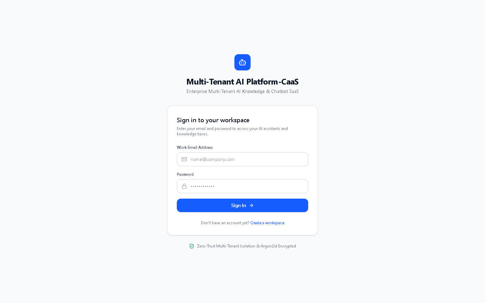
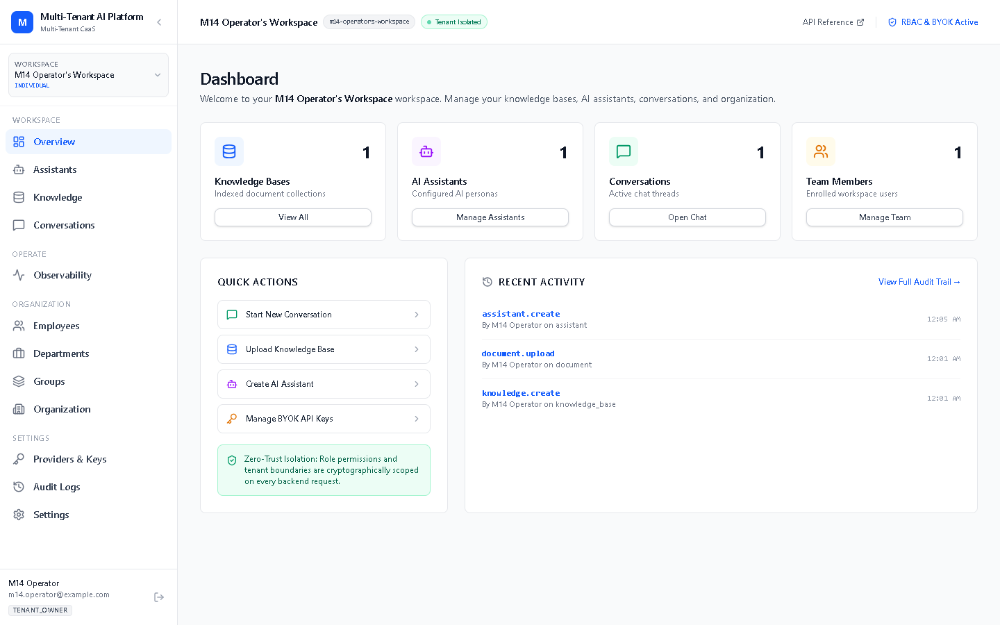
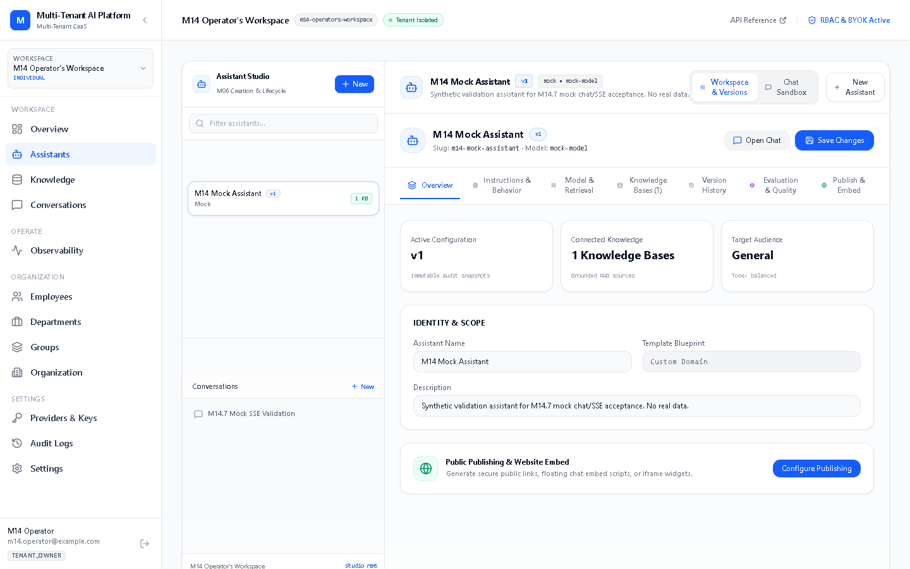
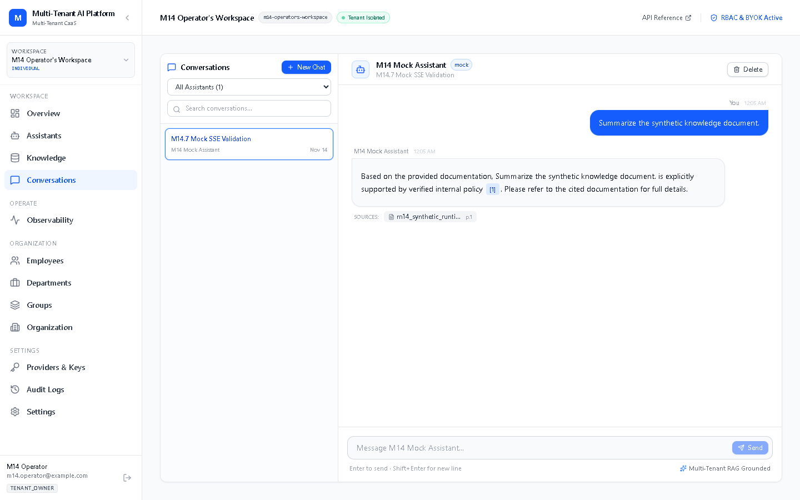
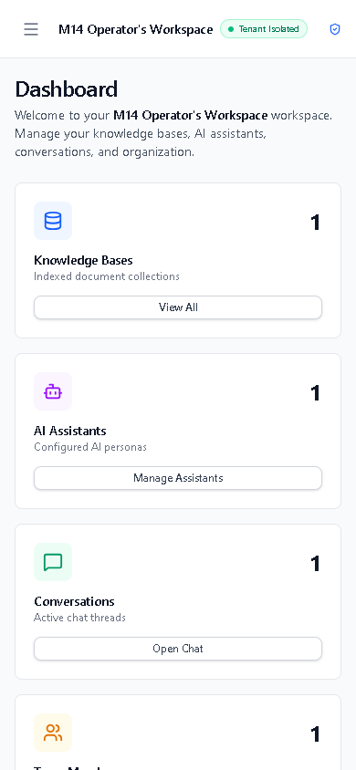
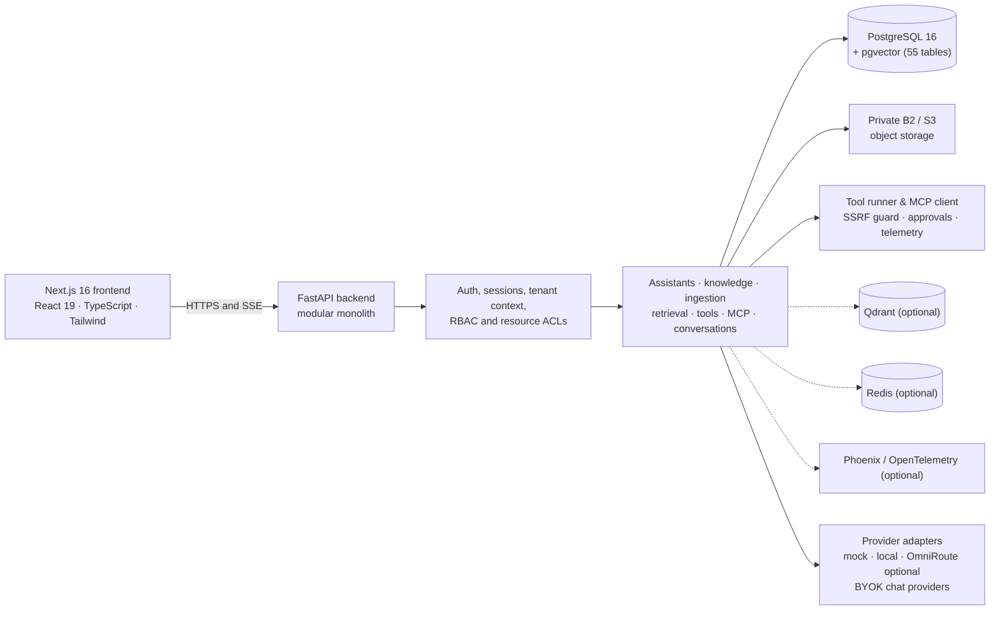
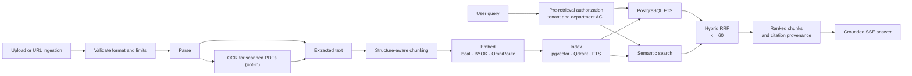
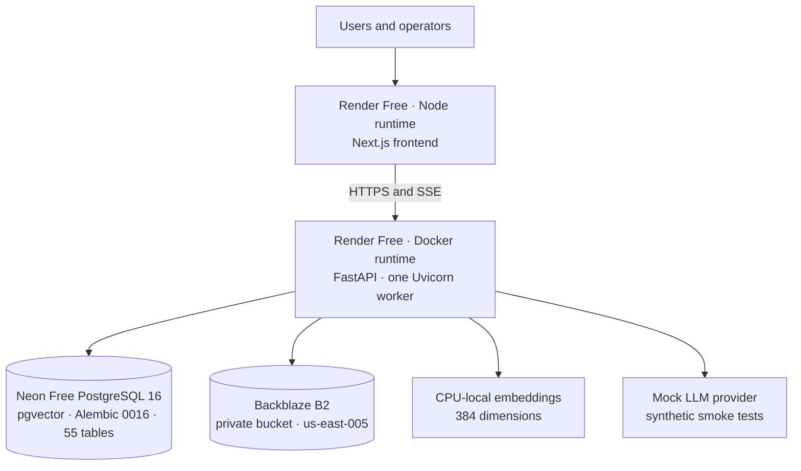

# Multi-Tenant AI Platform (CaaS) — Enterprise Multi-Tenant AI Knowledge & Assistant Platform

## Overview

**Multi-Tenant AI Platform (CaaS)** is a security-first, multi-tenant AI knowledge and assistant platform for individuals and organizations. It combines private knowledge ingestion, grounded retrieval, configurable assistants, custom tool registries, Model Context Protocol (MCP) integrations, human-in-the-loop approvals, and streaming chat with tenant-scoped administration, developer integration, and end-to-end request observability.

## Screenshots

The screenshots below show the private staging workspace using synthetic data only.

| Login | Dashboard |
|---|---|
|  |  |
| **Login.** Light theme, synthetic staging workspace. | **Dashboard.** Workspace overview with synthetic data. |

| Assistants | Knowledge |
|---|---|
|  |  |
| **Assistants.** Assistant studio, tool binding, and configuration views. | **Knowledge.** Knowledge bases, ingestion, and retrieval views. |

| Conversations | Mobile |
|---|---|
|  |  |
| **Conversations.** Grounded chat, SSE token stream, and in-chat approval cards. | **Mobile.** Responsive dashboard layout. |

All screenshots contain synthetic data only.

## Status

**Status: `STAGING_VERIFIED_OPERATOR_ACCEPTED` (M20.5 Integrated Release)** — a private, synthetic-data staging environment is deployed, technically validated, and operational on Render Free + Neon PostgreSQL 16 + Backblaze B2. Access is invitation-only. The platform is running Observability 2.0 and the Agentic MCP & Tools runtime.

- Staging frontend: <https://mmaip-frontend.onrender.com>
- Staging backend: <https://mmaip-backend.onrender.com>
- Observability console: <https://mmaip-frontend.onrender.com/dashboard/observability>
- Integrations console: <https://mmaip-frontend.onrender.com/dashboard/integrations>
- Custom Tools console: <https://mmaip-frontend.onrender.com/dashboard/tools>

Public registration is closed, onboarding is invitation-only, and no test credentials are provided.

## Features

- **Individual and organization workspaces** with workspace switching and strict tenant partitioning.
- **RBAC and resource ACLs** with organization roles, department membership, employee groups, and department-scoped document access.
- **Departments, groups, memberships, and invitations** for organization administration with secure invitation token hashing.
- **Server-side authentication sessions & refresh token rotation (M16)** with immediate token family invalidation upon replay detection.
- **Durable quota reservations (M17)** with atomic credit checks and concurrency protection in PostgreSQL.
- **Assistants and configuration versioning** with templates, guided creation, immutable snapshots, tool bindings, and forward-only rollback.
- **Knowledge ingestion** with multi-format parsing, magic-byte validation, structure-aware chunking, asynchronous job tracking, and opt-in OCR.
- **Hybrid retrieval** over PostgreSQL full-text search, pgvector semantic search, and optional Qdrant, fused with Reciprocal Rank Fusion (RRF).
- **Citations and grounded answers** with document, page, chunk, and snippet provenance carried through streaming responses.
- **Custom Tool Registry (M19)** supporting custom HTTP endpoints with JSON schema validation, write-only credentials, and strict SSRF loopback/private-network protections.
- **Model Context Protocol (MCP) Integrations (M20)** for connecting external MCP servers, discovering tool schemas, and enforcing tool execution risk boundaries.
- **Human-in-the-Loop Approvals (M20)** for write-like or mutating tool actions, with in-chat approval cards, single-use token consumption, and zero LLM self-authorization.
- **Streaming conversations** over Server-Sent Events (SSE), with persisted messages, citations, agent tool steps, and usage accounting.
- **Observability 2.0 and AI request intelligence**: durable request tracing, span waterfalls (`retrieval`, `context_assembly`, `provider_generation`, `tool_execution`), RAG diagnostics, token & cost tracking, zero-trust `METADATA_ONLY` privacy policies, and retention management.
- **BYOK provider management** with encrypted credentials, strict no-platform-fallback behavior for supported commercial chat providers, and optional OmniRoute gateway routing.
- **Publishing and developer platform**: gated public assistant pages, embed widgets, scoped API keys, developer REST endpoints, and Python/TypeScript SDKs.
- **Evaluation and testing (M18)**: evaluation datasets, benchmark runs, and comparisons with deterministic retrieval and citation metrics.
- **Operational controls**: health/readiness probes, audit logs, Alembic migrations (0001–0016), Docker Compose profiles, and CI quality gates.

## Architecture

### System architecture



The backend is a modular monolith: routers handle HTTP concerns, tenant-context and permission dependencies enforce access, services implement ingestion/retrieval/chat/tool workflows, and repositories scope tenant-owned queries to the active workspace. PostgreSQL is the source of truth; pgvector stores embeddings; B2/S3 stores original objects. Qdrant, Redis, Phoenix, and the standalone ingestion worker are optional components and are not part of the staging topology.

### Retrieval flow



The diagram shows the hybrid path. Lexical mode uses PostgreSQL FTS only; semantic mode uses the configured vector store; hybrid mode combines both candidate sets with RRF before citations are assembled and streamed.

### Deployment topology



The staging topology uses the components shown above with in-process failure-isolated tracing and durable PostgreSQL persistence. Redis, Qdrant, Phoenix, and the standalone worker are not deployed there.

## Tech stack

| Area | Stack |
|---|---|
| Frontend | Next.js 16 App Router, React 19, TypeScript, Tailwind CSS, Lucide icons |
| Backend | Python 3.12, FastAPI, SQLAlchemy 2.0 async, Pydantic v2, Alembic |
| Database | PostgreSQL 16 with pgvector |
| Object storage | S3-compatible adapter (Backblaze B2 in staging) |
| Tooling & MCP | Custom HTTP tool runner, Model Context Protocol (MCP) client with SSRF guards |
| AI providers | Mock, local embeddings, optional OmniRoute gateway, OpenAI/Anthropic/Gemini/Groq BYOK |
| Security | Argon2id password hashing, JWT (HS256), Fernet-encrypted credentials, server-side session store |
| Local infrastructure | Docker Compose core services plus optional `vector`, `workers`, `redis`, and `observability` profiles |
| Testing | Pytest backend suites (623 tests), Next.js typecheck/build, Python and TypeScript SDK checks |

## Repository structure

```text
.
├── backend/            FastAPI application, tests, Alembic migrations, lockfiles
│   ├── app/            api/v1, assistant_runtime, core, models, observability, repositories, schemas, services
│   ├── app/parsers/    PDF, DOCX, XLSX, PPTX, CSV, JSON, SQL, TXT, Markdown
│   ├── app/retrieval/  lexical, semantic, hybrid RRF, citations, authorization
│   ├── app/services/   mcp, tools, evaluation, session, quota, ingestion
│   ├── app/storage/    local and S3-compatible object storage providers
│   ├── tests/          unit, security, and environment-gated integration tests (623 passing)
│   └── alembic/        migrations 0001 through 0016 (including sessions, quotas, tools, MCP, and assistant tool configs)
├── frontend/           Next.js App Router frontend
│   ├── app/            login, dashboard (assistants, knowledge, chat, observability, integrations, tools), public assistant, embed
│   ├── components/     UI, assistant, knowledge, chat, and in-chat approval cards
│   └── lib/            typed API client and SSE reader
├── sdk/                Python and TypeScript developer clients
├── infrastructure/     Dockerfiles and operational scripts
├── docs/               architecture, API, security, product, runbook, and milestone documentation (M01–M20)
├── docker-compose.yml  local core services and optional profiles
└── render.yaml         free-tier staging blueprint
```

## Supported formats

| Format | Handling |
|---|---|
| PDF | Text extraction; OCR for scanned pages when enabled |
| DOCX | Paragraphs, headings, tables |
| XLSX | Sheets, rows, columns, tables |
| PPTX | Slides, titles, notes, tables |
| CSV | Delimiter detection, headers, rows |
| JSON | Nested objects, JSON Lines, flattened key paths |
| SQL | Static AST parsing only; no SQL execution against a live database |
| TXT | Encoding detection and paragraph grouping |
| Markdown | Heading hierarchy, sections, code blocks |

Scanned PDFs can be processed with opt-in OCR. **Standalone image uploads are not implemented**; images are not a supported top-level document format.

## Retrieval modes

| Mode | Backend | Configuration |
|---|---|---|
| Lexical | PostgreSQL full-text search (`tsvector`, `ts_rank_cd`) | `DEFAULT_RETRIEVAL_MODE=lexical`, `DEFAULT_VECTOR_STORE=fts` |
| Semantic | pgvector cosine distance | `DEFAULT_RETRIEVAL_MODE=semantic`, `DEFAULT_VECTOR_STORE=pgvector` |
| Semantic, optional | Qdrant | `DEFAULT_RETRIEVAL_MODE=semantic`, `DEFAULT_VECTOR_STORE=qdrant`, `QDRANT_URL` |
| Hybrid | PostgreSQL FTS plus the configured vector store, fused with RRF | `DEFAULT_RETRIEVAL_MODE=hybrid`, `DEFAULT_VECTOR_STORE=pgvector` (or `qdrant`), `RRF_K_CONSTANT=60` |

Defaults can be overridden by retrieval configuration and per-assistant settings. Staging uses hybrid retrieval with pgvector and 384-dimensional local embeddings. Qdrant is supported by code but is not deployed in staging.

## Security model

Access is enforced at the request boundary and again in tenant-scoped data access:

- **Tenant isolation.** Tenant-scoped routes require a JWT and the active workspace header; the server verifies active membership before resolving tenant context. Tenant-owned repository queries are scoped by `tenant_id`, and composite foreign keys reduce cross-tenant references. Cross-tenant negative tests are part of the automated suite.
- **Server-side authentication sessions & token rotation.** Stored in `auth_sessions`; refreshing rotates tokens; reusing a superseded refresh token invalidates the entire session family immediately.
- **SSRF and network isolation.** Custom HTTP tools and MCP connection URLs are strictly validated: loopback, link-local, private RFC 1918 subnets, and cloud metadata endpoints are blocked.
- **Human approval boundary.** High-risk or write-like tools pause execution and require explicit tenant-administrator authorization. Token consumption is single-use and idempotent; LLMs cannot self-authorize.
- **RBAC and resource ACLs.** System roles and granular permissions cover workspace administration, member management, departments, assistants, knowledge, conversations, tools, and audit access.
- **BYOK.** Provider credentials are Fernet-encrypted at rest, masked in responses, decrypted only in memory at invocation time, and never returned in plaintext. OpenAI, Anthropic, Gemini, and Groq chat are BYOK-strict; there is no platform-paid fallback for those providers. OmniRoute is an optional operator-configured gateway.
- **Registration and onboarding.** Public registration is disabled by default outside development and is explicitly `false` in staging. Onboarding is invitation-only.
- **Feature gates.** Public publishing, developer API, tenant custom provider endpoints, remote MCP execution (`MCP_ENABLED=false`), and API documentation are off by default in staging.
- **CORS.** Staging requires explicit trusted origins. Missing, wildcard, or localhost origins fail closed at startup.
- **Upload and ingestion limits.** The configured bounds are 10 MiB per file, 2 files per request, 5 MiB of extracted text per document, and up to 1,000 pages. OCR is opt-in. Ingestion runs in-process with a single concurrency slot in staging.
- **Secrets and audit.** Passwords use Argon2id; session tokens use JWT; BYOK secrets use Fernet. Audit entries are tenant-scoped and insert-only.

## Deployment (M20.5 staging, verified)

The deployed environment is private, synthetic-only staging on free tiers running Observability 2.0 and the Agentic Tools Runtime at release commit `a0cd98c` / `18ed20e`.

| Layer | Configuration |
|---|---|
| Frontend | Render Free, Node runtime, Next.js 16: <https://mmaip-frontend.onrender.com> |
| Backend | Render Free, Docker runtime, FastAPI, one Uvicorn worker: <https://mmaip-backend.onrender.com> |
| Database | Neon Free PostgreSQL 16 with pgvector; Alembic head `0016_m20_2_assistant_tools_config`; 55 public tables |
| Object storage | Backblaze B2 private bucket in `us-east-005`, accessed through the S3-compatible adapter |
| Embeddings | CPU-local `local-feature-projection`, 384 dimensions |
| LLM | Mock provider for smoke tests; no platform-paid LLM fallback |
| Observability | In-process failure-isolated tracer; durable PostgreSQL persistence; zero-trust `METADATA_ONLY` policy |
| Tools & MCP | Custom HTTP tool registry; MCP client with SSRF loopback protections; `MCP_ENABLED=false` |
| Data class | Synthetic data only; no real, customer, or regulated documents |

Verified in M20.5 staging:

- `/health` returned `200` and `/ready` returned `200` with `database: connected`.
- Alembic migration `0016_m20_2_assistant_tools_config` applied cleanly; runtime DML grants verified for `mmaip_app`.
- Session login, refresh token rotation, and reuse rejection verified live.
- SSE chat stream delivered 33 events and created durable trace in Neon PostgreSQL.
- Custom tool created, bound to assistant `tools_config`, tested, and deleted cleanly.
- SSRF protections verified against loopback and cloud metadata endpoints.
- Observability console at `/dashboard/observability`, Integrations at `/dashboard/integrations`, and Tools at `/dashboard/tools` verified.

**Access and data restrictions:** registration is closed, onboarding is invite-only, no test credentials are provided, and real documents are not approved.

Free-tier services can spin down when idle; first requests after idle may incur a cold start.

## Quick start (local development, PowerShell)

### Prerequisites

- Python 3.12+
- Node.js 20+
- Optional: Docker Desktop for containerized PostgreSQL, Qdrant, Redis, and worker profiles
- Optional: PostgreSQL 16 with pgvector for close-to-staging local parity

### Backend

```powershell
cd backend
python -m venv .venv
.\.venv\Scripts\Activate.ps1
pip install -r requirements.lock
pip install -e .
Copy-Item ..\.env.example .env
```

Review `backend/.env` and replace placeholders. For a local PostgreSQL instance, set `DATABASE_URL` and `DATABASE_SYNC_URL`; SQLite is supported for lightweight local testing. Do not commit `.env` or real credentials.

```powershell
alembic upgrade head
uvicorn app.main:app --reload --host 127.0.0.1 --port 8000
```

The API is served at `http://127.0.0.1:8000`. In development, interactive API documentation is available at `/docs` and health probes are available at `/health` and `/ready`.

### Frontend

```powershell
cd frontend
npm ci
Set-Content -Path .env.local -Value "NEXT_PUBLIC_API_BASE_URL=http://127.0.0.1:8000"
npm run dev
```

Open `http://localhost:3000`. The backend origin is configured without `/api/v1`; the frontend appends the versioned API path.

## Testing

Latest verified regression results:

| Check | Result |
|---|---|
| Backend full suite (Pytest) | **623 passed, 18 skipped, 0 failed** across all 72 test suites |
| Frontend typecheck (`tsc --noEmit`) | **0 TypeScript errors** |
| Frontend production build (`npm run build`) | **22 routes prerendered** (including `/dashboard/integrations` and `/dashboard/tools`) |
| Live staging verification | M20.5 synthetic acceptance: Auth sessions, token rotation, custom tools, assistant tool binding, SSE streaming, observability traces (100% pass) |
| Python SDK | Passed |
| TypeScript SDK | 0 type errors |

Run backend tests:

```powershell
cd backend
.\.venv\Scripts\python.exe -m pytest -q
```

Run frontend checks:

```powershell
cd frontend
npx tsc --noEmit
npm run build
```

## API overview

All application endpoints are versioned under `/api/v1`. Tenant-scoped routes require `Authorization: Bearer <token>` and `X-Tenant-ID: <workspace-uuid>`; active tenant membership is verified server-side.

| Group | Purpose |
|---|---|
| `/api/v1/auth` | Login, refresh, sessions, logout, identity, and invitation acceptance |
| `/api/v1/tenants`, `/organizations`, `/members`, `/departments`, `/groups`, `/roles` | Workspaces, organization structure, membership, and permissions |
| `/api/v1/assistants` | Assistant CRUD, templates, configuration versions, tool bindings (`tools_config`), and rollback |
| `/api/v1/tools` | Custom tool registry, input/output schemas, write-only credentials, and execution testing |
| `/api/v1/mcp` | Model Context Protocol connections, server handshakes, tool discovery, and telemetry |
| `/api/v1/approvals` | Human-in-the-loop pending approval decisions and single-use resolution |
| `/api/v1/knowledge`, `/documents`, `/ingestion` | Knowledge bases, upload and URL ingestion, document metadata, chunks, and jobs |
| `/api/v1/conversations` | Conversations, message history, and SSE chat streaming with tool events |
| `/api/v1/retrieval` | Search, preview, and retrieval playground |
| `/api/v1/evaluation` | Evaluation datasets, runs, and benchmark comparisons |
| `/api/v1/observability` | Request traces, span waterfalls, RAG diagnostics, token/cost metrics, and capture policies |
| `/api/v1/developer` | Developer API keys and developer chat endpoints (feature-gated) |
| `/health`, `/ready` | Liveness and readiness probes at the service root |

## Project milestones

| Milestone | Summary |
|---|---|
| M01–M10 | Core foundation: multi-tenancy, ingestion, hybrid retrieval, SSE conversations, assistant studio, knowledge BYOK, developer API, and UI hardening. |
| M11–M13 | Staging readiness: PostgreSQL migrations, backup/restore drills, free-tier architecture, and Render/Neon/B2 runbooks. |
| M14 | Private free-tier staging deployed: Render backend/frontend, Neon PostgreSQL 16 + pgvector, private B2, local embeddings, and mock-LLM smoke tests. |
| M15 | Observability 2.0: Durable request tracing, span waterfalls, RAG diagnostics, token & cost tracking, zero-trust `METADATA_ONLY` privacy policies, and high-density dashboard UI. |
| M16 | Secure Sessions & Refresh Rotation: Server-side session tracking, rotation, replay attack revocation, and hardened invitations. |
| M17 | Durable Quota Reservations: PostgreSQL-backed atomic quota reservation lifecycle and concurrency enforcement. |
| M18 | Retrieval & Citation Evaluation: Automated benchmark runner, dataset management, and deterministic retrieval/citation metrics. |
| M19 | Tool Registry: Custom HTTP tool builder, JSON schemas, write-only credentials, and SSRF loopback protections. |
| M20 | Model Context Protocol (MCP) & Approvals: MCP client, server handshake, tool discovery, human-in-the-loop approvals, and agentic runtime. |
| M20.1–M20.2 | Unified Integrations UI: `/dashboard/integrations`, `/dashboard/tools`, assistant Tools & Integrations tab, and in-chat approval cards. |
| M20.3–M20.5 | Integrated Staging Release: Git reconciliation (`a0cd98c`), Neon recovery checkpoint (`br-holy-bird-ar61gvun`), migration `0012 -> 0016`, Render deployments, and live synthetic acceptance (`M20_5_LIVE_TECHNICAL_PASS_MANUAL_UI_PENDING`). |

## Documentation

- `docs/architecture/` — architecture, assistant configuration, provider, and retrieval notes
- `docs/api/` — API overview and endpoint specifications
- `docs/m20/` — M20 release reports, migration verification, and live acceptance evidence
- `docs/runbooks/` — local development and operational runbooks
- `sdk/python/README.md` and `sdk/typescript/README.md` — SDK usage

## License

License: not specified. No repository-level `LICENSE` file is present.
