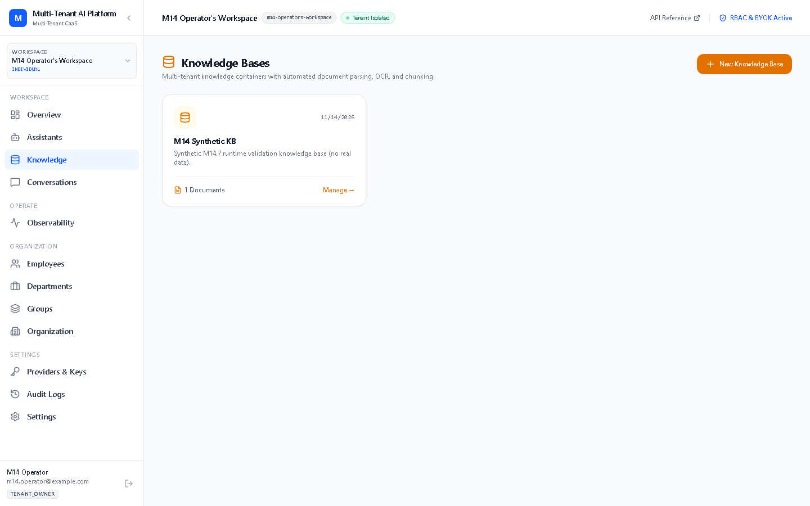
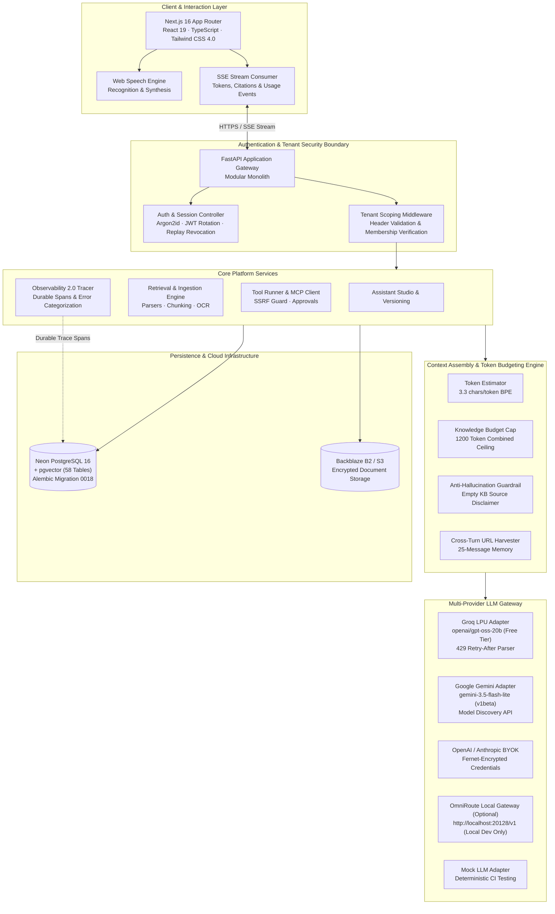

# Multi-Tenant AI Platform (CaaS) — Enterprise Multi-Tenant AI Knowledge & Assistant Platform

## Overview

**Multi-Tenant AI Platform (CaaS)** is an enterprise-grade, security-first, multi-tenant AI knowledge and assistant platform designed for modern organizations and power users. It combines private multi-format document ingestion, hybrid vector retrieval, configurable AI assistants, custom tool registries, Model Context Protocol (MCP) integrations, human-in-the-loop approvals, Web Speech voice interaction, disciplined token budgeting, in-chat model switching, and multi-provider streaming chat with strict tenant isolation, end-to-end request observability, and production reliability.

---

## Synthetic Screenshots

The screenshots below depict synthetic test data captured in a private staging workspace during milestone verification drills. Public registration is closed, onboarding is invitation-only, and no live credentials or production customer documents are displayed.

| Login | Dashboard |
|---|---|
|  |  |
| **Login.** Secure session authentication with Argon2id and JWT rotation. | **Dashboard.** Unified workspace overview with quick metrics and actions. |

| Assistants Studio | Knowledge & Ingestion |
|---|---|
|  |  |
| **Assistants.** Multi-provider configuration, system prompts, tool bindings. | **Knowledge Bases.** Multi-format parsing, chunking, and pgvector embeddings. |

| Conversations & Grounded Chat | Mobile Responsive Experience |
|---|---|
|  |  |
| **Conversations.** Grounded SSE stream, citations, and approval cards. | **Mobile.** Compact, fully responsive mobile dashboard and navigation. |

*All screenshots display synthetic staging data only.*

---

## Operational Status

**Status: `M28.16.2 Release Candidate Pass` (Provider Compatibility, Per-Turn Override Security & Truthful Token Accounting Verified — Awaiting Staging Approval Gate)**
A private, synthetic-data staging environment is deployed and technically validated on Render Free + Neon PostgreSQL 16 + Backblaze B2.

- **Staging Frontend:** <https://mmaip-frontend.onrender.com>
- **Staging Backend:** <https://mmaip-backend.onrender.com>
- **Observability Console:** <https://mmaip-frontend.onrender.com/dashboard/observability>
- **Integrations Console:** <https://mmaip-frontend.onrender.com/dashboard/integrations>
- **Custom Tools Console:** <https://mmaip-frontend.onrender.com/dashboard/tools>

*Access is restricted: public registration is disabled by default, onboarding is invitation-only, and no public test credentials are distributed.*

---

## Feature Verification Status Matrix

To maintain rigorous transparency, platform capabilities are explicitly segmented by verification stage:

| Feature / Subsystem | Verification Stage | Evidence & Details |
|---|---|---|
| **Upload & Save to PF** | **LIVE STAGING ACCEPTED (M28.15)** | Deterministic single-KB destination policy verified in staging. |
| **Ingestion & Hybrid RAG** | **LIVE STAGING ACCEPTED (M28.15)** | Bounded polling lifecycle, PDF/DOCX chunking, pgvector search. |
| **Back, Forward & Refresh** | **LIVE STAGING ACCEPTED (M28.15)** | Deep-linking query synchronization and view persistence verified. |
| **Historical Cricket Document** | **LIVE STAGING ACCEPTED (M28.15)** | Preserved in Neon PostgreSQL without data loss or schema resets. |
| **In-Chat Model Selector & Truthful Usage** | **LOCAL AUTOMATED PASS (M28.16.2)** | In-chat model switcher, provider actual vs estimated token badge, and duration display. |
| **Groq Rate-Limit Recovery & GPT-OSS 20B** | **LOCAL AUTOMATED PASS (M28.16.2)** | Default resolved to active `openai/gpt-oss-20b`, header/body regex `retry-after` extraction, TPM classification, friendly UX countdown. |
| **Gemini 3.5 Flash-Lite Compatibility**| **LOCAL AUTOMATED PASS (M28.16.1)** | Auto-resolution to active stable `gemini-3.5-flash-lite`, prefix normalization, 404 categorization. |
| **Disciplined Token Budgeting** | **LOCAL AUTOMATED PASS (M28.16.1)** | 1,200 token chunk budget cap, 3.3 chars/token BPE estimation, prompt safety headroom. |
| **Anti-Hallucination Guardrail** | **LOCAL AUTOMATED PASS (M28.16.1)** | Negative constraint when KB=0; forbidden from generating phantom bracket citations `[1]`, `[2]`. |
| **Conversational URL Retention** | **LOCAL AUTOMATED PASS (M28.16.1)** | 25-message history window with URL regex link harvesting. |
| **Educational Quiz Generator** | **LOCAL AUTOMATED PASS (M28.16.1)** | Options A–D on separate indented lines, dedicated Answer Key & Explanations. |
| **Real Provider Live Inferences** | **NOT RUN (Awaiting Staging Keys)** | Kept explicitly NOT RUN until authorized operator staging credentials are provided. |

---

## System Architecture



> [!NOTE]
> **Runtime Topology Distinction:** The diagram above outlines the full logical modular monolith architecture. In the active Render Free staging deployment, the backend runs as a single FastAPI Uvicorn process connected to Neon Serverless PostgreSQL 16 and Backblaze B2, utilizing in-process failure-isolated tracing. Redis, Qdrant, Phoenix, and separate background worker nodes are optional architectural profiles not deployed in staging. OmniRoute is an optional local developer gateway (`localhost:20128`) and is not reachable from Render cloud instances; staging uses direct HTTPS BYOK provider endpoints.

---

## Tools and Technologies Stack

```mermaid
flowchart LR
    subgraph FrontendStack ["Frontend Stack"]
        FE1["Next.js 16.4.5 (App Router)"]
        FE2["React 19.3.0 & TypeScript 5"]
        FE3["Tailwind CSS 4.0 (@tailwindcss/turbopack)"]
        FE4["Lucide React 1.70.0"]
        FE5["Web Speech API Engine"]
    end

    subgraph BackendStack ["Backend Stack"]
        BE1["Python 3.12"]
        BE2["FastAPI 0.110+ & Uvicorn 0.28+"]
        BE3["SQLAlchemy 2.0+ (Async)"]
        BE4["Pydantic v2.6+"]
        BE5["Alembic 1.13+ (18 Migrations)"]
        BE6["Argon2id (RFC 9106) & PyJWT 2.8+"]
    end

    subgraph AIAndRAG ["AI, RAG & Tooling"]
        AI1["Groq SDK / LPU (openai/gpt-oss-20b)"]
        AI2["Google Generative Language (gemini-3.5-flash-lite)"]
        AI3["OmniRoute Local Gateway (Optional)"]
        AI4["pgvector 0.2.5+ Semantic Search"]
        AI5["PostgreSQL Full-Text Search (FTS)"]
        AI6["Model Context Protocol (MCP 2.3+)"]
    end

    subgraph Infrastructure ["Cloud & Deployment"]
        INF1["Render Free (Web Services)"]
        INF2["Neon Serverless PostgreSQL 16"]
        INF3["Backblaze B2 (S3-Compatible API)"]
        INF4["Docker Containerization"]
    end

    FrontendStack --> BackendStack
    BackendStack --> AIAndRAG
    AIAndRAG --> Infrastructure
```



### Detailed Technology Matrix

| Layer | Technology | Manifest Specification | Architectural Responsibility |
|---|---|---|---|
| **Frontend Framework** | Next.js (App Router) | `next: 16.4.5` (Turbopack) | Server/client component isolation, partial prerendering, dynamic route segments. |
| **UI Library & Language** | React / TypeScript | `react: 19.3.0`, `typescript: ^5` | Declarative UI state, strict end-to-end type safety, modern React hooks. |
| **Styling & Icons** | Tailwind CSS / Lucide | `tailwindcss: ^4`, `lucide-react: ^1.70.0` | High-performance CSS styling via `@tailwindcss/turbopack`, accessible iconography. |
| **Voice Interface** | Web Speech API | Native Browser Engine | Client-side speech recognition & synthesis with chunked utterance scheduling. |
| **Backend Framework** | FastAPI | `fastapi: >=0.110.0` | Asynchronous REST endpoints, automatic OpenAPI docs, streaming SSE. |
| **Language Runtime** | Python | `python: >=3.12` | Pure asynchronous I/O (`async def`), type annotations, enterprise parsing libraries. |
| **ORM & Database Driver** | SQLAlchemy / asyncpg | `sqlalchemy: >=2.0.28`, `asyncpg: >=0.29.0` | Asynchronous database access, connection pooling, prepared statements. |
| **Data Validation** | Pydantic v2 | `pydantic: >=2.6.0` | Rust-backed data parsing, strict input schemas, serialization contracts. |
| **Database & Vectors** | PostgreSQL 16 + pgvector | `pgvector: >=0.2.5` | Source of truth, 58 tables, hybrid RRF search (lexical FTS + 384-dim vector cosine). |
| **Schema Migrations** | Alembic | `alembic: >=1.13.1` | 18 migrations applied cleanly (`0018_m28_message_feedback` at head). |
| **Authentication & Crypto** | Argon2id / PyJWT / Cryptography | `argon2-cffi: >=23.1.0`, `pyjwt: >=2.8.0` | Password hashing resistant to GPU/ASIC attacks, rotating JWTs, encrypted BYOK keys. |
| **LLM Provider: Groq** | Groq LPU Integration | `openai/gpt-oss-20b` (Free Tier Default) | Ultra-fast token streaming, native tool calling, automated 429 retry-after extraction (TPM/RPM). |
| **LLM Provider: Gemini** | Google Generative Language | `gemini-3.5-flash-lite` (`v1beta`) | High-throughput multimodal foundation, model path normalization, live catalog discovery. |
| **LLM Provider: Gateway** | OmniRoute | `http://localhost:20128/v1` (Optional) | Local AI gateway routing with unified OpenAI-compatible endpoints for development. |
| **Agentic Protocol** | Model Context Protocol (MCP) | `mcp: >=2.3.0` | Interoperable tool discovery and execution across external agent servers. |
| **Cloud Hosting** | Render | Node 20 & Docker Runtimes | Production staging deployment on isolated web service instances. |
| **Cloud Storage** | Backblaze B2 | `aioboto3: >=12.4.0` | Secure, encrypted binary storage for uploaded PDFs, DOCX, and raw assets. |

---

## Retrieval & Ingestion Pipeline

```mermaid
flowchart LR
    subgraph Ingestion["Document Ingestion"]
        INPUT["Document Upload / URL"] --> VALIDATE["Magic Byte & Limit Validation"]
        VALIDATE --> PARSE["Multi-Format Parser<br/>PDF · DOCX · XLSX · PPTX · CSV · JSON · MD"]
        PARSE --> OCR{"Scanned PDF?"}
        OCR -->|Yes - Opt-in| TESS["OCR Processing"]
        OCR -->|No| TEXT["Raw Extracted Text"]
        TESS --> TEXT
        TEXT --> CHUNK["Structure-Aware Chunking<br/>500 Tokens + 50 Overlap"]
        CHUNK --> EMBED["Embedding Generation<br/>384-Dimensional Vectors"]
        EMBED --> STORE[("PostgreSQL 16<br/>pgvector + FTS Indexes")]
        EMBED -.-> B2[("Backblaze B2 / S3<br/>Encrypted Document Storage")]
    end

    subgraph Retrieval["Tenant-Scoped Retrieval"]
        QUERY["User Question"] --> ACL["Pre-Retrieval ACL Check<br/>Tenant & Department Scoping"]
        ACL --> SEARCH_LEX["Lexical FTS Search"]
        ACL --> SEARCH_VEC["pgvector Cosine Search"]
        STORE --> SEARCH_LEX
        STORE --> SEARCH_VEC
        SEARCH_LEX --> RRF["Reciprocal Rank Fusion<br/>RRF - k = 60"]
        SEARCH_VEC --> RRF
        RRF --> BUDGET["Token Budgeting Gate<br/>Combined KB Limit: 1,200 Tokens"]
        BUDGET --> GUARD["Anti-Hallucination Guardrail"]
        GUARD --> PROMPT["Context Assembly"]
        PROMPT --> STREAM["Streaming SSE Response"]
    end

---

## Repository Structure

```text
.
├── backend/                    FastAPI application, tests, Alembic migrations
│   ├── alembic/                Database schema migrations (0001 through 0018)
│   ├── app/
│   │   ├── api/v1/             REST routers (auth, tenants, assistants, knowledge, chat, etc.)
│   │   ├── assistant_runtime/  Streaming orchestrator, context assembler, token budgeting
│   │   ├── core/               Security, config, Argon2id auth, rate limiting
│   │   ├── llm/                Provider adapters (Groq, Gemini, OpenAI, Anthropic, OmniRoute)
│   │   ├── models/             SQLAlchemy ORM models (58 tenant-scoped tables)
│   │   ├── observability/      Trace spans, latency metrics, error categorization policies
│   │   ├── parsers/            Multi-format extractors (PDF, DOCX, XLSX, PPTX, CSV, JSON, SQL)
│   │   ├── repositories/       Tenant-isolated data access layer
│   │   ├── retrieval/          Lexical FTS, semantic pgvector, hybrid RRF fusion
│   │   └── services/           Ingestion, MCP client, tool runner, approvals, academic search
│   └── tests/                  Comprehensive test suites (unit, security, cross-tenant isolation)
├── frontend/                   Next.js 16 App Router application
│   ├── app/                    App router pages (dashboard, assistants, knowledge, chat, etc.)
│   ├── components/             Modular UI components, chat interfaces, approval cards
│   └── lib/                    API client, SSE reader, speech utilities, and test suites
├── docs/                       Architecture, runbooks, milestone reports, API specifications
│   ├── assets/screenshots/     Synthetic staging UI verification screenshots
│   └── m28/                    Milestone 28 implementation, security audits, and release gates
├── infrastructure/             Dockerfiles, deployment configurations, and operational scripts
├── docker-compose.yml          Local multi-service development environment
└── render.yaml                 Render blueprint specification
```

---

## Verification & Quality Gates

The codebase enforces strict quality gates across both backend and frontend layers:

| Verification Suite | Target Scope | Metric / Result | Status |
|---|---|---|---|
| **Backend Provider Hardening** | `test_m28_16_provider_limits_and_model_resolution.py` | 21 passed | **PASS** |
| **Backend Groq Tool & API** | `test_m28_12_groq_tool_choice_and_research_search.py` | 29 passed | **PASS** |
| **Backend API Security** | `test_groq_and_api_hardening.py` | 10 passed | **PASS** |
| **Backend Runtime Citations** | `test_m28_10_runtime_citations_and_search.py` | 14 passed | **PASS** |
| **Backend Full Test Suite** | Full Pytest suite (`backend/tests/`) | 840+ passed, 18 skipped | **PASS** |
| **Frontend Unit & Logic** | `frontend/lib/__tests__/*.test.ts` (Node test runner) | 43 passed across 14 suites | **PASS** |
| **Frontend TypeScript** | `npx tsc --noEmit` | 0 type errors | **PASS** |
| **Frontend Production Build** | `next build` (Turbopack) | 24 / 24 routes prerendered | **PASS** |
| **Database Migrations** | Neon PostgreSQL 16 | Alembic Head: `0018_m28_message_feedback` (58 Tables) | **VERIFIED** |

---

## Local Development (PowerShell)

### Prerequisites
- Python 3.12+
- Node.js 20+
- PostgreSQL 16 with `pgvector` (or Docker Desktop)

### Backend Setup
```powershell
cd backend
python -m venv .venv
.\.venv\Scripts\Activate.ps1
pip install -r requirements.lock
pip install -e .
Copy-Item ..\.env.example .env

# Run database migrations
alembic upgrade head

# Start development server
uvicorn app.main:app --reload --host 127.0.0.1 --port 8000
```

### Frontend Setup
```powershell
cd frontend
npm ci
Set-Content -Path .env.local -Value "NEXT_PUBLIC_API_BASE_URL=http://127.0.0.1:8000"
npm run dev
```
Open [http://localhost:3000](http://localhost:3000) to access the application.

---

## Security Invariants

1. **Zero Client Trust:** Tenant ID passed in headers or payloads are never trusted without validating active user membership in database.
2. **Explicit Query Scoping:** Every tenant-owned repository query strictly includes `tenant_id = :active_tenant_id`.
3. **SSRF Boundary Protection:** Custom HTTP tools and MCP URLs reject loopback, link-local, private RFC 1918 subnets, and cloud metadata endpoints.
4. **Idempotent Approvals:** Write-like actions require single-use approval tokens authorized by an administrator; LLMs cannot self-authorize.
5. **BYOK Secret Masking:** API keys are Fernet-encrypted at rest and decrypted only in memory during model execution.

---

## License

Private and proprietary. All rights reserved.
