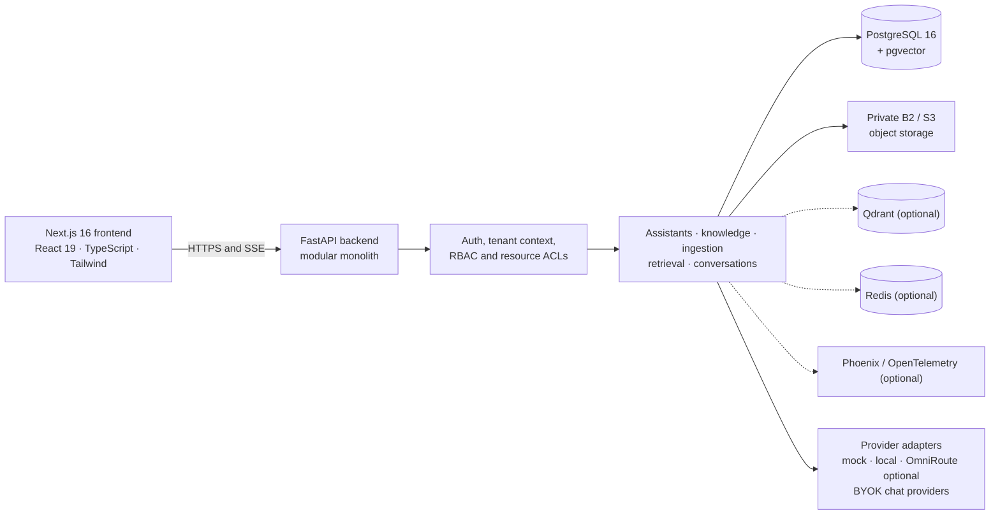
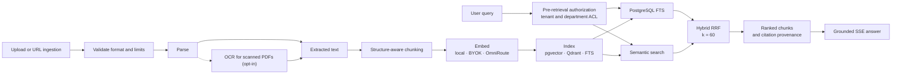
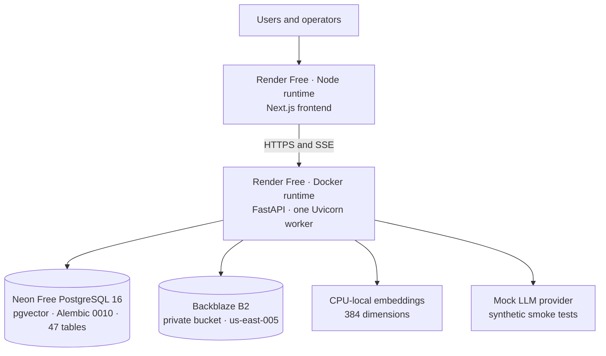
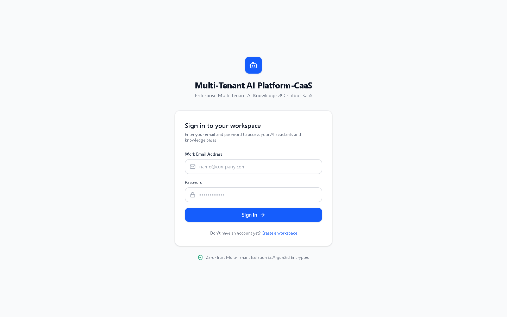
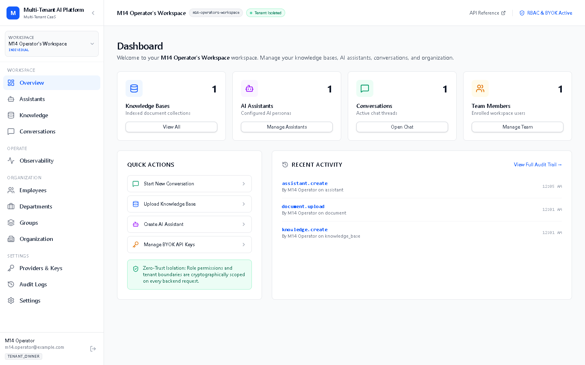
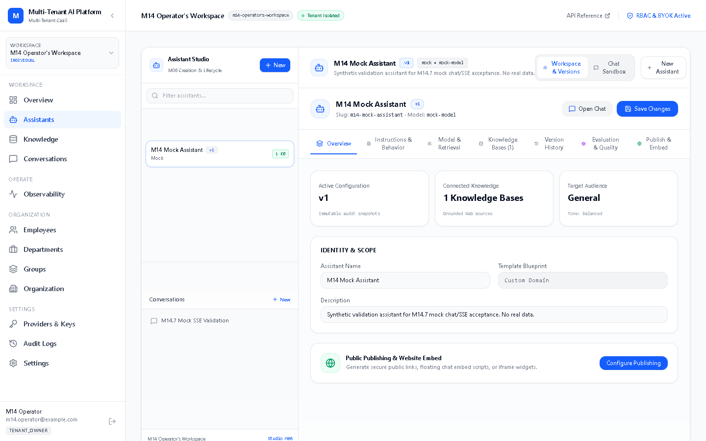
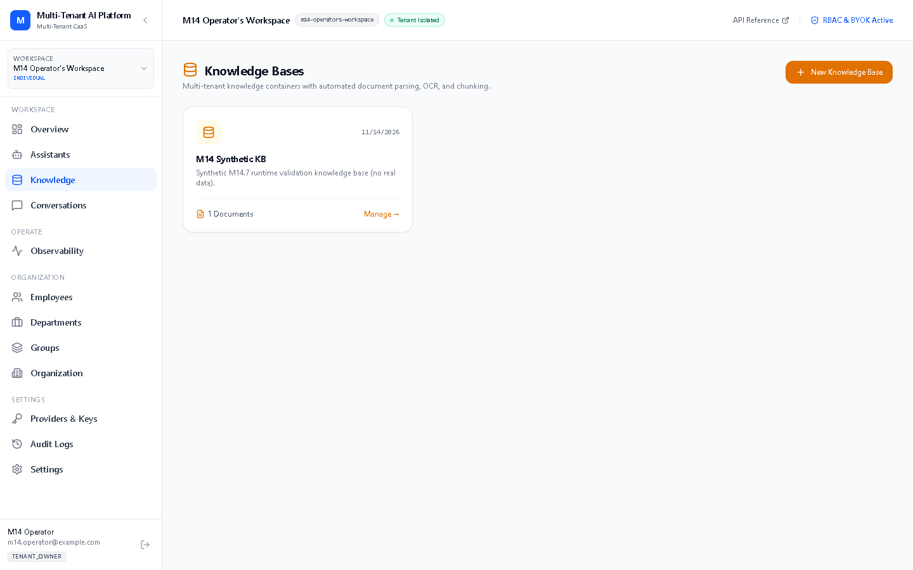
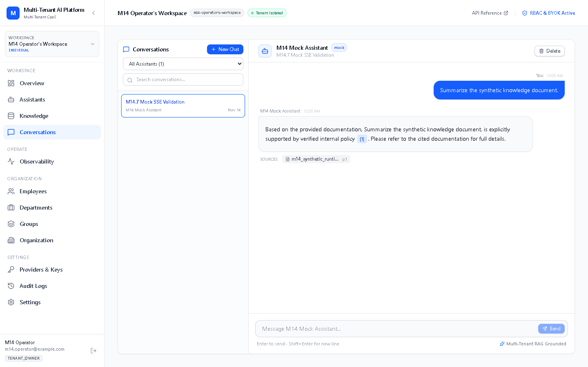
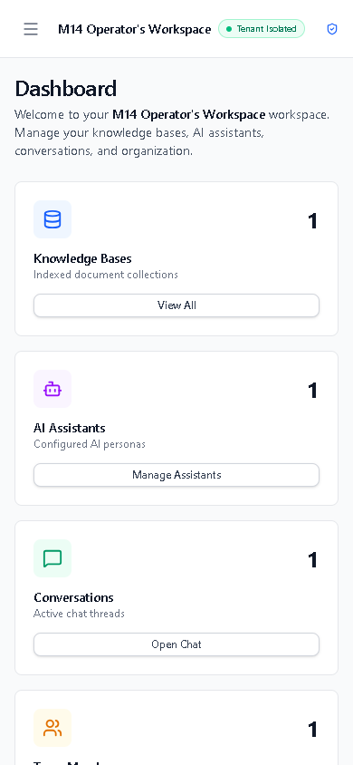

# Multi-Tenant AI Platform (CaaS) — Enterprise Multi-Tenant AI Knowledge & Assistant Platform

## Status

**Status: `CONDITIONAL_READY`** — a private, synthetic-data staging environment is deployed and technically validated (M14). Access is invitation-only. The platform is **not production-ready** and is **not approved for real or customer documents**; manual UI acceptance is pending.

- Staging frontend: <https://mmaip-frontend.onrender.com>
- Staging backend: <https://mmaip-backend.onrender.com>

Public registration is closed, onboarding is invitation-only, and no test credentials are provided.

## Overview

Multi-Tenant AI Platform (CaaS) is a security-first, multi-tenant AI knowledge and assistant platform for individuals and organizations. It combines private knowledge ingestion, grounded retrieval, configurable assistants, and streaming chat with tenant-scoped administration and developer integration.

## Features

- **Individual and organization workspaces** with workspace switching and strict tenant partitioning.
- **RBAC and resource ACLs** with organization roles, department membership, employee groups, and department-scoped document access.
- **Departments, groups, memberships, and invitations** for organization administration.
- **Assistants and configuration versioning** with templates, guided creation, immutable version snapshots, and forward-only rollback.
- **Knowledge ingestion** with multi-format parsing, magic-byte validation, structure-aware chunking, asynchronous job tracking, and opt-in OCR.
- **Hybrid retrieval** over PostgreSQL full-text search, pgvector semantic search, and optional Qdrant, fused with Reciprocal Rank Fusion (RRF).
- **Citations and grounded answers** with document, page, chunk, and snippet provenance carried through streaming responses.
- **Streaming conversations** over Server-Sent Events (SSE), with persisted messages, citations, and usage accounting.
- **BYOK provider management** with encrypted credentials, strict no-platform-fallback behavior for supported commercial chat providers, and optional OmniRoute gateway routing.
- **Publishing and developer platform**: gated public assistant pages, embed widgets, scoped API keys, developer REST endpoints, and Python/TypeScript SDKs.
- **Evaluation and observability**: evaluation datasets, runs and comparisons with deterministic metrics; in-process traces, metrics, and trace identifiers.
- **Operational controls**: health/readiness probes, audit logs, Alembic migrations, Docker Compose profiles, and CI quality gates.

## Architecture

### System architecture



The backend is a modular monolith: routers handle HTTP concerns, tenant-context and permission dependencies enforce access, services implement ingestion/retrieval/chat workflows, and repositories scope tenant-owned queries to the active workspace. PostgreSQL is the source of truth; pgvector stores embeddings; B2/S3 stores original objects. Qdrant, Redis, Phoenix, and the standalone ingestion worker are optional components and are not part of the M14 staging topology.

### Retrieval flow



The diagram shows the hybrid path. Lexical mode uses PostgreSQL FTS only; semantic mode uses the configured vector store; hybrid mode combines both candidate sets with RRF before citations are assembled and streamed.

### Deployment topology



The M14 staging topology uses the components shown above. Redis, Qdrant, Phoenix, and the standalone worker are not deployed there.

## Tech stack

| Area | Stack |
|---|---|
| Frontend | Next.js 16 App Router, React 19, TypeScript, Tailwind CSS, Lucide icons |
| Backend | Python 3.12, FastAPI, SQLAlchemy 2.0 async, Pydantic v2, Alembic |
| Database | PostgreSQL 16 with pgvector |
| Object storage | S3-compatible adapter (Backblaze B2 in staging) |
| AI providers | Mock, local embeddings, optional OmniRoute gateway, OpenAI/Anthropic/Gemini/Groq BYOK |
| Security | Argon2id password hashing, JWT (HS256), Fernet-encrypted BYOK credentials |
| Local infrastructure | Docker Compose core services plus optional `vector`, `workers`, `redis`, and `observability` profiles |
| Testing | Pytest backend suites, Next.js typecheck/build, Python and TypeScript SDK checks |

## Repository structure

```text
.
├── backend/            FastAPI application, tests, Alembic migrations, lockfiles
│   ├── app/            api/v1, core, models, schemas, repositories, services
│   ├── app/parsers/    PDF, DOCX, XLSX, PPTX, CSV, JSON, SQL, TXT, Markdown
│   ├── app/retrieval/  lexical, semantic, hybrid RRF, citations, authorization
│   ├── app/storage/    local and S3-compatible object storage providers
│   ├── tests/          unit, security, and environment-gated integration tests
│   └── alembic/        migrations 0001 through 0010
├── frontend/           Next.js App Router frontend
│   ├── app/            login, register, dashboard, public assistant, embed
│   ├── components/     UI, assistant, knowledge, and chat components
│   └── lib/            typed API client and SSE reader
├── sdk/                Python and TypeScript developer clients
├── infrastructure/     Dockerfiles and operational scripts
├── docs/               architecture, API, security, product, and runbook documentation
├── docker-compose.yml  local core services and optional profiles
└── render.yaml         free-tier staging blueprint
```

## Supported formats

| Format | Handling |
|---|---|
| PDF | Text extraction; OCR for scanned pages when enabled |
| DOCX | Paragraphs, headings, tables |
| XLSX | Sheets, rows, columns, tables |
| PPTX | Slides, titles, notes, tables |
| CSV | Delimiter detection, headers, rows |
| JSON | Nested objects, JSON Lines, flattened key paths |
| SQL | Static AST parsing only; no SQL execution against a live database |
| TXT | Encoding detection and paragraph grouping |
| Markdown | Heading hierarchy, sections, code blocks |

Scanned PDFs can be processed with opt-in OCR. **Standalone image uploads are not implemented**; images are not a supported top-level document format.

## Retrieval modes

| Mode | Backend | Configuration |
|---|---|---|
| Lexical | PostgreSQL full-text search (`tsvector`, `ts_rank_cd`) | `DEFAULT_RETRIEVAL_MODE=lexical`, `DEFAULT_VECTOR_STORE=fts` |
| Semantic | pgvector cosine distance | `DEFAULT_RETRIEVAL_MODE=semantic`, `DEFAULT_VECTOR_STORE=pgvector` |
| Semantic, optional | Qdrant | `DEFAULT_RETRIEVAL_MODE=semantic`, `DEFAULT_VECTOR_STORE=qdrant`, `QDRANT_URL` |
| Hybrid | PostgreSQL FTS plus the configured vector store, fused with RRF | `DEFAULT_RETRIEVAL_MODE=hybrid`, `DEFAULT_VECTOR_STORE=pgvector` (or `qdrant`), `RRF_K_CONSTANT=60` |

Defaults can be overridden by retrieval configuration and per-assistant settings. M14 staging uses hybrid retrieval with pgvector and 384-dimensional local embeddings. Qdrant is supported by code but is not deployed in staging.

## Security model

Access is enforced at the request boundary and again in tenant-scoped data access:

- **Tenant isolation.** Tenant-scoped routes require a JWT and the active workspace header; the server verifies active membership before resolving tenant context. Tenant-owned repository queries are scoped by `tenant_id`, and composite foreign keys reduce cross-tenant references. Cross-tenant negative tests are part of the automated suite.
- **RBAC and resource ACLs.** System roles and granular permissions cover workspace administration, member management, departments, assistants, knowledge, conversations, and audit access. Department-scoped document authorization is applied during retrieval, not only in the UI.
- **BYOK.** Provider credentials are Fernet-encrypted at rest, masked in responses, decrypted only in memory at invocation time, and never returned in plaintext. OpenAI, Anthropic, Gemini, and Groq chat are BYOK-strict; there is no platform-paid fallback for those providers. OmniRoute is an optional operator-configured gateway.
- **Registration and onboarding.** Public registration is disabled by default outside development and is explicitly `false` in staging. Onboarding is invitation-only: invitations are created by authorized members and accepted through `POST /api/v1/auth/accept-invite`, but no accept-invite page is shipped, so activation is operator-assisted.
- **Feature gates.** Public publishing, the developer API, tenant custom provider endpoints, and API documentation are off by default. API documentation is disabled outside development unless explicitly overridden. M14 staging verified `/docs` and `/openapi.json` as `404`, the developer API as `403`, and publication as unavailable.
- **CORS.** Staging and production require explicit trusted origins. Missing, wildcard, or localhost origins fail closed at startup rather than falling back to a permissive default. M14 staging accepted the deployed frontend origin and rejected a hostile origin.
- **Upload and ingestion limits.** The configured bounds are 10 MiB per file, 2 files per request, 5 MiB of extracted text per document, and up to 1,000 pages. OCR is opt-in. Ingestion runs in-process with a single concurrency slot in staging.
- **Secrets and audit.** Passwords use Argon2id; access and refresh tokens use JWT; BYOK secrets use Fernet. Audit entries are tenant-scoped and insert-only.

### Known limitations

- **RLS is not enabled.** Staging has zero RLS policies and zero RLS-enabled tables. Tenant isolation currently relies on application-level tenant-scoped queries; the runtime database role does not bypass RLS, so policies can be added later.
- **Rate limiting is process-local.** Limiter state is in memory and is not shared across workers or replicas. Staging runs one worker, and clients may share a bucket behind a proxy unless exact trusted proxy peers are configured.
- **No password reset, email verification, or token revocation.** Logout is stateless; access tokens remain valid until expiry, and refresh tokens are not denylisted. Account lifecycle is handled operationally.
- **Tenant suspension gap.** A tenant-level suspension flag is not enforced uniformly across every access path. Offboarding must explicitly deactivate memberships and API keys; access tokens remain valid until expiry.
- **Parser and OCR threads are not killable.** A timeout stops the task from being awaited, but Python cannot force-kill a thread already inside parser or OCR code. A stuck job may consume CPU until the process is recycled.
- **Public application URLs are not network-private.** The Render `onrender.com` endpoints are internet-reachable. Application authentication and tenant isolation are the boundary; CORS is not access control.

## Deployment (M14 staging, verified)

The deployed environment is private, synthetic-only staging on free tiers. It is not a production deployment.

| Layer | M14 configuration |
|---|---|
| Frontend | Render Free, Node runtime, Next.js: <https://mmaip-frontend.onrender.com> |
| Backend | Render Free, Docker runtime, FastAPI, one Uvicorn worker: <https://mmaip-backend.onrender.com> |
| Database | Neon Free PostgreSQL 16 with pgvector 0.8.7; Alembic head `0010_m10_remediation_schema_alignment`; 47 public tables |
| Object storage | Backblaze B2 private bucket in `us-east-005`, accessed through the S3-compatible adapter |
| Embeddings | CPU-local `local-feature-projection`, 384 dimensions |
| LLM | Mock provider for smoke tests; no platform-paid LLM fallback |
| Optional services | Redis, Qdrant, Phoenix, and the standalone worker are not deployed |
| Data class | Synthetic data only; no real, customer, or regulated documents |

Verified in M14 staging:

- `/health` returned `200` and `/ready` returned `200` with `database: connected`.
- CORS accepted the exact frontend origin and rejected a hostile origin without an allow-origin header.
- Registration, the developer API, and API documentation gates behaved as closed (`403`, `403`, `404`).
- Authentication, B2 upload persistence, ingestion, pgvector indexing, SSE streaming, and persisted citations were exercised with a synthetic account and synthetic content.
- The deployed backend connected to Neon using the restricted runtime role; the B2 object size and SHA-256 matched the uploaded synthetic file.
- The frontend `/login` route served successfully with the backend API base baked into the build.

**Access and data restrictions:** registration is closed, onboarding is invite-only, no test credentials are provided, and real documents are not approved. Real or customer documents remain blocked until B2-aware backup/export and operational restore gates close; manual UI acceptance is also pending.

Free-tier services can spin down when idle; first requests after idle may incur a cold start.

## Quick start (local development, PowerShell)

### Prerequisites

- Python 3.12+
- Node.js 20+
- Optional: Docker Desktop for containerized PostgreSQL, Qdrant, Redis, and worker profiles
- Optional: PostgreSQL 16 with pgvector for close-to-staging local parity

### Backend

```powershell
cd backend
python -m venv .venv
.\.venv\Scripts\Activate.ps1
pip install -r requirements.lock
pip install -e .
Copy-Item ..\.env.example .env
```

Review `backend/.env` and replace placeholders. For a local PostgreSQL instance, set `DATABASE_URL` and `DATABASE_SYNC_URL`; SQLite is supported for lightweight local testing. Do not commit `.env` or real credentials. The template is development-oriented; replace default secrets and disable open registration before exposing any environment.

```powershell
alembic upgrade head
uvicorn app.main:app --reload --host 127.0.0.1 --port 8000
```

The API is served at `http://127.0.0.1:8000`. In development, interactive API documentation is available at `/docs` and health probes are available at `/health` and `/ready`.

For test tooling, install the development extras:

```powershell
pip install -e ".[dev]"
```

### Frontend

```powershell
cd frontend
npm ci
Set-Content -Path .env.local -Value "NEXT_PUBLIC_API_BASE_URL=http://127.0.0.1:8000"
npm run dev
```

Open `http://localhost:3000`. The backend origin is configured without `/api/v1`; the frontend appends the versioned API path.

### Docker Compose

Core services:

```powershell
docker compose up -d postgres backend frontend
```

Optional profiles:

```powershell
docker compose --profile vector up -d
docker compose --profile workers up -d
docker compose --profile redis up -d
docker compose --profile observability up -d
docker compose --profile full up -d
```

The optional profiles are for local development and are not part of the M14 staging deployment. Keep all secrets in local environment files or a secret manager.

## Testing

Latest available evidence:

| Check | Result |
|---|---|
| Backend full suite (M13.3) | 568 passed, 18 skipped: 12 live PostgreSQL environment gates, 5 live Qdrant gates, 1 host-RAM gate |
| Focused M13.2/M13.3 suite (M14.0) | 161 passed, 0 skipped |
| M14 focused storage/isolation and auth validation | 44 passed focused storage run; 45 passed focused storage/isolation run; live login, refresh, logout, and protected-endpoint checks passed in staging |
| M14 live staging validation | Auth, B2 upload/persistence, database identity, SSE streaming, citations, CORS, and closed feature gates |
| Frontend typecheck | 0 TypeScript errors |
| Frontend production build | 18 routes: 16 static plus 2 partial-prerender |
| Python SDK | 2 passed |
| TypeScript SDK | 0 type errors |
| Frontend lint | 122 inherited problems (38 errors, 84 warnings); pre-existing debt |

Run the backend suite:

```powershell
cd backend
.\.venv\Scripts\python.exe -m pytest -q
```

Run offline tests only:

```powershell
.\.venv\Scripts\python.exe -m pytest -q -m "not postgres_integration and not qdrant_integration"
```

Run frontend checks:

```powershell
cd frontend
npx tsc --noEmit
npm run build
```

Unit and offline tests do not require live cloud credentials or external services. Live PostgreSQL and Qdrant tests are environment-gated; the M14 staging checks require operator-controlled credentials and are not part of the offline suite.

## SDKs

The developer API includes Python and TypeScript clients. Both support listing developer assistants and streaming chat responses over SSE.

| SDK | Source | Capabilities |
|---|---|---|
| Python | `sdk/python` (`mmaip`) | `list_assistants()`, `stream_chat()` |
| TypeScript | `sdk/typescript` (`@mmaip/client`) | `assistants.list()`, `assistants.streamChat()` |

Developer endpoints:

- `GET /api/v1/developer/assistants`
- `POST /api/v1/developer/assistants/{assistant_id}/chat` (SSE)

The developer API is disabled by default. Enable it explicitly in a development environment before using these examples.

Python:

```python
import os
from mmaip import MMAIPClient

client = MMAIPClient(
    api_key=os.environ["MMAIP_API_KEY"],
    base_url="http://localhost:8000/api/v1",
)

assistants = client.list_assistants()
for event in client.stream_chat(assistants[0]["id"], message="Summarize the policy"):
    if event["event"] == "token":
        print(event["data"]["delta"], end="")
```

TypeScript:

```typescript
import { MMAIPClient } from "@mmaip/client";

const client = new MMAIPClient({
  apiKey: process.env.MMAIP_API_KEY!,
  baseUrl: "http://localhost:8000/api/v1",
});

const assistants = await client.assistants.list();
for await (const event of client.assistants.streamChat(assistants[0].id, {
  message: "Summarize the policy",
})) {
  if (event.event === "token") process.stdout.write(event.data.delta);
}
```

Install the Python client from the repository with `pip install -e sdk/python`. Build the TypeScript client from `sdk/typescript` with an installed TypeScript 5.x toolchain.

## API overview

All application endpoints are versioned under `/api/v1`. Tenant-scoped routes require `Authorization: Bearer <token>` and `X-Tenant-ID: <workspace-uuid>`; active tenant membership is verified server-side. Authentication routes require the bearer token.

| Group | Purpose |
|---|---|
| `/api/v1/auth` | Login, refresh, logout, identity, and invitation acceptance; registration is gated |
| `/api/v1/tenants`, `/organizations`, `/members`, `/departments`, `/groups`, `/roles` | Workspaces, organization structure, membership, and permissions |
| `/api/v1/assistants` | Assistant CRUD, templates, preview, configuration versions, and rollback |
| `/api/v1/knowledge`, `/documents`, `/ingestion` | Knowledge bases, upload and URL ingestion, document metadata, chunks, and jobs |
| `/api/v1/conversations` | Conversations, message history, and SSE chat streaming |
| `/api/v1/retrieval` | Search, preview, and retrieval playground |
| `/api/v1/assistants/{id}/publish`, `/api/v1/public` | Publication lifecycle and public assistant access, both feature-gated |
| `/api/v1/developer` | Developer API keys and developer chat endpoints, feature-gated |
| `/api/v1/providers`, `/embedding-providers`, `/vector-stores` | Provider credentials and model metadata, embedding providers, and vector-store metadata |
| `/api/v1/evaluation` | Evaluation datasets, runs, and run comparisons |
| `/api/v1/observability` | Recent traces, trace detail, and metrics |
| `/api/v1/audit`, `/templates` | Tenant audit logs and assistant templates |
| `/health`, `/ready` | Liveness and readiness probes at the service root |

API documentation and OpenAPI output are disabled in staging. Health and readiness are intentionally outside `/api/v1`.

## Screenshots

The screenshots show the private staging workspace using synthetic data only. They are being captured separately into `docs/assets/screenshots/`; the links below are the planned set, and any missing image will be removed when the capture set is finalized.

| Login | Dashboard |
|---|---|
|  |  |
| **Login.** Light theme, synthetic staging workspace. | **Dashboard.** Workspace overview with synthetic data. |

| Assistants | Knowledge |
|---|---|
|  |  |
| **Assistants.** Assistant studio and configuration views. | **Knowledge.** Knowledge bases, ingestion, and retrieval views. |

| Conversations | Mobile |
|---|---|
|  |  |
| **Conversations.** Grounded chat with streamed answers and citations. | **Mobile.** Responsive dashboard layout. |

All screenshots contain synthetic data only.

## Project milestones

| Milestone | Summary |
|---|---|
| M01 | Foundation: modular monolith, individual and organization tenants, RBAC, JWT/Argon2id, workspace switching, and tenant-isolation regression tests. |
| M02 | Ingestion: nine document parsers, opt-in OCR, structure-aware chunking, asynchronous job tracking, and local/S3 storage abstraction. |
| M03 | Retrieval: embedding adapters, pgvector/Qdrant/FTS stores, hybrid RRF, reranking, and retrieval authorization. |
| M04 | Conversational RAG: SSE streaming, context assembly, citations, templates, and multi-turn memory. |
| M05 | Reliability: provider hardening, prompt-injection defenses, recovery runbooks and drills; physical drills remained conditional. |
| M06 | Assistant Studio: 12 templates, guided wizard, configuration versioning and forward rollback, and the prompt trust hierarchy. |
| M07 | Knowledge Studio and BYOK: retrieval playground, encrypted credential vault, and usage/quota controls. |
| M08 | Publishing and developer platform: public pages and embeds, API keys, developer API, and Python/TypeScript SDKs. |
| M09 | Security, evaluation, and observability: durable ingestion recovery, S3 adapter, evaluation metrics, in-process tracing, and quota reservations. |
| M10 | UI and release hardening: light theme, security verification, assistant/knowledge lifecycle checks, and Markdown/citation quality work. |
| M11 | Private staging readiness: PostgreSQL migration validation, dependency locks, job reliability, storage/backup drills, and optional-infrastructure decisions. |
| M12 | Staging architecture and cost review: free-tier/private staging plan, configuration inventory, manual acceptance checklist, and conditional readiness. |
| M13 | Free-tier deployment configuration: Render blueprint, Neon/B2 runbooks, security remediation, and local validation. |
| M14 | Private free-tier staging deployed: Render backend/frontend, Neon PostgreSQL 16 + pgvector, private B2, local embeddings, and mock-LLM smoke tests. Technical validation complete; manual UI acceptance pending; real documents not approved. |

## Limitations and roadmap

- **Manual UI acceptance** of the deployed frontend remains pending.
- **B2 runtime is verified**, but B2-aware backup/export and operational restore for real documents remain gates. A synthetic paired restore drill passed; real-document recovery is not approved.
- **RLS and database-role hardening**: add tenant RLS policies and continue least-privilege role work before broadening access.
- **Account lifecycle**: add password reset, email verification, and token revocation/denylisting.
- **Tenant suspension enforcement**: make a tenant-level suspension fail closed across all access paths.
- **Frontend lint debt**: resolve the inherited ESLint findings before treating the frontend quality gate as clean.
- **MinIO recovery drill**: complete the deferred MinIO validation for the M05 recovery matrix.
- **Optional infrastructure**: validate Qdrant live if it becomes part of the deployment envelope; Redis, Phoenix, and the standalone worker remain outside the current staging topology.
- **Real documents** remain blocked until storage/recovery gates close; manual UI acceptance remains pending.

## Security policy

Do not open public issues containing secrets, API keys, connection strings, tokens, customer data, or real documents. Report security concerns privately to the repository maintainers. Do not upload real or customer documents to the staging environment; it is synthetic-only.

## Documentation

- `docs/architecture/` — architecture, assistant configuration, provider, and retrieval notes
- `docs/api/` — API overview
- `docs/runbooks/` — local development and operational runbooks
- `docs/product/` — product scope, journeys, and capability documentation
- `sdk/python/README.md` and `sdk/typescript/README.md` — SDK usage

## License

License: not specified. No repository-level `LICENSE` file is present.