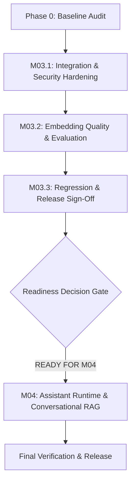

# Master Execution Plan: M03.1 → M03.2 → M03.3 → M04

**Project:** Multi-Tenant AI Platform-CaaS  
**Workspace:** `E:\MM Office\Multi-Tanant-CaaS`  
**Date:** 2026-11-07  

---

## Roadmap Overview

---

## Detailed Step-by-Step Plan

### Phase 1: Milestone 03.1 — Integration and Security Hardening
1. **Dimensionality Strategy Correction:**
   - Investigate `Vector(1536)` in `ChunkEmbedding`.
   - Implement isolated vector spaces / dimension validation in `ChunkEmbedding` and `PgVectorStore`.
   - In PostgreSQL pgvector, `Vector()` can be declared with dynamic dimensions or support explicit dimension spaces (`dim_384`, `dim_768`, `dim_1536`) to strictly prevent cross-dimension pollution.
   - Enforce pre-insertion and pre-search validation: raise clear `ValueError` if provider dimension does not match active space dimension.
2. **PostgreSQL FTS Verification & Hardening:**
   - Parameterized queries using `plainto_tsquery` / `websearch_to_tsquery`.
   - Explicit language dictionary (`english`).
   - GIN index definitions in migrations.
3. **Qdrant Vector Adapter Hardening:**
   - Verify payload filters (`tenant_id`, `knowledge_base_id`, `embedding_version`).
   - Ensure relational database authorization (`RetrievalAuthorizer`) remains authoritative and always post-validates candidate passages.
4. **Reindexing Lifecycle:**
   - Implement atomic version activation: keep version $N$ active while version $N+1$ generates, atomic switch once complete, rollback support.
5. **BYOK Credential Protection:**
   - Verify AES/Fernet encryption for provider keys, zero plaintext leakage in logs/responses.
6. **Deliverable:** `01_m03_1_integration_security.md`.

---

### Phase 2: Milestone 03.2 — Embedding Quality & Retrieval Evaluation
1. **Genuine Semantic Local Embedding Provider:**
   - Add `SentenceTransformerProvider` utilizing `sentence-transformers/all-MiniLM-L6-v2` (384 dimensions).
   - CPU-friendly, lazy-loaded on first inference, no forced auto-download during tests.
   - Retain `LocalFeatureProjectionProvider` as a deterministic test/baseline provider.
2. **Reproducible Evaluation Dataset:**
   - Create a localized evaluation corpus (6 documents across HR, IT, Legal, Engineering).
   - 25 ground-truth evaluation queries (direct keywords, semantic paraphrases, synonyms, cross-document queries, and unanswerable questions).
3. **Evaluation Runner & Metrics:**
   - Measure Recall@K, Precision@K, MRR, nDCG@K, Hit Rate@K, and Latency.
   - Compare: FTS vs. Semantic (`all-MiniLM-L6-v2`) vs. Hybrid RRF.
4. **Deliverable:** `02_m03_2_embedding_quality.md`.

---

### Phase 3: Milestone 03.3 — Regression, Documentation, and Release Sign-Off
1. **Comprehensive Regression:** Run backend Pytest, Ruff, ESLint, TypeScript check, Next.js production build.
2. **Documentation:** Update setup guides, operating modes, and PowerShell commands.
3. **Readiness Decision:** Formal gate evaluation (`READY FOR M04`).
4. **Deliverable:** `03_m03_3_release_signoff.md`.

---

### Phase 4: Milestone 04 — Assistant Runtime & Conversational RAG
1. **Data Model & Migrations:**
   - Models: `Assistant`, `AssistantKnowledgeBase`, `Conversation`, `Message`, `MessageCitation`.
   - Migration: `0004_assistants_and_conversations.py`.
2. **LLM Provider Gateway:**
   - BYOK-first architecture.
   - `OpenAILLMProvider` (supporting OmniRoute and direct OpenAI endpoints).
   - `MockLLMProvider` for fast, cost-free automated tests.
3. **Context Builder & Token Budgeting:**
   - Strict context window management, truncation of old history, injection of retrieved passages with `[1]` citation tags.
   - Prompt injection defense: treat document text as untrusted data.
4. **Conversational RAG Execution:**
   - Revalidate user's access to knowledge bases at execution time.
   - Hallucination mitigation instructions and explicit no-answer handling.
5. **Streaming Chat (SSE):**
   - Server-Sent Events endpoint with structured events (`message_start`, `token`, `citation`, `message_complete`, `message_error`).
6. **Frontend Chat & Assistants UI:**
   - Upgrade `/dashboard/assistants` with Assistant CRUD & Editor.
   - Interactive Chat UI with streaming messages, citation inspection drawer, and copy buttons.
7. **Comprehensive Tests:**
   - Unit tests, integration tests, security tests (cross-tenant, forged IDs, unauthorized KB access), and realistic end-to-end RAG flow.
8. **Deliverables:**
   - `04_m04_assistant_runtime.md`
   - `05_final_system_verification.md`
   - `05_final_summary.json`
