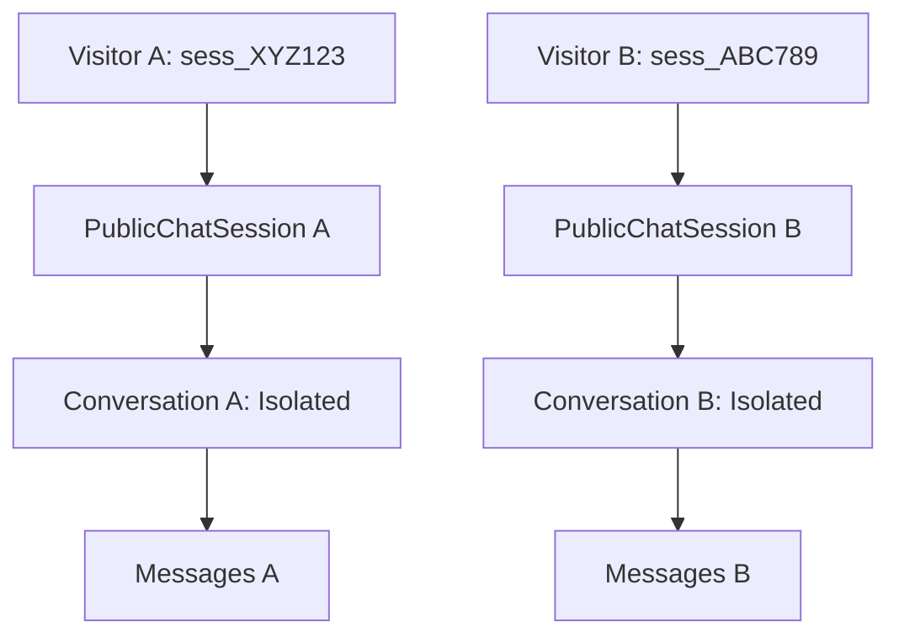

# M08 Security Closure: Anonymous Session Security & Isolation Audit

**Milestone:** M09 — Stage 1 (M08 Security Closure)  
**Component:** `backend/app/models/publishing.py` & `backend/app/api/v1/public_chat.py`  
**Auditor:** Application Security Engineer & Principal Architect  

---

## 1. Anonymous Session Security Architecture

Public and embedded assistant visitors do not hold human accounts in the `users` table. To enable multi-turn conversational context without requiring login, the platform issues ephemeral session tokens:

- **Format:** `sess_[24 urlsafe base64 characters]` (192 bits of cryptographic entropy).
- **Storage:** Client-side `localStorage` (`mmaip_pub_session_[publicId]`).
- **Server Persistence:** `public_chat_sessions` table with client IP hash, user-agent, and 7-day expiration.

---

## 2. Identified Defect: Non-Deterministic Conversation Resolution

### The Vulnerability
In the initial M08 implementation of `public_chat.py`:
```python
conv_stmt = (
    select(Conversation)
    .where(
        Conversation.tenant_id == pub.tenant_id,
        Conversation.assistant_id == asst.id,
        Conversation.user_id.is_(None),
    )
    .order_by(Conversation.created_at.desc())
    .limit(1)
)
```
Because the query selected the *most recent* conversation where `user_id is None`, two concurrent anonymous visitors chatting with the same published assistant would resolve to the same conversation ID. Visitor B's questions would enter Visitor A's context history, resulting in a **cross-visitor session collision**.

---

## 3. Hardened Remediation: 1:1 Session-to-Conversation Binding

### Database & Service Modification
1. Add `conversation_id: Mapped[Optional[uuid.UUID]]` to `PublicChatSession` referencing `conversations.id` (`ondelete="SET NULL"`).
2. Update `get_or_create_public_session` and `public_chat_stream`:
   - When a visitor connects with a `session_token`, look up `PublicChatSession`.
   - If `session_rec.conversation_id` exists and is valid, resume that conversation.
   - If no conversation is bound to the session, create a dedicated `Conversation(user_id=None)` and store its UUID in `session_rec.conversation_id`.



### Security Guarantees Achieved
- **Zero Cross-Visitor Interference:** Visitors cannot see or contaminate other visitors' message histories.
- **IDOR Protection:** Conversations with `user_id is None` are not accessible via `/api/v1/conversations/` (which requires authenticated user context).
- **Tenant Isolation:** All conversations remain strictly scoped by `tenant_id` and `assistant_id`.
