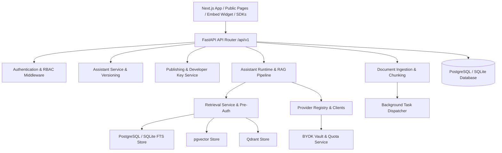

# M09 Preflight: Full-Platform Architecture Audit

**Project:** Multi-Tenant AI Assistant Platform (Chatbot-as-a-Service / CaaS)  
**Date:** November 10, 2026  
**Auditor:** Principal Software Architect  
**Milestone:** M09 — Preflight Architecture Audit  

---

## 1. Architectural Overview: Modular Monolith

The platform is designed as a **modular monolith** divided into distinct application domains within `backend/app/` and a modern Next.js App Router client in `frontend/app/`.

---

## 2. Backend Domain Deep-Dive

### 2.1. Authentication, Authorization & RBAC
- **Status:** **SOLID**.
- **Mechanisms:** Argon2id password hashing with salt; JWT Bearer tokens; `TenantContext` dependency enforces tenant membership validation on every scoped request.
- **Role Hierarchy:** System roles (`TENANT_OWNER`, `TENANT_ADMIN`, `TENANT_MEMBER`, `TENANT_VIEWER`) with fine-grained permission codes.
- **Finding:** Public endpoints correctly bypass tenant JWT authentication but must strictly validate publication status and origin permissions.

### 2.2. Assistant Runtime & Conversational RAG Pipeline
- **Status:** **HIGH EFFICIENCY**.
- **Execution:** Streaming SSE via `POST /api/v1/assistants/{id}/chat` and `POST /api/v1/public/assistants/{public_id}/chat`.
- **Context Construction:** 4-Tier Prompt Trust Hierarchy (System instructions $\rightarrow$ Grounded Knowledge Citations $\rightarrow$ Conversation History $\rightarrow$ User Message).
- **Public Filtering:** Dynamic query filters documents attached to active knowledge bases strictly by `access_level == 'PUBLIC'`.
- **Finding:** As discovered during code audit, if no public documents exist, `target_doc_ids` is `[]`. `fts_store.py` and `pgvector_store.py` handle this correctly by returning `[]`, but `qdrant_store.py` currently treats `[]` as empty and omits the filter condition.

### 2.3. Retrieval & Vector Store Adapters
- **Status:** **MULTI-STRATEGY HYBRID**.
- **Stores Supported:**
  1. `PostgresFTSStore`: Lexical search using PostgreSQL `ts_rank_cd` and SQLite FTS match.
  2. `PgVectorStore`: Semantic vector search using cosine distance `<=>`.
  3. `QdrantStore`: Distributed vector database with metadata filtering.
- **Hybrid Fusion:** Reciprocal Rank Fusion (RRF) with configurable constant $k=60$.
- **Finding:** The platform currently labels PostgreSQL full-text search as lexical ranking, which is mathematically distinct from Okapi BM25. Documentation and evaluation metrics must accurately reflect this distinction.

### 2.4. Provider Management, BYOK & Quota Tracking
- **Status:** **SECURE & LOCAL-FIRST**.
- **Key Vault:** Fernet symmetric encryption with environment-configured master secret keys. Plaintext keys are never logged or returned over API.
- **Quota Service:** Pre-invocation check against token thresholds.
- **Traffic Tracking:** M08 added `credential_source` (`SYSTEM_POOL` vs `TENANT_BYOK`) and `traffic_type` (`INTERNAL_APP`, `PUBLIC_CHAT`, `EMBED_WIDGET`, `DEVELOPER_API`).
- **Policy Finding:** Silent fallback from a failed/missing tenant BYOK key to platform-funded credentials is strictly prohibited. The system correctly halts with an actionable error.

### 2.5. Background Processing & Ingestion
- **Status:** **PARTIAL / NEEDS HARDENING (M09 TARGET)**.
- **Current Implementation:** Asynchronous processing of document uploads, OCR, and embedding generation uses in-process Python tasks via `asyncio.create_task` and status updates in `ingestion_jobs`.
- **Defect / Debt:** If the backend process crashes or restarts during document ingestion, in-flight jobs remain stuck in `RUNNING` or `PROCESSING` state without automatic recovery or dead-letter escalation. M09 Stage 5 must implement durable restart recovery.

---

## 3. Frontend Architecture

### 3.1. Structure & Tech Stack
- **Framework:** Next.js 16.0.7 (App Router), TypeScript, Tailwind CSS, Lucide icons.
- **Page Layouts:**
  - Authenticated Workspace: `/dashboard/*` (Assistants, Knowledge, Providers, Settings, Audit, Workspace).
  - Standalone Public Assistant: `/p/[publicId]` (Linear × Apple Notes, distraction-free).
  - Embed Widget View: `/embed/[publicId]` (Iframe container).
- **State & Data Fetching:** Clean separation between server wrappers and client interactive pages (`"use client"`). Wrapped in `<Suspense>` to eliminate SSR/prerender bailouts.
- **Finding:** Navigation between Assistant Overview, Knowledge attachments, Model settings, Testing, and Publishing is functional, but lacks a dedicated "AI Evaluation" tab.

---

## 4. Hardware & Resource Constraints Analysis

- **RAM Constraint:** Host machine has 8 GB total RAM, with ~550 MB free physical RAM during active development.
- **Architecture Implication:**
  - Cannot run heavy multi-worker Celery/Redis setups locally.
  - Cannot run local heavy 7B/13B parameter LLMs in-memory.
  - Must rely on lightweight CPU-based FastEmbed (`all-MiniLM-L6-v2`), SQLite/PostgreSQL durable background job tracking, single-worker test suites, and mock/lightweight local providers.
