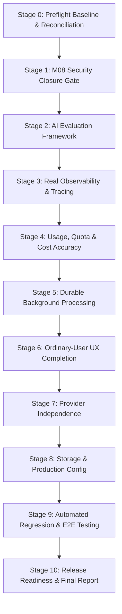

# M09 Preflight: Comprehensive Execution Plan & Quality Gates

**Project:** Multi-Tenant AI Assistant Platform (Chatbot-as-a-Service / CaaS)  
**Date:** November 10, 2026  
**Auditor:** Principal Software Architect & QA Lead  
**Milestone:** M09 — Quality, Security Closure, AI Evaluation & Production Readiness  

---

## 1. Milestone Objective & Core Principles

The objective of Milestone **M09** is **Platform Quality, Security Closure, AI Evaluation, Observability, Reliability, UX Completion, and Production Readiness**. Rather than creating an entirely new unrelated product or dashboard clutter, M09 consolidates, hardens, evaluates, and verifies the existing modular monolith.

### Guiding Principles
1. **Security Gate First:** Do not build new capabilities until the M08 security closure gate has passed.
2. **Deterministic & Free-First:** Evaluation and tests must function locally using deterministic mocks, CPU-only FastEmbed, and zero paid cloud spend.
3. **No Silent Paid Fallback:** Never fall back from a tenant's BYOK configuration to platform-funded credentials.
4. **Hardware-Aware:** Strictly honor the 8 GB RAM, CPU-only, Drive E: workspace constraints.
5. **Preserve Heritage:** M05 status remains `CONDITIONAL_PASS` with the 4 drills kept `DEFERRED — NOT RUN`.

---

## 2. Stage-by-Stage Execution Plan

### Stage Details & Deliverables

#### Stage 0: Repository & Architecture Reconciliation
- **Scope:** Audit repository HEAD, Alembic migration chain, memory and hardware profile, baseline capability matrix, and technical debt.
- **Artifacts:** `artifacts/evaluations/m09_preflight/` (7 documents).
- **Exit Condition:** Clean baseline verified and documented.

#### Stage 1: M08 Security Closure (Mandatory Release Gate)
- **Scope:**
  1. Upgrade public assistant ID generation to 128-bit entropy (`pub_[32 hex chars]`) with backward compatibility for 16-hex IDs.
  2. Fix Qdrant store filter bug when `document_ids == []`.
  3. Bind `public_chat_sessions` to deterministic `conversation_id` to prevent multi-visitor cross-talk.
  4. Ensure server-side liveness check halts active sessions upon publication deactivation.
  5. Add optional per-key assistant restriction and new granular scopes (`assistant:eval`, `knowledge:read`) in developer API keys.
  6. Verify iframe sandboxing, CSP frame-ancestors, and parent postMessage origin safety.
  7. Add automated SDK test verification scripts for TypeScript and Python SDKs.
- **Artifacts:** `artifacts/evaluations/m09_m08_security_closure/` (7 documents).
- **Exit Condition:** All critical security tests pass.

#### Stage 2: AI Evaluation Framework
- **Scope:**
  - Build modular evaluation module in `backend/app/evaluation/`.
  - Implement deterministic metric evaluators: Retrieval (Recall@K, MRR, nDCG@K, Hit Rate), Answer (Faithfulness, Groundedness, Completeness), Citation Presence & Coverage.
  - Create deterministic local test dataset in `backend/app/evaluation/datasets/` that runs offline without paid APIs.
  - Support optional BYOK LLM-as-judge with explicit user selection.
  - Implement Frontend Assistant Studio "Evaluation" tab to run evaluations and inspect individual question/answer/citation scores.
- **Exit Condition:** Deterministic local evaluation runs and displays verified scores in UI.

#### Stage 3: Real Observability & Tracing
- **Scope:**
  - Implement lightweight request lifecycle tracing in `backend/app/observability/`.
  - Capture request spans: Auth, Retrieval, Context assembly, Provider latency, First-token latency, SSE Streaming, Usage accounting.
  - Strictly redact sensitive credentials, API keys, and passwords before exporting telemetry.
  - Build lightweight Observability UI drill-down in Dashboard to inspect recent requests, latency breakdowns, and error categories.
- **Exit Condition:** Real requests produce structured traces viewable in the platform.

#### Stage 4: Usage, Quota & Cost Management
- **Scope:**
  - Distinguish provider-reported exact tokens vs estimated tokens.
  - Distinguish verified model pricing vs unknown pricing (never display fabricated costs).
  - Implement atomic pre-invocation quota reservation to prevent concurrent request race conditions.
  - Strictly enforce policy: NO silent fallback to platform-managed credentials upon BYOK failure.
- **Exit Condition:** Quotas cannot be bypassed by concurrent requests; billing policy verified.

#### Stage 5: Durable Background Processing & Recovery
- **Scope:**
  - Build durable job state machine in `backend/app/services/job_service.py` (`QUEUED`, `RUNNING`, `COMPLETED`, `FAILED`, `CANCELLED`, `RETRYING`).
  - Implement process startup recovery: scan for orphaned in-flight jobs, mark as `FAILED_INTERRUPTED` or retry.
  - Expose job cancellation and retry endpoints.
- **Exit Condition:** Backend restarts cleanly handle interrupted jobs without leaving orphaned records.

#### Stage 6: Complete Ordinary-User Product Experience
- **Scope:**
  - Validate 6 core personas: Student (exam prep), Teacher (tutor/MCQ), Company Admin (policy assistant), Customer Support Manager (public embed), Developer (SDK/API), Researcher (document analysis).
  - Add conversation management: Rename, Search, Delete, Stop generation, Copy response, and Retry.
  - Ensure Simple Mode exposes intuitive controls while Advanced Mode preserves expert settings.
- **Exit Condition:** Key personas complete end-to-end journeys cleanly.

#### Stage 7: Provider Independence & Model Reliability
- **Scope:**
  - Verify direct independent operation of OpenAI, Anthropic, Gemini, Groq, and local/mock providers without requiring OmniRoute.
  - Verify model catalog accuracy (context windows, streaming, vision, tool calling).
- **Exit Condition:** Direct providers operate independently without mandatory gateway dependencies.

#### Stage 8: Storage, Database & Production Configuration
- **Scope:**
  - Verify database migration upgrade safety and PostgreSQL compatibility.
  - Review production storage requirements (S3 adapter specification).
  - Provide sanitized `.env.example` with zero hardcoded secrets.
  - Enhance `/api/v1/health` with readiness and component-level health status.
- **Exit Condition:** Production configuration and readiness blueprints verified.

#### Stage 9: Automated Testing & Real End-to-End Verification
- **Scope:**
  - Run full backend regression suite (all unit, integration, and security tests).
  - Execute independent SDK test suites (TypeScript & Python).
  - Execute frontend TypeScript check and production build.
  - Run browser E2E walkthroughs where supported.
- **Exit Condition:** Zero test regressions; all verification results recorded with exact timestamps.

#### Stage 10: Release Readiness & Final Artifacts
- **Scope:**
  - Generate comprehensive reports in `artifacts/evaluations/m09_final/`.
  - Produce final release decision (PASS, CONDITIONAL_PASS, or FAIL).
- **Exit Condition:** Complete M09 release sign-off.
