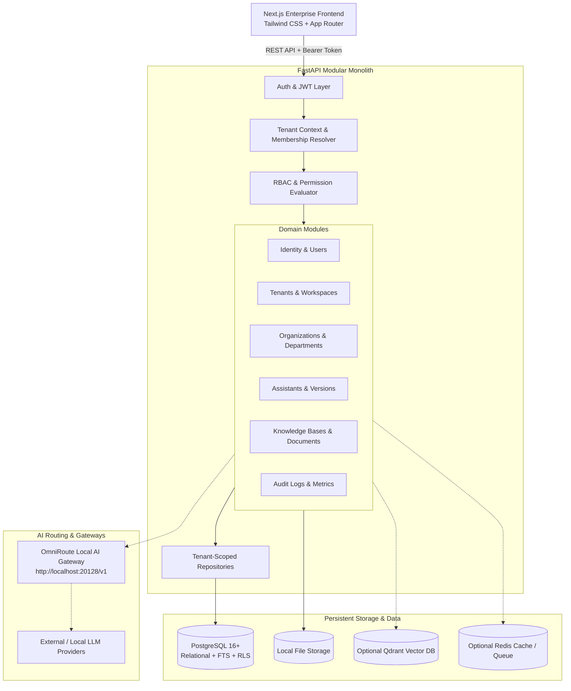

# MM AI Platform — System Architecture

## 1. Architectural Philosophy

The **MM AI Platform** is designed as a **Modular Monolith** prioritizing:
1. **Security-First Multi-Tenancy:** Hard tenant isolation at every layer (database constraints, repository filters, middleware validation, and RBAC).
2. **Local-First & Resource Efficient:** Designed to operate smoothly on resource-constrained development environments (~8GB RAM, no dedicated GPU) without sacrificing enterprise production-readiness.
3. **Pluggable & Provider-Agnostic Extensibility:** Clean abstractions for vector stores (pgvector, Qdrant), LLMs (OmniRoute Gateway, OpenAI-compatible APIs), embeddings, and document parsers/OCR (Badho OCR, local parsers).

---

## 2. High-Level Component Topology



---

## 3. Backend Module Hierarchy

The backend is partitioned into cleanly bounded domains inside `backend/app/`:

```text
backend/app/
├── api/v1/                 # HTTP Transport layer (routers, parameter validation)
│   ├── auth.py             # /api/v1/auth
│   ├── users.py            # /api/v1/users
│   ├── tenants.py          # /api/v1/tenants
│   ├── organizations.py    # /api/v1/organizations
│   ├── members.py          # /api/v1/members
│   ├── departments.py      # /api/v1/departments
│   ├── groups.py           # /api/v1/groups
│   ├── roles.py            # /api/v1/roles
│   ├── permissions.py      # /api/v1/permissions
│   ├── assistants.py       # /api/v1/assistants
│   ├── knowledge.py        # /api/v1/knowledge
│   └── audit.py            # /api/v1/audit
├── core/                   # Cross-cutting foundational utilities
│   ├── config.py           # Pydantic v2 BaseSettings
│   ├── security.py         # Argon2id hashing, JWT creation & verification
│   └── constants.py        # System roles, default permissions, error codes
├── database/               # Database connectivity & session handling
│   ├── base.py             # SQLAlchemy DeclarativeBase
│   └── session.py          # Async engine, sessionmaker, dependency injection
├── middleware/             # Request lifecycle middleware
│   ├── tenant_context.py   # Extracts and validates X-Tenant-ID header
│   └── error_handler.py    # Standardized API error responses
├── models/                 # SQLAlchemy 2.0 ORM entities
│   ├── user.py
│   ├── tenant.py
│   ├── membership.py
│   ├── organization.py
│   ├── department.py
│   ├── group.py
│   ├── role.py
│   ├── permission.py
│   ├── assistant.py
│   ├── knowledge.py
│   ├── config.py
│   ├── conversation.py
│   └── administration.py
├── schemas/                # Pydantic v2 DTOs (Request / Response validation)
└── repositories/           # Encapsulated data-access layer with tenant filtering
```

---

## 4. Tenancy & Identity Architecture

Every workspace is represented by a `Tenant` entity of type:
1. `INDIVIDUAL`: Personal sandbox workspace tied to a single user.
2. `ORGANIZATION`: Enterprise workspace supporting hierarchical departments, employee groups, role assignments, and team collaboration.

A user may belong to multiple tenants. When calling tenant-scoped APIs:
1. The client supplies the desired workspace ID via the `X-Tenant-ID` header (or route parameter).
2. The authentication layer resolves the user from the `Authorization: Bearer <JWT>` token.
3. The tenancy resolver queries `tenant_memberships` ensuring the user has an `ACTIVE` membership in that tenant.
4. The user's role and granular permissions in that specific tenant are attached to the request context.
5. All downstream repository queries are scoped strictly by `tenant_id`.

---

## 5. Extensibility Boundaries for Future Milestones

- **Vector Storage:** An abstract `VectorStoreRepository` interface allows switching between PostgreSQL (FTS / pgvector), Qdrant, or in-memory vectors without altering application business logic.
- **LLM Gateway:** Integrated via OmniRoute Gateway (`http://localhost:20128/v1`) using standard OpenAI client abstractions with dynamic model fallback (`model="auto"`).
- **Document Ingestion:** Future parsers (PDF, DOCX, TXT, CSV, PPTX, JSON, SQL, OCR) implement a standard `DocumentParser` interface producing normalized chunks for ingestion jobs.
