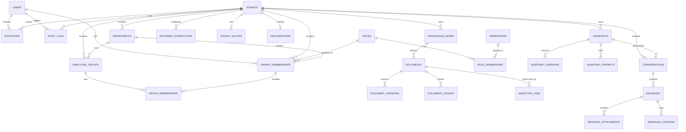

# MM AI Platform — Database Schema & Data Architecture

## 1. Overview & Principles

PostgreSQL is the single source of truth for the MM AI Platform. The relational database schema is designed according to these core principles:
1. **UUID Primary Keys:** All tables use standard UUIDv4 primary keys to prevent enumeration attacks and simplify distributed data migrations.
2. **UTC Timestamps:** All tables record `created_at` and `updated_at` in timezone-aware UTC (`TIMESTAMP WITH TIME ZONE`).
3. **Explicit Foreign Key Constraints:** Hard referential integrity enforced with `ON DELETE CASCADE` or `RESTRICT` as appropriate.
4. **Hard Tenant Scoping:** Every resource owned by a workspace carries an explicit `tenant_id` foreign key. Composite uniqueness constraints (e.g. `(tenant_id, name)`) prevent tenant naming collisions and cross-tenant leakage.
5. **No Blind JSONB Overuse:** Relational columns are used for all structured attributes, relationships, and queries. JSONB is reserved strictly for polymorphic provider settings, dynamic prompt metadata, and ingestion payloads.

---

## 2. Complete Entity-Relationship Diagram (ERD)



---

## 3. Entity Catalog by Domain

### 3.1 Identity & Tenancy
- **`users`**: Platform user accounts (email, hashed password, full name, status, verification flags, last login).
- **`tenants`**: Workspace container (`type` ENUM: `INDIVIDUAL`, `ORGANIZATION`; `name`, `slug`, `status`).
- **`organizations`**: Extended enterprise metadata for organization tenants (legal name, domain, tax ID, logo URL).
- **`tenant_memberships`**: Maps users to tenants with assigned role, department, title, and status (`ACTIVE`, `SUSPENDED`).
- **`invitations`**: Pending email invitations to join a tenant with token, expiration, and pre-assigned role.

### 3.2 Organization & Access Management
- **`departments`**: Organizational units within a tenant (e.g., HR, Finance, Engineering) scoped by `tenant_id`.
- **`employee_groups`**: Functional groups within an organization (e.g., "Full-Time Staff", "Audit Team").
- **`group_memberships`**: Many-to-many link between `employee_groups` and `tenant_memberships`.
- **`roles`**: System and tenant-level roles (`platform_superadmin`, `tenant_owner`, `org_admin`, `dept_admin`, `assistant_manager`, `knowledge_editor`, `employee`, `viewer`).
- **`permissions`**: Granular platform permissions (e.g. `tenant.read`, `member.invite`, `assistant.create`, `knowledge.upload`).
- **`role_permissions`**: Many-to-many junction mapping roles to permissions.
- **`resource_permissions`**: Optional direct object-level access override for specific resources.

### 3.3 Assistant Foundation
- **`assistants`**: AI Assistant definitions (name, description, tenant_id, default_llm_model, system_prompt, status).
- **`assistant_versions`**: Immutable version snapshots of assistant configuration for rollbacks.
- **`assistant_prompts`**: Context prompts, tone settings, and persona definitions.
- **`assistant_memberships`**: Access controls granting specific departments or groups access to assistants.

### 3.4 Knowledge & Document Foundation
- **`knowledge_bases`**: Grouping of indexed documents for specific departments or assistants.
- **`documents`**: Document metadata (file name, MIME type, storage path, size, hash, status).
- **`document_versions`**: Versioning for re-uploaded or modified documents.
- **`document_chunks`**: Segmented text chunks with token counts, chunk sequence, and vector references.
- **`ingestion_jobs`**: Asynchronous processing queue tracking parsing, OCR, chunking, and embedding stages.

### 3.5 AI & Retrieval Configuration
- **`provider_connections`**: Encrypted API provider configurations (OmniRoute, local Ollama, OpenAI-compatible).
- **`embedding_configs`**: Chunk dimensions, model name, and batching parameters.
- **`vector_store_configs`**: Connection details for PostgreSQL pgvector, Qdrant, or FTS.
- **`retrieval_configs`**: Hybrid search weights (keyword vs vector), top_k, reranking settings.

### 3.6 Conversations & Chat
- **`conversations`**: Chat sessions linking a user, assistant, and tenant.
- **`messages`**: Individual messages (role: user/assistant/system, content, token usage).
- **`message_attachments`**: Files uploaded during chat session.
- **`message_citations`**: Grounding citations linking generated assistant responses directly to document chunks.

### 3.7 Administration & Audit
- **`audit_logs`**: Tamper-evident ledger recording actor_id, tenant_id, action, resource_type, resource_id, IP address, and payload diff.
- **`usage_records`**: Metered LLM token consumption, storage utilization, and query counts.
- **`tenant_quotas`**: Hard limits on users, assistants, knowledge storage, and monthly token limits per tenant.

---

## 4. Indexing & Query Optimization Strategy

1. **Tenant Lookup:**
   - Index: `CREATE INDEX idx_tenant_memberships_user_tenant ON tenant_memberships(user_id, tenant_id);`
   - Index: `CREATE INDEX idx_tenant_memberships_tenant ON tenant_memberships(tenant_id);`
2. **Resource Scoping:**
   - Every tenant-owned table has a single-column or composite index on `tenant_id`:
   - `CREATE INDEX idx_departments_tenant ON departments(tenant_id);`
   - `CREATE INDEX idx_assistants_tenant ON assistants(tenant_id);`
   - `CREATE INDEX idx_knowledge_bases_tenant ON knowledge_bases(tenant_id);`
   - `CREATE INDEX idx_documents_kb_tenant ON documents(tenant_id, knowledge_base_id);`
3. **Audit Trail Scoping:**
   - `CREATE INDEX idx_audit_logs_tenant_created ON audit_logs(tenant_id, created_at DESC);`
4. **Natural Uniqueness:**
   - `CREATE UNIQUE INDEX uq_tenant_slug ON tenants(slug);`
   - `CREATE UNIQUE INDEX uq_department_tenant_name ON departments(tenant_id, name);`

---

## 5. PostgreSQL Row Level Security (RLS) Strategy

For enhanced defense-in-depth on PostgreSQL deployments:
```sql
-- Enable RLS on tenant tables
ALTER TABLE departments ENABLE ROW LEVEL SECURITY;
ALTER TABLE assistants ENABLE ROW LEVEL SECURITY;
ALTER TABLE knowledge_bases ENABLE ROW LEVEL SECURITY;

-- Set session tenant variable in application connection:
-- SET LOCAL app.current_tenant_id = 'tenant-uuid-here';

CREATE POLICY tenant_isolation_policy ON departments
    AS RESTRICTIVE
    FOR ALL
    USING (tenant_id = NULLIF(current_setting('app.current_tenant_id', true), '')::uuid);
```
Application repositories simultaneously enforce explicit `WHERE tenant_id = :tenant_id` on all queries to ensure isolation even before hitting database-level RLS policies.

---

## 6. Migration Strategy

- Migrations are managed through **Alembic** (`backend/alembic/`).
- **`0001_initial_core_schema.py`**: Establishes Identity, Tenancy, RBAC, Organizations, Departments, Employee Groups, and Audit tables, while establishing foundational schemas for Assistants and Knowledge Bases.
- **`0002_document_ingestion_engine.py`**: Adds Document Ingestion, Parsing, OCR, and Chunking tables:
  - `ingestion_configs`: Per-KB chunking strategies, chunk size, overlap, and OCR settings.
  - `documents`: Tenant-isolated document container tracking filenames, SHA-256 hashes, storage paths, status, pages, and chunks.
  - `document_versions`: Additive version history storing raw extracted text, structured section breakdowns, and extraction statistics.
  - `document_chunks`: Fine-grained extracted text chunks preserving chunk index, page number, heading paths, character/token counts, and cryptographic hashes.
  - `ingestion_jobs`: Ingestion job execution tracker recording state (`QUEUED`, `PROCESSING`, `OCR_REQUIRED`, `CHUNKING`, `COMPLETED`, `FAILED`, `CANCELLED`), progress, duration, and error classifications.
  - `ingestion_events`: Comprehensive audit event log recording timestamps and structured details for every pipeline step.
