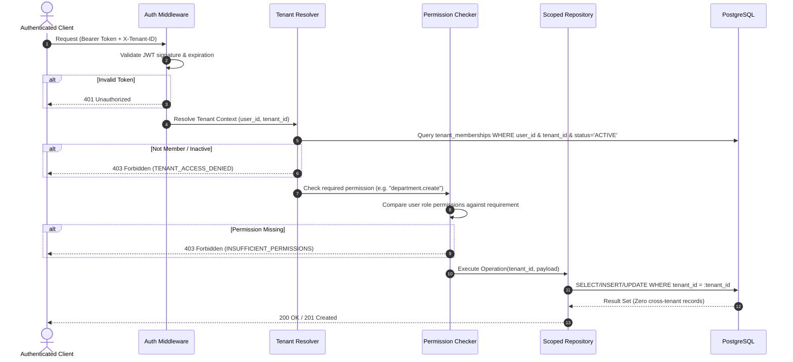

# MM AI Platform — Security Model & Authorization Architecture

## 1. Security Architecture Principles

The MM AI Platform enforces **Zero-Trust Multi-Tenancy**:
1. **No Implicit Trust:** No request, route parameter, or header is trusted until cryptographically authenticated and checked against tenant authorization.
2. **Provider-Agnostic Authentication:** Core identity logic is decoupled from external identity providers. Local credentials use **Argon2id** password hashing.
3. **Stateless JWT with Ephemeral Expiration:** Short-lived access tokens (15-60 minutes) coupled with refresh tokens.
4. **Defense in Depth:** Enforced simultaneously across:
   - Request HTTP middleware / dependency injection
   - Tenant membership resolution
   - Role-Based Access Control (RBAC) permission evaluation
   - Tenant-scoped repository queries (`WHERE tenant_id = :id`)
   - Database constraints (composite unique keys and foreign keys)
   - PostgreSQL Row Level Security (RLS) policies

---

## 2. Authentication Layer

### 2.1 Password Hashing: Argon2id
All passwords are hashed using **Argon2id** with industry standard work factors:
- Memory cost: 65,536 KiB (64 MiB)
- Time cost: 3 iterations
- Parallelism: 4 threads
- Salt length: 16 bytes
*(Bcrypt is supported as a fallback during migration scenarios, but Argon2id is the mandatory primary algorithm).*

### 2.2 Token Lifecycle
- **Access Tokens:** Signed with HMAC-SHA256 (`HS256`) containing `sub` (User UUID), `email`, and `exp`.
- **Active Workspace Token/Header:** The active tenant context is passed via `X-Tenant-ID`. The server validates that `(user_id, tenant_id)` exists in `tenant_memberships` and has `status = 'ACTIVE'`.

---

## 3. Role-Based Access Control (RBAC)

### 3.1 Initial System Roles

| Role Key | Name | Scope | Typical Assignment |
|---|---|---|---|
| `platform_superadmin` | Platform Superadmin | System | Global operations and infrastructure |
| `tenant_owner` | Tenant Owner | Tenant | Workspace creator, billing, full control |
| `org_admin` | Organization Admin | Tenant | Department management, employee provisioning |
| `dept_admin` | Department Admin | Department | Oversees specific department staff & resources |
| `assistant_manager` | Assistant Manager | Tenant | AI configuration, prompts, integrations |
| `knowledge_editor` | Knowledge Editor | Tenant | Document upload, curation, chunk inspection |
| `employee` | Standard Employee | Tenant | Standard conversational access, workspace member |
| `viewer` | Read-only Viewer | Tenant | Read-only inspection of permitted resources |

### 3.2 Granular Permissions Matrix

```text
-- Tenant Lifecycle
tenant.read
tenant.update
tenant.delete
tenant.billing

-- Member & Employee Management
member.invite
member.read
member.update
member.remove

-- Organization & Departments
department.create
department.read
department.update
department.delete

-- Assistant Management
assistant.create
assistant.read
assistant.update
assistant.delete
assistant.execute

-- Knowledge Base & Documents
knowledge.create
knowledge.read
knowledge.upload
knowledge.delete

-- Conversations & Chat
conversation.create
conversation.read
conversation.delete

-- Administration & Observability
audit.read
usage.read
```

---

## 4. Tenant Resolution & Authorization Flow



---

## 5. Defense Against Common Exploits

1. **Guessed UUIDs & IDOR Attacks:** Even if an attacker discovers a valid UUID of a department, assistant, or document in another tenant, queries execute with `WHERE id = :target_id AND tenant_id = :authenticated_tenant_id`. The database returns 0 rows, resulting in a safe `404 Not Found` without disclosing metadata.
2. **Forged Tenant Header:** Supplying `X-Tenant-ID: <Victim-Tenant-ID>` immediately triggers a membership check. If the caller does not have an active membership in that tenant, the request is rejected with `403 Forbidden`.
3. **Privilege Escalation:** Only users with `member.update` permission can change member roles, and an actor cannot grant permissions or roles higher than their own assigned role.
4. **Audit Immutability:** Audit log entries are insert-only. No application role possesses `UPDATE` or `DELETE` permissions on `audit_logs`.
