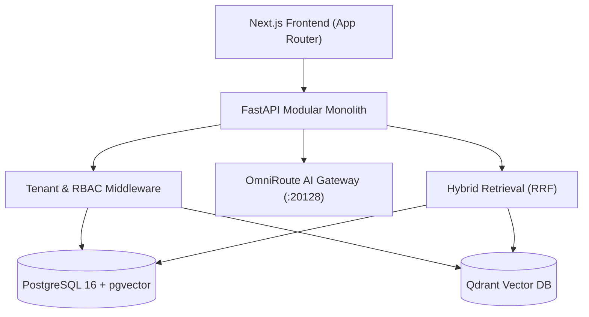

# 🧭 Multi-Tenant AI Platform — Obsidian Vault Dashboard

Welcome to the **Multi-Tenant AI Platform / CaaS** engineering knowledge base in Obsidian!

> [!TIP]
> **Obsidian Tip:** Press `Ctrl + G` to open the **Graph View** to see how all architectural components, security models, and runbooks connect to each other. Press `Ctrl + O` to quickly search and switch between notes.

---

## 🏛️ System Architecture & Design Hub

| Topic | Document Note | Description |
|---|---|---|
| **System Overview** | [[docs/ARCHITECTURE|System Architecture]] | Core modular monolith structure, ingestion, embeddings, and retrieval layers |
| **Security Architecture** | [[docs/SECURITY_MODEL|Security Model]] | Argon2id, AES/Fernet encryption, BYOK credential isolation, and RBAC |
| **Multi-Tenant Isolation** | [[docs/TENANT_ISOLATION|Tenant Isolation]] | Dual-mode tenancy, composite foreign keys, and query-scoping rules |
| **Architecture Decisions** | [[docs/ARCHITECTURE_DECISIONS|Architecture Decisions (ADRs)]] | Rationale for technology choices (PostgreSQL, Qdrant, OmniRoute, Next.js) |
| **Implementation Roadmap** | [[docs/IMPLEMENTATION_ROADMAP|Implementation Roadmap]] | Progression across Milestones M01 through M05+ |

---

## 💾 Data, Storage & Vector Infrastructure

- [[docs/DATABASE_SCHEMA|Database Schema & Models]]: Relational tables, composite constraints, and Alembic migrations.
- **PostgreSQL 16 + pgvector**: Native vector storage and full-text keyword indexing (`ts_rank_cd`).
- **Qdrant v1.9.0**: Standalone vector store with tenant payload filtering and dimension isolation.
- **Encryption Engine**: AES-GCM & Fernet encryption for BYOK credentials in `backend/app/core/crypto.py`.

---

## 🔌 API & Integration Specifications

- [[docs/API_SPECIFICATION|API Specification]]: Full REST endpoint contracts, authentication headers, and request/response payloads.
- [[docs/api/api-overview|API Architecture Overview]]: Overview of route modules, dependency injection, and Pydantic schemas.
- **OmniRoute Integration**: Default gateway pointing to `http://localhost:20128/v1` with dynamic model fallback (`model="auto"`).

---

## 🚀 Operational Runbooks & Deployment

All operational procedures for running, testing, and troubleshooting the platform:

- [[docs/runbooks/staging-deployment|Staging Deployment Guide]]: Controlled rollout to Render (backend) and Vercel (frontend).
- [[docs/runbooks/staging-readiness-checklist|Staging Readiness Checklist]]: Pre-flight gates and production parity validation.
- [[docs/runbooks/backup-and-recovery|Backup and Disaster Recovery Runbook]]: Paired PostgreSQL and file storage backup procedures.
- [[docs/runbooks/troubleshooting|Troubleshooting Guide]]: Common error remediation (ports, database locks, Qdrant sync).
- [[docs/runbooks/security-operations|Security Operations Runbook]]: Secret rotation, key management, and incident response.
- [[docs/runbooks/local-development|Local Development Guide]]: Environment variables, virtual environments, and Docker profiles.

---

## 📋 Milestone 05 Release Audits & Live Infrastructure

Key evidence and audit reports for Milestone 05 final release:

- [[artifacts/evaluations/m05_final_closure_20261108/handover_readiness_audit/00_handover_readiness_summary|Handover Readiness Summary]]: Final executive decision and snapshot verification.
- [[artifacts/evaluations/m05_final_closure_20261108/handover_readiness_audit/09_external_operator_runbook|External Linux Operator Runbook]]: Step-by-step copy-paste commands for live container testing.
- [[artifacts/evaluations/m05_final_closure_20261108/handover_readiness_audit/03_postgres_test_selection_audit|PostgreSQL Test Selection Audit]]: 12 live integration test node IDs.
- [[artifacts/evaluations/m05_final_closure_20261108/handover_readiness_audit/04_qdrant_test_selection_audit|Qdrant Test Selection Audit]]: 5 live Qdrant test node IDs.
- [[artifacts/evaluations/m05_final_closure_20261108/handover_readiness_audit/05_postgres_recovery_drill_audit|PostgreSQL Backup/Restore Drill Audit]]: Disaster recovery audit.
- [[artifacts/evaluations/m05_final_closure_20261108/handover_readiness_audit/06_qdrant_rebuild_drill_audit|Qdrant Application Rebuild Drill Audit]]: Vector collection rebuild audit.

---

## 🛠️ Developer Rules & Coding Standards

- [[AGENTS|Engineering & Agent Guidelines]]: Prime directives for multi-tenant isolation, OmniRoute integration, and security testing.
- [[README|Project Overview & Architecture]]: High-level overview, quick start, and directory structure.
- [[README_RUNNER|Portable Live Test Runner Guide]]: Standalone live test suite documentation.

---

## 🏷️ Recommended Note Tags

Organize and filter notes in the Obsidian Tag Pane:
- `#architecture` — Architectural design and module interactions
- `#security` — RBAC, tenant isolation, and cryptographic storage
- `#database` — Schemas, migrations, and query patterns
- `#vector` — pgvector and Qdrant vector-store adapters
- `#api` — REST endpoint specifications and schemas
- `#runbook` — Step-by-step operational workflows
- `#audit/m05` — Milestone 05 release readiness artifacts
