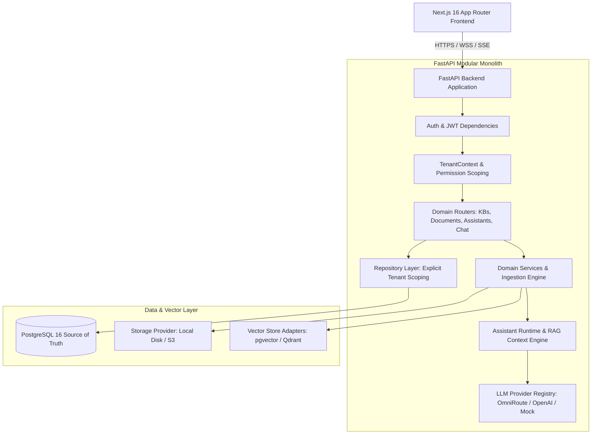

# MM AI Platform — System Architecture

**Status:** IMPLEMENTED AND VERIFIED  
**Version:** 1.0 (M05 Milestone Release)  
**Architecture Pattern:** Modular Monolith with Asynchronous Ingestion & Vector-Store Adapters

---

## 1. System Overview

The **MM AI Platform** (Conversational AI-as-a-Service / CaaS) is a secure, multi-tenant enterprise platform that allows organizations to create specialized AI assistants grounded in private knowledge bases. It features strict multi-tenant isolation, department-level ACLs, asynchronous document processing, hybrid retrieval (pgvector + PostgreSQL FTS + optional Qdrant), BYOK provider management, and PDF citation inspection with bounding box overlays.

---

## 2. High-Level Architecture Diagram

---

## 3. Core Backend Subsystems

1. **FastAPI Application & Middlewares (`backend/app/main.py`)**
   * Configures `CORSMiddleware` with dynamic regex support for Vercel preview environments (`^https://.*\.vercel\.app$`).
   * Provides health (`/health`) and readiness (`/ready`) endpoints.
   * Registers domain routers under `/api/v1/`.

2. **Tenant Context & Authorization (`backend/app/api/deps.py`)**
   * Authenticates user via JWT bearer token.
   * Resolves active workspace from `X-Tenant-ID` header.
   * Validates active tenant membership and assigns user role (`OWNER`, `ADMIN`, `MEMBER`, `VIEWER`).
   * Injects immutable `TenantContext` into all protected routes.

3. **Repository Layer & Tenant Isolation (`backend/app/repositories/`)**
   * Strictly scopes every query with `WHERE id = :id AND tenant_id = :active_tenant_id`.
   * Enforces composite foreign keys and unique constraints.

4. **Document Ingestion Engine (`backend/app/parsers/`, `backend/app/chunking/`)**
   * Magic-byte file validation (`filetype`).
   * Parsers: PyMuPDF (PDF), python-docx (DOCX), openpyxl (XLSX), python-pptx (PPTX), csv, json, sqlglot (SQL).
   * Chunking: Recursive character, markdown header, token-bounded, structured table, and slides.

5. **Vector Store Adapters (`backend/app/vectorstores/`)**
   * `PGVectorStore`: Stores vector embeddings in PostgreSQL `chunk_embeddings` with cosine similarity (`<=>`) and dimension isolation.
   * `FTSStore`: Lexical search using PostgreSQL `tsvector` and `ts_rank_cd`.
   * `QdrantVectorStore`: Remote vector store with isolated collections per dimension (`mmaip_chunks_384d`, `mmaip_chunks_1536d`).

6. **Assistant Runtime & Conversational RAG (`backend/app/assistant_runtime/`)**
   * `build_rag_context`: Token budgeting, older history pruning, and prompt boundary framing.
   * Neutralizes prompt injection (`<KNOWLEDGE_BASE_CONTEXT>`) and strips fake instruction headers.
   * Emits Server-Sent Events (SSE): `message_start`, `retrieval_complete`, `token`, `usage`, `message_complete`.
   * Computes standard PDF viewport bounding box coordinates ($612 \times 792$ pt) with slot distribution.

---

## 4. Frontend Subsystems (`frontend/`)

1. **App Router Structure (`frontend/app/`)**
   * Next.js 16.4.5 with Turbopack and React 19.
   * Dynamic routes: `/dashboard/assistants`, `/dashboard/knowledge`, `/dashboard/departments`, `/dashboard/employees`, `/dashboard/settings`.
2. **API Client (`frontend/lib/api.ts`)**
   * Injects JWT token and active `X-Tenant-ID` header into all HTTP requests.
   * Implements robust SSE streaming reader (`streamChatMessage`).
3. **Interactive PDF Citation Inspector**
   * Parses inline citations `[1]` into clickable emerald interactive chips.
   * Full-screen drawer with simulated document canvas, glowing bounding box overlay, tabs, carousel, and copy actions.
