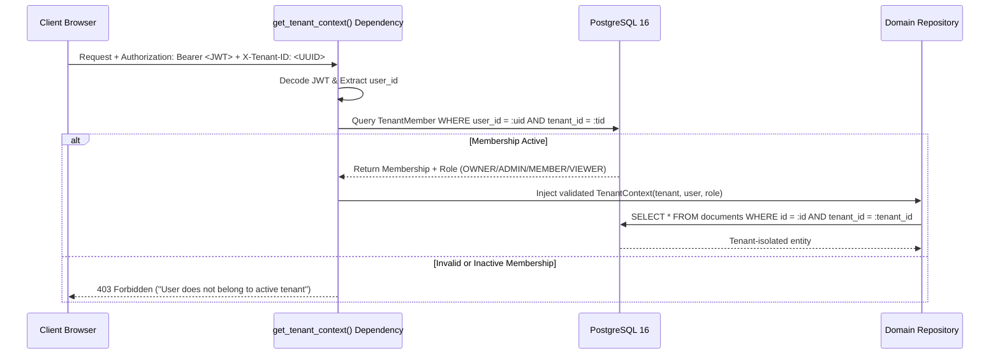

# Tenant Isolation & Authorization Architecture

**Status:** IMPLEMENTED AND VERIFIED  
**Enforcement Boundary:** Multi-Layered (Dependency Layer $\rightarrow$ Service/Repository Layer $\rightarrow$ Database Constraints)

---

## 1. Prime Directive

1. **Never trust client-supplied tenant IDs:** The authenticated user's active membership in the target tenant is verified on every request.
2. **Explicit query scoping:** Application code explicitly scopes all database queries with `tenant_id = :active_tenant_id`.
3. **No cross-tenant referencing:** Resources (assistants, knowledge bases, documents, chunks, conversations) strictly belong to exactly one tenant.

---

## 2. Tenant Context Resolution Flow

---

## 3. Defense-in-Depth Isolation Layers

### Layer 1: API Dependency Injection (`app/api/deps.py`)
* `require_permission(permission_name)`: Enforces RBAC permissions on endpoints.
* Header validation rejects forged `X-Tenant-ID` headers (403) and path-to-header tenant mismatches (403).

### Layer 2: Repository Scoping (`app/repositories/`)
* Every repository subclass requires `tenant_id` at initialization: `DocumentRepository(session, tenant_id)`.
* Lookups against another tenant's entity ID return `404 Not Found`, preventing tenant enumeration attacks.

### Layer 3: Relational Retrieval Authorization (`app/retrieval/authorization.py`)
* When vector stores return search candidate chunk IDs, the authorizer verifies that:
  1. The chunk belongs to the user's active `tenant_id`.
  2. The parent document is not deleted (`status != DELETED`).
  3. The document's `department_id` matches the user's department or is public to the workspace.

### Layer 4: Storage Containment (`app/storage/local.py`)
* Raw uploaded files are stored under `{STORAGE_PATH}/tenants/{tenant_id}/`.
* Path traversal attempts containing `../` or absolute path breakouts are caught by `_resolve_tenant_path` and raise `PermissionError`.
