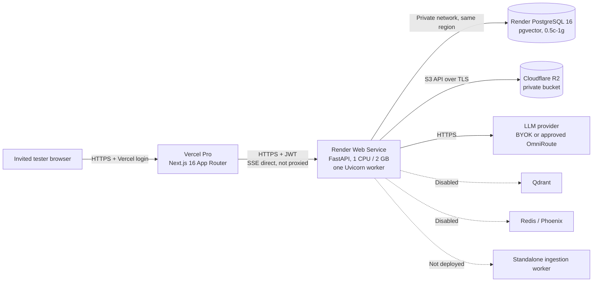

# M11 Private Staging Deployment Plan

| Field | Value |
|---|---|
| Milestone | M11 - private staging readiness |
| Document | Deployment plan for a closed, synthetic-data private staging environment |
| Repository | `E:\MM Office\Multi-Tanant-CaaS` |
| Date | 2026-11-12 |
| Status | **PLAN ONLY - NOT EXECUTED** |
| Baseline | `HEAD` = `fdb1246`; the working tree contains uncommitted M11 changes |
| Change boundary | No account, billing, cloud resource, deployment, migration, upload, or Git mutation was performed. |
| Readiness | **Real documents: NO-GO** (M11 Stage 8). Synthetic-data cohort only after the gates in this plan. |

> This plan describes the exact sequence for a private staging environment. Provider facts and prices are the Stage 1 values verified on 2026-11-12; they were not re-fetched for this document. Anything that requires a live account is marked **UNVERIFIED** until executed. The plan does not create accounts or spend money.

---

## 0. Preconditions and current state

| Item | Current state | Consequence |
|---|---|---|
| Live staging environment | **None.** No Vercel, Render, Cloudflare, or database resource exists for this effort. | Every step below is prospective. |
| Repository baseline | `HEAD` = `fdb1246`; M11 remediations are in the working tree and uncommitted. | A deployment must use a reviewed release commit/tag that includes those changes. This plan does not commit them. |
| `render.yaml` | Present but not deployable as-is for this topology (legacy database plan, 512 MB web plan, two workers, `/health`). | Apply the corrections in Section 3 as a separate approved change. |
| Backend lockfiles | `backend/requirements.lock` and `requirements-dev.lock` exist in the working tree; Docker and Render build commands use the lock. | Include them in the release; otherwise the build is not reproducible. |
| Manual UI acceptance | **PENDING** (Stage 10; 18 areas / 82 sub-checks). | Complete or explicitly waive for a synthetic cohort before testers. |
| Real-document gate | **`STAGING_READY = NO`** (Stage 8). | Real documents are prohibited until P0-1 through P0-8 close and a live restore drill passes. |
| Provider spend | **Not approved.** | Vercel/Render/Cloudflare/LLM accounts and plans require explicit user approval. |
| Backend private access | **None.** Render web service is public. | Vercel Deployment Protection protects the frontend only; the API must be treated as internet-facing. |

**Plan verdict:** GO for a closed synthetic-data staging cohort only after the user makes the decisions in Section 9 and every GO condition in Section 10 passes. **NO-GO** for real documents, public publishing, or an open registration URL.

---

## 1. Recommended topology

The topology is the Stage 1 recommendation:

- **Frontend:** Vercel Pro, Next.js 16 App Router, `frontend/` root.
- **Frontend private access:** Vercel Authentication, All Deployments, free Viewer seats for testers.
- **Backend:** Render Web Service, Python 3.12, `1c-2g` (1 CPU / 2 GB), one Uvicorn worker, region Oregon.
- **Database:** Render PostgreSQL 16, `0.5c-1g` (1 GB RAM, 15 GB default disk, 100 connections), internal connection string.
- **Migrations:** Render `preDeployCommand: alembic upgrade head`.
- **Object storage:** Cloudflare R2, private bucket, S3 API, backend-proxied reads/writes.
- **Retrieval:** PostgreSQL pgvector + FTS hybrid, 384-dimensional `all-MiniLM-L6-v2`.
- **Disabled:** Qdrant, Redis, Phoenix, standalone ingestion worker.
- **Domain:** generated `*.vercel.app` / `*.onrender.com`; no purchase in this plan.



**SSE path:** the browser calls Render directly. Do not proxy the stream through a Next.js route or Vercel Function; that would subject it to a proxy/function duration and buffering. Render permits HTTP responses up to 100 minutes (Stage 1 [R12]), but deploys still terminate streams at shutdown.

**Backend exposure:** the Render URL is public. Vercel Deployment Protection does not protect it. The security profile relies on application JWT/tenant isolation, disabled registration, rate limits, CORS, and no public publishing. If the user requires a network-private API, that is a separate approved design (for example an edge access proxy) and is **not** included here.

---

## 2. LOCAL DEV / PRIVATE STAGING / PRODUCTION separation

| Concern | LOCAL DEV | PRIVATE STAGING | PRODUCTION |
|---|---|---|---|
| `ENVIRONMENT` | `development` | `staging` | `production` |
| `DEBUG` | `true` (default) | `false` | `false` |
| Access | localhost / LAN | Vercel Authentication + invite-only app | Not approved by M11; requires separate review |
| `ALLOW_PUBLIC_REGISTRATION` | `true` unless overridden | `false` | `false` |
| Frontend | `npm run dev` / compose | Vercel Pro | Not part of this plan |
| Backend | `uvicorn` / compose | Render `1c-2g`, one worker | Not part of this plan |
| Storage | `local` (`STORAGE_PATH`) | `s3` (R2 private) | `s3`; must be validated |
| CORS | localhost defaults; LAN regex only with explicit opt-in | Exact HTTPS frontend origin; no localhost/LAN/wildcard | Exact HTTPS origins; fail-closed |
| Database | SQLite or local PostgreSQL | Render PostgreSQL 16 `0.5c-1g` | Managed PostgreSQL with formal backup/PITR |
| Retrieval | pgvector/FTS/mock | pgvector + FTS, 384-dim local embeddings | Only with measured capacity and backup |
| Optional services | Compose profiles (`workers`, `vector`, `redis`, `observability`, `full`) | Disabled | Only with a measured need and review |
| Ingestor | In-process or compose worker | In-process dispatcher, one process | Not approved; requires shared claim/lease review |
| Public publishing | Allowed for development testing | **Operationally disabled** | Requires public-product/security approval |
| Data class | Synthetic/test | **Synthetic only until Stage 8 P0 closure** | Real data only after approval |
| Migrations | `create_all` / local Alembic | `preDeployCommand: alembic upgrade head`, verify `0010` | Controlled, expand/contract; no destructive down-migrations |
| Backups | None | PITR + logical dump + daily object inventory (planned; not configured) | Formal policy, tested restore, key escrow |
| Status | Local only | **Conditional GO for synthetic cohort** | **NOT APPROVED** |

`docker-compose.yml` is a development stack (`ENVIRONMENT=development`, `DEBUG=true`, local storage, localhost ports). Do not use it as staging. The `m05-*` compose files are disposable test infrastructure, not staging.

---

## 3. Required corrections before the first deploy

### 3.1 Release and change control

1. Freeze the deployment scope.
2. Review the working-tree diff, including the M11 source files, tests, lockfiles, Dockerfile, and documentation.
3. Create a release commit and tag **only with explicit user approval**. This plan does not perform Git mutations.
4. Deploy that exact commit/tag. Do not deploy an uncommitted working tree or a moving branch.
5. Record the commit SHA, lockfile SHA-256 values, and the Render/Vercel deployment IDs in the staging evidence file.

### 3.2 `render.yaml` corrections

The current blueprint is a starting point, not the staging topology. Apply these corrections in a separate approved change:

| # | Current | Required | Reason |
|---:|---|---|---|
| 1 | Web `plan: starter` (0.5 CPU / 512 MB) | `plan: 1c-2g` (1 CPU / 2 GB) | 512 MB is too tight for PDF/DOCX parsing, 50 MB uploads, embeddings, and SSE. |
| 2 | Database `plan: starter` (legacy) | `plan: 0.5c-1g`; legacy types are not available for new databases | The legacy plan can fail or require manual selection. |
| 3 | `startCommand: ... --workers 2` | `--workers 1` | In-process ingestion and startup recovery assume one API OS process; two workers also double per-process rate limits. |
| 4 | `healthCheckPath: /health` | `/ready` | `/health` is process-only; `/ready` checks PostgreSQL. |
| 5 | No shutdown grace | `maxShutdownDelaySeconds: 120` | Reduce deploy-time SSE cuts; Render default is 30 s, max 300 s. |
| 6 | `autoDeploy: true` | `false` until smoke tests pass | Prevent an unreviewed deploy during bring-up. |
| 7 | No instance count | `numInstances: 1` | Protect the connection budget and single-process assumptions. |
| 8 | `FRONTEND_URL` has both `sync: false` and a literal `value` | Use one mechanism with the actual Vercel production hostname | The ambiguous blueprint can resolve to a stale or missing origin and break CORS. |
| 9 | `CORS_ORIGIN_REGEX` defaults to a Vercel prefix pattern | Empty, or a narrow regex for the exact project | Avoid admitting other hostnames that match the prefix pattern (for example, preview deployments not intended to call the API). |
| 10 | `ENVIRONMENT=staging` with the storage guard only for `production` | Explicit `STORAGE_BACKEND=s3` plus startup verification | Staging + `local` currently passes validation. |
| 11 | `SECRET_ENCRYPTION_KEY: generateValue: true` | Explicit externally generated secret, escrowed before first use | Render-generated values are not an escrow; losing the key makes BYOK data unrecoverable. |
| 12 | No rate-limit/trusted-proxy env vars | Add `TRUSTED_PROXY_IPS` and `RATE_LIMIT_*` | Make the staging values explicit rather than relying on code defaults. |
| 13 | No explicit optional-service settings | Add `QDRANT_URL=""`, `QDRANT_API_KEY=""`, `REDIS_URL=""`, `PHOENIX_ENABLED=false` | Prevent accidental use of localhost defaults. |
| 14 | No explicit ingestion settings | Add `INGESTION_INLINE_DISPATCHER_ENABLED=true`, poll 2, lease 3600, concurrency 1 | Document the single-process operating envelope. |
| 15 | `S3_REGION_NAME: us-east-1` | `auto` (optional; R2 aliases `us-east-1`) | Document the actual R2 region. |
| 16 | `STORAGE_PATH: /app/data/storage` remains | Remove or leave explicitly unused | It invites accidental local use. |
| 17 | Python version implied | Pin Python 3.12 | Reproducible builds. |
| 18 | Database disk size not explicit | `diskSizeGB: 15` or confirm the default | Make the storage assumption explicit. |

Do not put secret values in `render.yaml`. The blueprint may reference secret env vars with `sync: false`, but the values must be entered in the Render dashboard.

### 3.3 Lockfile and Docker build

- `backend/requirements.lock` must be part of the release.
- The backend build should install the hashed lock before copying application source, then install the local package with `--no-deps`.
- The current `infrastructure/docker/backend.Dockerfile` already follows this pattern in the working tree.
- The frontend is deployed through Vercel, not the development `frontend.Dockerfile` (`npm run dev`). Do not use the frontend Dockerfile for staging.

---

## 4. Exact deployment sequence

### Phase 0 - User approvals and freeze

1. Approve the decisions in Section 9, especially spend, testers, data classification, provider/gateway, region, and the real-document gate.
2. Confirm that the staging environment is for **synthetic data only** unless Stage 8 P0 closure is separately approved.
3. Freeze the release scope and record the commit/tag.
4. Nominate owners: deployment owner, backup owner, security owner, and the person who can approve rollback.

**Exit criteria:** written approval recorded; no unresolved decision blocks Phase 1.

### Phase 1 - Provision accounts (external; requires user approval)

No account is created by this plan. The user or an authorized operator must:

1. Create/upgrade the **Vercel Pro** team ($20/month). Enable MFA. Record the team owner.
2. Create the **Render** workspace and add a payment method for the paid web service and PostgreSQL. Enable MFA and billing alerts.
3. Create the **Cloudflare** account for R2 (free tier). Enable MFA. Record the account owner.
4. Create or select the **LLM provider/BYOK** account, or confirm that no platform-funded gateway will be used. Set a provider spend cap.
5. Optional: register a domain. The recommended Stage 1 default is no custom domain.
6. Create a password-manager entry for the deployment secrets and a separate escrow entry for `SECRET_ENCRYPTION_KEY`.

**Exit criteria:** accounts exist, MFA is on, billing alerts are set, and the user has approved the monthly cap. Do not invite testers yet.

### Phase 2 - Create PostgreSQL and R2

1. In Render, create a PostgreSQL 16 database:
   - Plan `0.5c-1g` (1 GB RAM, 15 GB default disk, 100 connections).
   - Region Oregon, same as the backend.
   - Name `mmaip-postgres` (or an approved equivalent).
2. Record both the **internal** and **external** connection strings. Use the internal string for the backend and migrations.
3. Confirm the actual PITR window and restore semantics in the Render dashboard. Stage 1 records **3 days on a Hobby workspace, 7 days on Pro**; confirm the workspace tier. This is **UNVERIFIED** until seen live.
4. Confirm pgvector support. Migration `0003` runs `CREATE EXTENSION IF NOT EXISTS vector`; verify the extension after migrations.
5. In Cloudflare R2, create a private bucket, for example `mmaip-staging-<unique-suffix>`.
   - Disable public access and do not attach a public R2.dev URL or custom domain.
   - Create an API token scoped to **Object Read & Write** for this bucket only.
   - Record the S3 endpoint `https://<ACCOUNT_ID>.r2.cloudflarestorage.com`, the access key ID, and the secret in the secret manager.
6. Do **not** create Qdrant, Redis, Phoenix, or a standalone worker.

**Exit criteria:** database and bucket exist; credentials are stored; no public bucket access; no optional service exists.

### Phase 3 - Set environment variables and secrets

1. Generate secrets outside the repository:
   ```text
   SECRET_KEY       = python -c "import secrets; print(secrets.token_hex(32))"
   JWT_SECRET       = a different 32-byte hex value
   SECRET_ENCRYPTION_KEY = python -c "from cryptography.fernet import Fernet; print(Fernet.generate_key().decode())"
   ```
2. Store the generated values in the Render secret environment and in the external secrets manager. Never commit them.
3. Escrow `SECRET_ENCRYPTION_KEY` and any future `PREVIOUS_SECRET_KEYS` with dual control. Record a SHA-256 fingerprint of the derived key, never the key itself.
4. Set the backend variables from the security profile, including:
   - `ENVIRONMENT=staging`, `DEBUG=false`, `ALLOW_PUBLIC_REGISTRATION=false`.
   - `FRONTEND_URL=https://<vercel-production-host>`, `BACKEND_URL=https://<render-host>`.
   - `ALLOWED_ORIGINS=""`, `ALLOW_DEV_LAN_ORIGINS=false`, `CORS_ORIGIN_REGEX=""`.
   - `TRUSTED_PROXY_IPS=""` until measured.
   - `DATABASE_URL` / `DATABASE_SYNC_URL` from the Render internal connection string.
   - `STORAGE_BACKEND=s3` plus the R2 bucket, endpoint, key, secret, and `S3_REGION_NAME=auto`.
   - `DEFAULT_VECTOR_STORE=pgvector`, `DEFAULT_RETRIEVAL_MODE=hybrid`, local embedding provider/model/dimensions.
   - `INGESTION_INLINE_DISPATCHER_ENABLED=true`, poll 2, lease 3600, concurrency 1.
   - `QDRANT_URL=""`, `QDRANT_API_KEY=""`, `REDIS_URL=""`, `PHOENIX_ENABLED=false`.
   - `LLM_BASE_URL` to the approved endpoint; leave platform-funded keys empty unless approved.
5. Do not use Render `generateValue` for the encryption key. Generate it externally so it can be escrowed.
6. Verify no secret appears in `render.yaml`, the repository, build logs, or the deployment plan.

**Exit criteria:** secret inventory is complete; the encryption key is escrowed; the backend env is ready.

### Phase 4 - Deploy the backend and run migrations

1. Apply the `render.yaml` corrections in Section 3.2 (separate approved change).
2. Create the Render web service from the blueprint or manually:
   - Python 3.12, region Oregon, plan `1c-2g`.
   - Root directory `backend`.
   - Build command uses `requirements.lock`.
   - Start command uses **one** Uvicorn worker.
   - Health check `/ready`.
   - `autoDeploy: false` for the first bring-up.
   - `maxShutdownDelaySeconds: 120`; `numInstances: 1`.
3. Set `preDeployCommand: alembic upgrade head`. It runs automatically before the new version receives traffic.
4. Deploy. The pre-deploy command:
   - Runs in a separate instance with a 30-minute limit.
   - Uses `DATABASE_SYNC_URL`.
   - Must reach `0010_m10_remediation_schema_alignment`.
   - Is transactional for PostgreSQL DDL; a failure should not promote the release.
5. Do **not** run `alembic upgrade head` manually in parallel with the pre-deploy. Run it once via `preDeployCommand`; only run a read-only `alembic current` in a shell if verification is needed.
6. Verify after deploy:
   - Render logs show the pre-deploy command succeeded.
   - `SELECT version_num FROM alembic_version;` returns `0010_m10_remediation_schema_alignment`.
   - `SELECT extname FROM pg_extension WHERE extname='vector';` returns `vector`.
   - 46 application tables (plus `alembic_version`), 98 FKs, 119 `ix_%` indexes (Stage 2 expected inventory).
   - Boolean defaults on `eval_datasets.is_system`, `eval_dataset_items.is_unanswerable`, and `eval_dataset_items.is_adversarial` are `false`.
   - Startup logs show the inline dispatcher started with concurrency 1 and lease 3600.
   - The app did not fall back to local storage.

**Exit criteria:** migration head verified, pgvector present, service healthy, one process, no startup storage/CORS error.

### Phase 5 - Verify backend health and security basics

Run from an approved workstation. Replace placeholders; do not paste tokens into tickets.

```text
GET  https://<backend>/health   -> 200 {"status":"healthy",...}
GET  https://<backend>/ready    -> 200 {"status":"ready","database":"connected",...}
POST https://<backend>/api/v1/auth/register -> 403 (public registration disabled)
GET  https://<backend>/api/v1/auth/me       -> 401 without a token
```

Additional checks:

- CORS preflight from the exact frontend origin returns 200 with `access-control-allow-origin`; an unlisted origin is rejected.
- CORS preflight from `http://localhost:3000` is rejected (`build_cors_policy` treats staging as non-development).
- The backend URL exposes `/docs`, `/redoc`, and `/openapi.json` unless blocked at the edge. Record the decision.
- Upload a small **synthetic** TXT/PDF through the app. Confirm:
  - The document and ingestion job are created.
  - The job reaches `COMPLETED`.
  - The object appears in R2 under the expected tenant prefix.
  - The actual key layout is recorded. The code applies `{tenant_id}/{relative_key}` on top of a key that already starts with `tenants/{tenant_id}/`, so the observed key may be `{tenant_id}/tenants/{tenant_id}/...`. Verify live; do not assume.
  - No file exists under a local `STORAGE_PATH` on Render.
- Query the database connection count during a small concurrent chat/upload test; keep it below 100.
- Confirm no PUBLIC assistant exists and public metadata returns 404 for unknown/private IDs.

**Exit criteria:** health/ready pass; registration 403; unauthenticated API 401; CORS exact; synthetic upload/ingestion passes; R2 key recorded; no local storage.

### Phase 6 - Deploy the frontend and enable private access

1. Import `frontend/` into the Vercel Pro project. Record the production hostname.
2. Set the frontend environment variable:
   - Preferred: `NEXT_PUBLIC_API_BASE_URL=https://<backend-host>`
   - Accepted fallback: `NEXT_PUBLIC_API_URL=https://<backend-host>`
   - Do **not** append `/api/v1`; `frontend/lib/api.ts` appends it. `NEXT_PUBLIC_*` values are build-time public configuration, so set them before the deployment that will serve testers.
3. Deploy the frontend. Environment-variable changes apply on the next deployment.
4. Enable **Deployment Protection -> Vercel Authentication -> All Deployments** before sharing any URL.
5. Add testers as **Viewer** seats only after approval. Viewer seats are free on Pro. Do not add external testers to a Hobby account; Hobby is limited to one external user and one shareable link and is non-commercial.
6. Verify:
   - A logged-out browser is redirected to the Vercel login.
   - An invited Viewer can reach the app.
   - A non-invited Vercel user cannot.
   - The frontend calls the Render backend directly; there is no Next.js API/SSE proxy.
7. Do not use Vercel Password Protection as the primary control unless the user approves the additional $20/month per protected project. It is a shared password, not per-user access.

**Exit criteria:** frontend loads behind Vercel Authentication; Viewer access works; API base URL is correct; no `/api/v1` duplication.

### Phase 7 - Verify CORS and SSE end to end

1. CORS:
   - Preflight from `https://<frontend-host>` to `/health` or a real API path returns 200 and the correct `access-control-allow-origin`.
   - Preflight from an unlisted origin is rejected.
   - Preflight from `http://localhost:3000` is rejected. Do not add LAN or `https://localhost` origins: the current policy only auto-rejects `http://localhost` and `http://127.0.0.1`, so an explicitly listed LAN origin would be accepted.
   - Login and an authenticated API call work from the deployed frontend.
2. SSE:
   - Log in as the staging owner, create a conversation, and send a prompt.
   - First token arrives without waiting for the full response.
   - A response longer than 60 seconds streams continuously and is not buffered.
   - A client disconnect does not crash the worker.
   - Schedule a deploy during an idle period; confirm `/ready` returns after deploy and the in-flight stream either finishes within the 120-second shutdown grace or fails cleanly and is retryable.
3. Known SSE gaps:
   - The current endpoints do not send periodic `: keepalive` comments. Stage 1 recommends a ~15-second keepalive. If tokens stall or the proxy idles the connection, stop and implement keepalive in a separate approved change.
   - Render warns that compression can buffer SSE. The app does not add GZip, but edge compression is **UNVERIFIED**; measure token arrival timing.
   - There is no resumable stream; a dropped connection may duplicate a user message. Accept or fix before testers.

**Exit criteria:** CORS exact, SSE first-token and >60 s streaming pass, deploy behavior understood, no buffering observed.

### Phase 8 - Invite-only onboarding

1. Add each approved tester to the Vercel team as a Viewer seat. Record the invitation/acceptance.
2. Bootstrap the first application owner. Choose one method and record it:
   - **Option A - short registration window (riskier; only with explicit approval):** temporarily set `ALLOW_PUBLIC_REGISTRATION=true`, deploy, create the owner and one staging tenant, then set `false` and redeploy immediately. Restrict the window to a maintenance period, keep the Vercel gate on, and record any accounts created.
   - **Option B - reviewed bootstrap command (preferred):** run a small, approved operator script in the Render shell that creates the owner, tenant, and owner membership with an Argon2id password. No bootstrap CLI is committed today; this requires a reviewed code/ops artifact.
   Do not leave registration enabled after the owner exists.
3. Create one staging tenant/workspace for the cohort. Assign testers `viewer` or `employee`; keep owner privileges with the operator only.
4. Invite testers through the backend API because the frontend invite modal does not display the one-time invitation token:
   ```text
   POST /api/v1/members/invite
   Authorization: Bearer <owner-access-token>
   X-Tenant-ID: <staging-tenant-id>
   {"email":"<tester-email>","role":"employee"}
   ```
   Capture `invitation_token` from the response. Deliver it out of band over an approved secure channel. Do not paste it into tickets, chat, or logs.
5. The tester accepts with:
   ```text
   POST /api/v1/auth/accept-invite
   {"token":"<invitation-token>","password":"<tester-chosen-password>"}
   ```
   There is no frontend accept-invite page; this is an API-only onboarding step today.
6. Verify the tester can log in and sees only the staging tenant. Verify a cross-tenant request with the tester token and another tenant ID returns 403/404.
7. Do not use member invitations for new emails if the raw token cannot be delivered securely; manually provision a strong password through the approved operator path instead, and record that account recovery is unavailable.

**Exit criteria:** owner bootstrapped; registration off; testers are Vercel Viewers and tenant members only; invite acceptance verified; no shared credentials.

### Phase 9 - Smoke and security checks before testers

Run the full Stage 1 smoke set plus the M11 controls:

| # | Check | Pass condition |
|---:|---|---|
| 1 | Private access | Logged-out browser redirects to Vercel login; invited Viewer reaches the app; non-invited Vercel user does not. |
| 2 | Registration | `POST /auth/register` returns 403; no user/tenant created. |
| 3 | Unauthenticated API | Protected routes return 401. |
| 4 | Cross-tenant isolation | Tenant A token cannot read/update/delete Tenant B assistant, KB, document, conversation, provider credential, or audit data (403/404). |
| 5 | Upload | Synthetic PDF, DOCX, and TXT upload; 50 MB file does not OOM; object lands in R2. |
| 6 | Ingestion | Job reaches COMPLETED; chunks and embeddings exist; a restart mid-job recovers per lease/retry rules. |
| 7 | Retrieval | Hybrid pgvector + FTS returns tenant-scoped results with citations; no cross-tenant chunks. |
| 8 | SSE | First token; continuous >60 s stream; no buffering; disconnect does not crash. |
| 9 | Deploy behavior | Deploy during idle completes; `/ready` returns; in-flight stream finishes within grace or fails cleanly. |
| 10 | Storage persistence | Redeploy does not lose uploaded synthetic objects; R2 get succeeds after restart. |
| 11 | Database persistence | Data survives a web-service restart. |
| 12 | Connection budget | Peak connections below 100; no pool exhaustion under concurrent chat + ingestion. |
| 13 | Public publishing | No PUBLIC publication exists; public metadata/chat for a private ID returns 404/403. |
| 14 | CORS | Allowed origin passes; unlisted and `http://localhost` origins rejected; no LAN origin is configured. |
| 15 | Rate limits | Repeated login/register/public attempts return 429 with `Retry-After`; a denied public request does not reach the provider. |
| 16 | Docs exposure | `/docs` exposure is blocked or explicitly accepted by the risk owner. |
| 17 | Real-document gate | Stage 8 P0-1 through P0-8 closed, or written synthetic-only risk acceptance; no real documents otherwise. |
| 18 | Cost | Actual run rate at or below the approved cap; billing alerts configured. |

**Exit criteria:** all applicable checks pass or have a written risk acceptance. Do not invite testers before this table is complete.
### Phase 10 - Backup schedule

This schedule is a **proposal**; no backup job, bucket copy, retention rule, or restore drill is configured by this plan. Stage 8 defines the requirements; the repository does not implement S3/R2 backup.

| Asset | Proposed schedule | Retention | Evidence / owner |
|---|---|---|---|
| PostgreSQL PITR | Continuous per provider | Confirm 3 days (Hobby) or 7 days (Pro) | Render dashboard; backup owner confirms the actual window. |
| PostgreSQL logical export | Daily at an approved UTC window; before destructive migrations | 14 daily / 8 weekly / 3 monthly (proposal) | Encrypted dump + SHA-256 + `alembic_version` in the manifest; offsite copy. |
| R2 object copy/inventory | Daily copy to a separate bucket/account plus an inventory manifest | 30-90 days (proposal) | R2 does **not** expose S3-style bucket versioning per Stage 1 [D5]; use a separate copy, not an assumed versioning feature. |
| DB↔object reconciliation | Daily `reconcile_storage --dry-run`; after every restart/incident | Report retained with the backup record | `backend/app/commands/reconcile_storage.py`; missing objects are P1, orphans P2. |
| Restore test | Weekly DB restore to a disposable target; monthly full DB+object drill | Keep the signed report | This is the only proof a backup is usable. |
| Key-escrow decrypt test | Monthly and after rotation | Keep the result and key fingerprint | One provider credential, one retrieval config, one assistant key. |

Rules:

- Do not use the live bucket as its own only backup.
- Encrypt backups at rest and in transit; restrict decrypt permission to the restore role.
- Include the Alembic revision in every DB manifest. The current PowerShell manifest does not; this is a known gap.
- Do not commit dumps, archives, or `backups/` artifacts. `backups/` is not currently ignored in `.gitignore` (Stage 8 E59).
- The local paired drill passed for local PostgreSQL + local filesystem, but the scripts are not an S3/R2 backup solution.

**Exit criteria (before real documents):** P0-1 through P0-8 closed; live R2 round-trip; separate object copy; PITR window confirmed; encrypted logical export; restore rehearsal; key escrow.

### Phase 11 - Restore rehearsal

Run this before real documents and after any material migration. It is **not** executed here.

1. Declare a maintenance window and stop writes (proxy block or stop the web service; there is no application maintenance flag).
2. Take a fresh logical DB export and note the Alembic revision and object inventory.
3. Provision a disposable PostgreSQL 16 + pgvector instance. Restore the dump with a transactional restore; do not target the live database.
4. Restore objects into a disposable R2 bucket/prefix. Never overwrite the live bucket.
5. Verify:
   - `alembic_version` matches the expected revision; no downgrade.
   - Row counts for tenants, users, KBs, documents, versions, chunks, embeddings, jobs, and audit.
   - Foreign keys and tenant scoping with spot queries.
   - Object sizes and SHA-256 against the DB; zero missing objects; orphans triaged.
   - Decrypt one provider credential, one retrieval config, and one assistant key with the escrowed key.
6. Normalize job/document state: `PROCESSING` -> failed/interrupted or requeued per lease; `QUEUED` explicitly recovered or failed; `COMPLETED` documents whose objects are missing must not remain silently complete.
7. Rebuild/verify pgvector and FTS; run a hybrid retrieval smoke test. Qdrant is disabled and not part of this rehearsal.
8. Run cross-tenant negative checks against the restored disposable database/objects.
9. Measure and record RTO/RPO; destroy the disposable resources.
10. Promote only after all checks pass; record the evidence with the backup ID.

The existing `M11_BACKUP_RESTORE_DRILL.md` local drill is `PASS` but explicitly not S3/R2, not PITR, and not key escrow. It does not satisfy this staging rehearsal.

### Phase 12 - Rollback plan

#### 12.1 Triggers

Roll back if any of the following occurs:

- Pre-deploy migration fails or the schema revision is unexpected.
- `/ready` does not return 200 after deploy.
- CORS blocks the legitimate frontend or admits an unlisted origin.
- SSE is buffered, truncated, or fails consistently.
- Registration is reachable, public publishing is reachable, or a cross-tenant test fails.
- S3 storage validation silently falls back to local or uploads fail.
- A deploy causes data loss, corruption, or an unexplained migration side effect.

#### 12.2 Frontend rollback

- Roll back to the previous Vercel deployment.
- Confirm the previous frontend points at the same backend and CORS origin.
- Do not disable Vercel Authentication during rollback.

#### 12.3 Backend rollback

- Redeploy the previous reviewed commit/tag on Render.
- Keep `autoDeploy` off during the rollback.
- If the previous code is compatible with the current schema (additive/expand-only), the rollback is a normal redeploy.
- If the previous code is not compatible, do not run it against the migrated database. Restore the pre-deploy database state into a new database and repoint `DATABASE_URL`/`DATABASE_SYNC_URL` after validation.

#### 12.4 Database rollback

- **Do not run destructive down-migrations.** M11 records a single head `0010`; downgrade behavior was not the release gate.
- PostgreSQL DDL is transactional, so a failed pre-deploy should roll back its own DDL and the release should not receive traffic.
- If a migration succeeded but caused a defect, use PITR or the pre-deploy logical export to restore into a **new** database, verify, then repoint the service.
- Never restore directly over the live database without a disposable-target rehearsal.
- Keep migrations backward-compatible (expand/contract) so the old and new code can overlap during deploy.

#### 12.5 Object and secret rollback

- Do not delete the R2 bucket or objects during a code rollback.
- If a bad upload or deletion occurred, restore from the separate object copy/inventory; do not assume R2 versioning.
- Keep the old `SECRET_ENCRYPTION_KEY` in `PREVIOUS_SECRET_KEYS` during rotation; remove it only after all encrypted rows are re-encrypted and verified.
- Rotate any credential exposed during the incident.

#### 12.6 Communication and evidence

- Record the rollback trigger, deployment IDs, commit SHAs, database restore point, and verification results.
- Notify testers before/after the rollback.
- Re-run the smoke/security checks after rollback.
- Do not mark the incident closed until reconciliation and a backup check pass.

### Phase 13 - Closeout

Record in the staging evidence file:

- Release commit/tag and lockfile hashes.
- Render/Vercel deployment IDs and regions.
- Environment-variable inventory (names only; no secrets).
- Migration head, pgvector extension, table/FK/index counts.
- CORS and SSE results.
- Synthetic upload object key and hash.
- Invite-only onboarding evidence.
- Backup/PITR status, restore rehearsal result, RTO/RPO.
- Open gaps and accepted residual risks.
- Confirmation that no real documents are present.

Do not update `STAGING_READY` to YES until Stage 8 P0-1 through P0-8 close and the live restore drill passes.

---

## 5. Environment-variable matrix (names only)

No secret values are included. Set values in the provider consoles or an external secret manager; never commit them.

### 5.1 Frontend (Vercel)

| Variable | Secret? | Purpose |
|---|---|---|
| `NEXT_PUBLIC_API_BASE_URL` | No | Preferred backend origin. Do not include `/api/v1`; `frontend/lib/api.ts` appends it. |
| `NEXT_PUBLIC_API_URL` | No | Accepted fallback if `NEXT_PUBLIC_API_BASE_URL` is not set; same origin-only rule. |
| `NODE_ENV` | No | Set by the Next.js/Vercel build, not the staging API. |

### 5.2 Backend (Render)

| Category | Variable names | Secret? |
|---|---|---|
| Core | `ENVIRONMENT`, `DEBUG`, `PROJECT_NAME`, `API_V1_STR` | No |
| Registration/security | `ALLOW_PUBLIC_REGISTRATION`, `SECRET_KEY`, `JWT_SECRET`, `SECRET_ENCRYPTION_KEY`, `PREVIOUS_SECRET_KEYS`, `JWT_ALGORITHM`, `ACCESS_TOKEN_EXPIRE_MINUTES`, `REFRESH_TOKEN_EXPIRE_DAYS` | Mixed; secrets marked in the security profile |
| URLs/CORS | `FRONTEND_URL`, `BACKEND_URL`, `ALLOWED_ORIGINS`, `ALLOW_DEV_LAN_ORIGINS`, `CORS_ORIGIN_REGEX` | No |
| Rate limiting | `RATE_LIMIT_ENABLED`, `TRUSTED_PROXY_IPS`, `RATE_LIMIT_LOGIN_PER_MINUTE`, `RATE_LIMIT_REGISTER_PER_HOUR`, `RATE_LIMIT_INVITE_ACCEPT_PER_HOUR`, `RATE_LIMIT_PUBLIC_MESSAGE_PER_MINUTE`, `RATE_LIMIT_DEVELOPER_PER_MINUTE`, `RATE_LIMIT_UPLOAD_PER_HOUR` | No |
| Database | `DATABASE_URL`, `DATABASE_SYNC_URL`, `DB_POOL_SIZE`, `DB_MAX_OVERFLOW`, `DB_POOL_TIMEOUT`, `DB_POOL_RECYCLE` | URLs contain credentials |
| Storage | `STORAGE_BACKEND`, `STORAGE_PATH`, `S3_BUCKET_NAME`, `S3_ENDPOINT_URL`, `S3_ACCESS_KEY_ID`, `S3_SECRET_ACCESS_KEY`, `S3_REGION_NAME`, `MAX_FILE_SIZE_BYTES`, `MAX_FILES_PER_REQUEST`, `MAX_EXTRACTED_TEXT_SIZE_BYTES` | Keys/secrets |
| Ingestion | `INGESTION_INLINE_DISPATCHER_ENABLED`, `INGESTION_DISPATCHER_POLL_SECONDS`, `INGESTION_LEASE_SECONDS`, `INGESTION_MAX_CONCURRENCY` | No |
| Retrieval | `DEFAULT_RETRIEVAL_MODE`, `DEFAULT_VECTOR_STORE`, `DEFAULT_EMBEDDING_PROVIDER`, `DEFAULT_EMBEDDING_MODEL`, `DEFAULT_EMBEDDING_DIMENSIONS`, `EMBEDDING_BATCH_SIZE`, `RRF_K_CONSTANT` | No |
| Optional services | `QDRANT_URL`, `QDRANT_API_KEY`, `QDRANT_COLLECTION_NAME`, `REDIS_URL`, `PHOENIX_ENABLED` | Qdrant key if used; otherwise empty/false |
| LLM/BYOK | `LLM_BASE_URL`, `OMNIROUTE_API_KEY`, `OPENAI_API_KEY`, `LLM_DEFAULT_MODEL` | Keys are secrets |

`SECRET_KEY`, `JWT_SECRET`, `SECRET_ENCRYPTION_KEY`, `PREVIOUS_SECRET_KEYS`, `S3_ACCESS_KEY_ID`, `S3_SECRET_ACCESS_KEY`, `OMNIROUTE_API_KEY`, and `OPENAI_API_KEY` must never appear in the repository or a deployment log.

---

## 6. Cost table and verified thresholds

Prices and limits below are the Stage 1 values fetched on **2026-11-12**. They are not quotes, exclude tax, and can change. They were not re-fetched for this plan.

### 6.1 Recommended monthly bill

| Provider | Role | Plan | Monthly | Stage 1 verified limits / notes |
|---|---|---|---:|---|
| Vercel | Frontend + private access | Pro | **$20** | Developer seats $20/user; **Viewer seats free**. Hobby is non-commercial, one external user, one shareable link. |
| Render | Backend web service | `1c-2g` | **$25** | 1 CPU / 2 GB; paid services do not spin down; HTTP responses up to 100 min; `preDeployCommand` 30 min; shutdown grace configurable (recommended 120 s). |
| Render | PostgreSQL 16 | `0.5c-1g` | **$19** | 1 GB RAM, 15 GB default disk, **100 connections**; pgvector supported; PITR 3 days on Hobby / 7 days on Pro. |
| Cloudflare | R2 object storage | Free tier | **$0** | 10 GB-month, 1M Class A, 10M Class B, zero egress; private by default. |
| Domain | Generated hostnames | - | **$0** | No purchase in this plan. |
| **Total** | | | **$64/month** | Excludes tax, LLM/embedding usage, overages, custom domain, and a second backup bucket/copy. |

### 6.2 Free-tier limits and first paid threshold

| Provider | Free-tier limit (Stage 1) | First paid threshold | Suspension / expiry behavior |
|---|---|---|---|
| Vercel Hobby | 100 GB Fast Data Transfer; 10 GB Fast Origin; 1M CDN requests; 4 CPU-hours; 360 GB-hours; 1M invocations; 300 s functions; 100 deployments/day | Pro **$20/month** | Overage pauses deployments until 30 days after billing-cycle start. Hobby is non-commercial. |
| Render Web Service | 0.1 CPU / 512 MB; 750 instance hours/month; 5 GB bandwidth; 500 build minutes; ephemeral filesystem; spins down after 15 min | `starter` **$7/month** (0.5 CPU / 512 MB) | Free services spin down; if 750 hours are exhausted, free services are suspended for the rest of the month. Paid services do not spin down. |
| Render PostgreSQL | 256 MB RAM / 0.1 CPU; 1 GB storage; 100 connections; no backups; no pooling | `0.1c-256mb` **$6/month**; `0.5c-1g` **$19/month** | Free database **expires 30 days after creation** (14-day grace, then deletion). Legacy `starter` databases are not available for new databases. |
| Cloudflare R2 | 10 GB-month; 1M Class A; 10M Class B; free egress | Overage billed monthly | Overage $0.015/GB-month; $4.50/M Class A; $0.36/M Class B. No inactivity suspension or expiry documented. |

### 6.3 UNVERIFIED cost/limit items

- Tax, currency conversion, and provider price changes.
- LLM and embedding API usage (governed by the chosen BYOK provider; no price fetched).
- Any overage beyond the free tiers.
- A second R2 bucket/account for backup copies and its storage/operation cost.
- A custom domain, DNS, and TLS cost.
- Actual backend memory footprint on `1c-2g`; the 1c-2g choice is engineering judgment, not a measured result.
- Render pgvector extension privilege/migration success on a live Render database.
- R2 + `aioboto3` live compatibility and durability SLA.
- Render's exact HTTP idle-connection timeout; only the 100-minute response ceiling is documented.
- Vercel's formal Next.js 16 support matrix; only documented behavior was verified.

---

## 7. Security boundaries and private access

### 7.1 Recommended private-access method

**Recommended:** Vercel Pro + **Deployment Protection -> Vercel Authentication -> All Deployments**, with each tester added as a **free Viewer seat**. This gives per-user access, revocation, and a Vercel login in front of the frontend. It does not protect the Render API.

| Boundary | Control | What it protects | What it does not protect |
|---|---|---|---|
| Frontend edge | Vercel Authentication, All Deployments | Frontend pages and assets | Render backend; R2 bucket; database; direct API calls |
| Frontend alternative | Vercel Password Protection (Pro, +$20/month per protected project) | Frontend with a shared password | Per-user revocation; backend; shared-password leakage |
| Frontend alternative | Cloudflare Access or an app-level invite gate | Frontend if configured correctly | Backend unless separately placed behind the same edge; app gate requires code |
| Backend API | Application JWT, tenant membership, RBAC, rate limits | Authenticated tenant operations | Public `/health`, `/ready`, `/docs`; unauthenticated endpoints; direct internet exposure |
| Database | Render private networking, internal connection string | Database from the public internet | Application credentials; queries by an authenticated app |
| Object storage | Private R2 bucket, scoped token, backend-proxied access | Public object access | Bucket deletion/credential compromise; no backup path yet |
| Rate limits | In-process sliding window | Basic abuse/credential-stuffing reduction | Distributed attacks across workers/instances; no WAF |

### 7.2 Do not assume

- Do not assume the Vercel gate protects the API. A direct request to the Render URL bypasses Vercel.
- Do not assume CORS is authentication. It only controls browser cross-origin reads/preflights. Do not add LAN or `https://localhost` origins; only `http://localhost`/`http://127.0.0.1` are auto-rejected in the non-development policy.
- Do not assume the embed allowlist is authentication. It is advisory and empty by default.
- Do not assume rate limits are cluster-wide. They are per process.
- Do not assume R2 versioning exists. Stage 1 records that R2's S3 API marks bucket versioning unimplemented.
- Do not assume backups exist because PITR is advertised. Confirm the window and run a restore.
- Do not assume `/ready` reflects storage health. It checks PostgreSQL only.

### 7.3 Approved-alternative rule

If the user requires a network-private backend, choose and verify an approved edge (for example an access proxy or WAF) as a separate design. It is not in this plan, no provider was selected, and it must not be claimed as implemented.

---

## 8. Do not enable yet

| Capability | Current state | Enable only when |
|---|---|---|
| Qdrant | Disabled; no Qdrant image/service live test | A measured retrieval need; Stage 5 pre-activation checklist; all 5 live Qdrant tests pass; backup/restore and orphan-vector cleanup defined. |
| Redis | Disabled; `REDIS_URL` is configuration-only | A shared limiter/cache/lock code path exists and is tested; do not add it merely to hold an unused URL. |
| Phoenix | Disabled; no runtime tracing integration | Tracing instrumentation and a collector exist; data-retention policy approved. |
| Standalone ingestion worker | Not deployed; inline dispatcher is the default | Atomic claim/lease is verified against PostgreSQL `SKIP LOCKED`; lease is sized above the longest job; worker env parity is proven. |
| Multiple API workers/instances | Not enabled; current `render.yaml` still says 2 workers | Shared rate limiting and claim semantics are reviewed; connection budget and startup recovery are safe. |
| Public publishing | Operationally disabled; no global switch | Public-product security review; embed allowlist accepted as advisory; content/data approved; public-only document restriction verified live. |
| Real documents | **NO-GO** | Stage 8 P0-1 through P0-8 closed; live R2 round-trip; separate object backup; PITR/restore rehearsal; key escrow and decrypt test. |
| Platform-funded LLM keys | Not set unless approved | Spend cap, data classification, provider approval, and quota policy approved. |
| Auto-deploy | Off until smoke tests pass | Smoke/security checks pass and the user accepts continuous deploy. |
| Custom domain | Not required | Domain, DNS, TLS, and CORS changes approved and tested. |

---

## 9. Decisions and accounts still required from the user

| ID | Decision / account | Recommended | Why it is required |
|---|---|---|---|
| D1 | Commercial classification and Vercel plan | Vercel Pro ($20/month) | Hobby is non-commercial and cannot support a few external testers natively. |
| D2 | Spend authorization | **$64/month + tax + LLM usage**, with a hard alert at $80 | No paid resource can be created without approval. |
| D3 | Private-access method | Vercel Authentication + free Viewer seats | Determines whether $20/month is spent and how testers access the app. |
| D4 | Tester list and roles | 3-5 testers, one staging tenant; operator = owner, testers = viewer/employee; each needs a Vercel account | Access, tenant isolation, and revocation depend on the list. |
| D5 | Data classification | **Synthetic only** until Stage 8 P0 closure; real documents require separate approval and provider data-flow review | Chat sends retrieved snippets/prompts to the LLM provider; parsed text is in PostgreSQL and R2. |
| D6 | Backend size and embedding provider | `1c-2g` + local `all-MiniLM-L6-v2` (384-dim) | Cost vs OOM risk vs data egress; memory is not measured. |
| D7 | PostgreSQL provider and backup target | Render `0.5c-1g`, same region; PITR + logical exports | Determines RPO/RTO, cost, and cross-provider latency. |
| D8 | Domain | Generated `*.vercel.app` / `*.onrender.com` | A custom domain adds purchase/DNS/TLS work. |
| D9 | LLM gateway/provider | Direct BYOK for staging; OmniRoute only if deployed and approved | Determines data flow, model behavior, and spend. AGENTS.md prefers OmniRoute, but no cloud OmniRoute exists in this design. |
| D10 | Region | Oregon unless testers are predominantly elsewhere | Affects SSE time-to-first-token and database latency; backend and database must match. |
| D11 | Registration policy | Disabled; invite-only | Open registration is a staging risk even behind a frontend gate. |
| D12 | Worker strategy | In-process only for Stage 1; worker off | Deploying both without a validated claim/lease risks duplicate ingestion. |
| D13 | Object/backup retention | 14 daily / 8 weekly / 3 monthly DB; 30-90 day object copies/inventory; confirm PITR | Determines storage cost, deletion behavior, and recovery window. |
| D14 | Real-document readiness | Close Stage 8 P0-1 through P0-8 and run the live restore rehearsal; otherwise written synthetic-only risk acceptance | M11 Stage 8 records `STAGING_READY = NO` for real documents. |
| D15 | First-owner bootstrap method | Reviewed bootstrap command preferred; a short registration window only with explicit approval | There is no committed bootstrap-admin CLI, and registration is disabled. |
| D16 | Account ownership and secret custody | Named owners for Vercel, Render, Cloudflare, LLM; MFA; dual-control escrow for `SECRET_ENCRYPTION_KEY` | Avoids shared accounts and unrecoverable BYOK data. |
| D17 | Public publishing | Keep disabled for the staging cohort | No global switch exists; enabling it requires a separate public-security review. |

**Accounts not created:** Vercel, Render, Cloudflare/R2, PostgreSQL, domain registrar, and any LLM provider. **Spend not authorized.** **No deployment performed.**

---

## 10. Go/No-Go

### 10.1 GO for a closed synthetic-data cohort

All of the following must be true:

1. D1-D17 are decided and recorded; spend is approved.
2. The reviewed release commit/tag includes the M11 working-tree changes and lockfiles.
3. Vercel Deployment Protection is on for all deployments; testers are Viewer seats.
4. Backend env matches the security profile; one worker; S3 storage; exact CORS; registration disabled.
5. Secrets are unique, not defaults, not committed, and `SECRET_ENCRYPTION_KEY` is escrowed.
6. `/health` and `/ready` pass; Alembic is at `0010`; pgvector exists; no local storage.
7. Synthetic upload/ingestion/retrieval/SSE pass; R2 key layout recorded.
8. No PUBLIC publication exists; public publishing is operationally off.
9. The smoke/security table passes, including cross-tenant negatives and rate-limit checks.
10. Manual UI acceptance is complete or explicitly waived for the synthetic cohort.
11. A backup/PITR check is scheduled; a restore rehearsal is planned before any real document.
12. The risk owner accepts the open gaps: public backend URL, `/docs` exposure, per-process limits, missing backup automation, no password reset.

### 10.2 NO-GO

Do not proceed if:

- Spend/testers/data class are not approved.
- The release is uncommitted or the lockfile is missing.
- Registration is enabled.
- Storage is local or the bucket is public.
- CORS includes localhost/LAN/wildcard.
- Public publishing is enabled.
- Real documents are present.
- `/ready` fails or the migration head is not `0010`.
- No one owns backups/escrow/rollback.
- The Vercel gate is off or testers are not controlled.

### 10.3 Real-document statement

**Real documents are not approved.** Stage 8's `STAGING_READY = NO` remains in force. Closing it requires P0-1 through P0-8, a live R2 round-trip, an object backup/inventory/restore path, PITR verification, key escrow, delete convergence, and a live paired restore drill. This deployment plan does not close those controls.

---

## 11. Evidence ledger and final statement

| Claim | Evidence |
|---|---|
| Provider prices/limits | Stage 1, fetched 2026-11-12; not re-fetched. |
| PostgreSQL migration PASS | Stage 2 validation + independent review: fresh `upgrade head` to `0010`, 46 tables, 98 FKs, 119 indexes, 12 tests pass. |
| Storage/backup gate | Stage 8: `STAGING_READY = NO`; local paired drill PASS is bounded. |
| Background jobs | Stage 5: `READY_FOR_SINGLE_PROCESS_PRIVATE_STAGING`. |
| Optional services | Stage 5/M11 optional-infrastructure decision: Qdrant/Redis/Phoenix disabled; 0 Qdrant constructions at startup. |
| Lockfile | M11 dependency lockfile: hashed locks generated and dry-run validated; Docker/Render build updated. |
| UI acceptance | Stage 10: PENDING; no browser execution. |
| Local security tests | This pass: 75 targeted tests passed; 23 storage/S3/health/auth tests passed. |
| Live staging | **Not performed.** |

**Final statement:** deploy only a reviewed release to a **closed synthetic-data** staging environment, using Vercel Pro private access, Render `1c-2g` with one worker, Render PostgreSQL `0.5c-1g`, and a private R2 bucket. Keep Qdrant, Redis, Phoenix, the worker, public publishing, platform-funded LLM keys, and real documents disabled. Treat the Render API as public and rely on application auth, tenant isolation, disabled registration, exact CORS, and rate limits. Complete the live backup/restore rehearsal before any real document.

No account creation, billing, deployment, migration, upload, or Git mutation was performed by this plan.

---

## Addendum — post-report alignment (2026-11-12)

> Appended after the original plan. The sections above are unchanged.

- `render.yaml` is now aligned with the verified single-process staging profile: `--workers 1`, `autoDeploy: false`, explicit staging flags (`ALLOW_PUBLIC_REGISTRATION=false`, `RATE_LIMIT_ENABLED=true`, operator-supplied `TRUSTED_PROXY_IPS`), inline dispatcher enabled, `INGESTION_LEASE_SECONDS=3600`, `INGESTION_MAX_CONCURRENCY=1`, `DEFAULT_VECTOR_STORE=pgvector`, and no `STORAGE_PATH`.
- The lockfile-based build command is unchanged: `pip install --require-hashes -r requirements.lock && pip install --no-deps -e .`. `preDeployCommand: alembic upgrade head`, `healthCheckPath: /health`, the S3 storage keys, `SECRET_*` generation, and the managed-database links are preserved.
- The hard-coded OpenAI `LLM_BASE_URL` and the `auto` default model were removed from the blueprint. The approved provider/gateway URL and model are chosen at deploy time; this does not select a vendor for the user.
- Plan sizes and spend are unchanged. Plan/spend selection still requires explicit user approval, as do accounts, testers, private access, and the real-document gate.
- `.env.production.example` mirrors the same variable names and values with placeholders only.
