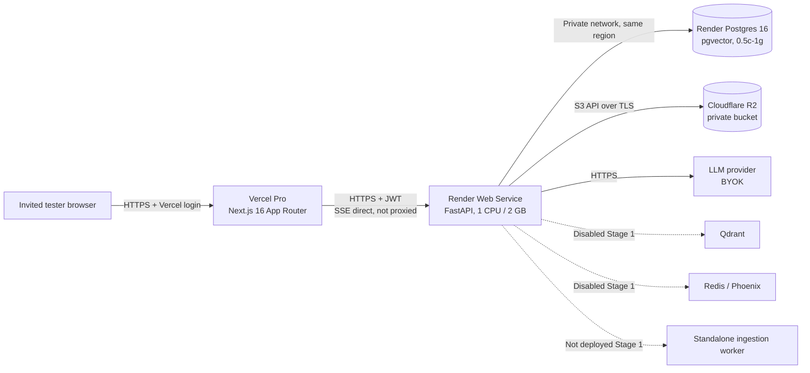

# M11 Stage 1 — Private Staging Architecture Decision

**Status:** Research complete; decision proposed — **AWAITING USER APPROVAL**
**Date:** 2026-11-12
**Scope:** A private staging environment for a few invited testers, using documents (real documents only after the M11 Stage 8 real-document gate), durable object storage, PostgreSQL, and SSE chat.
**Change boundary:** This document is the only artifact produced. No provider account was created, no cloud resource was provisioned, no deployment was performed, no purchase or spend was authorized, and no Git mutation was made.

---

## 0. Status legend used in this document

| Label | Meaning |
|---|---|
| **IMPLEMENTED** | Present in the repository today. Not proof that it works against a live cloud provider. |
| **TESTED (LOCAL ONLY)** | Covered by local/unit/integration test code or prior M10 evidence. No live staging verification was performed in this stage. |
| **RECOMMENDED** | Proposed decision for Stage 1. Not yet applied to infrastructure or code. |
| **AWAITING APPROVAL** | Requires an explicit user decision, spend authorization, or data/security approval. |
| **UNVERIFIED** | No official source was fetched, or the fact cannot be established without a live test. Do not treat as fact. |

Citation convention: provider-source IDs are enclosed in square brackets (for example `[C1]`, `[D1]`, `[R1]`). Bare IDs such as `C1` or `D1` refer to the configuration-change table (Section 4.8) or the decision table (Section 7), not to a provider source.

---

## 1. Executive decision

### 1.1 Recommended initial private staging stack

| Layer | Decision | Why |
|---|---|---|
| Frontend | **Vercel Pro**, Next.js 16 App Router, `frontend/` root | Keeps the repository's existing Vercel direction. Pro avoids Hobby's non-commercial restriction and is required for more than one external tester using native Vercel access control. |
| Frontend private access | **Vercel Authentication, "All Deployments"**, with invited testers added as **free Viewer seats** | Per-user access, revocable, gated by Vercel login. No custom auth gate needs to be written for Stage 1. |
| Backend | **Render Web Service**, Python 3.12, **1 CPU / 2 GB (`1c-2g`)**, 1 Uvicorn worker | Paid Render services do not spin down. 2 GB gives headroom for PDF/DOCX parsing, 50 MB uploads, optional local embeddings, and long-lived SSE connections. One API OS process keeps in-process ingestion within the M11 Stage 5 safe operating envelope. |
| Backend timeouts | Render HTTP responses up to **100 minutes**; deployment shutdown grace **120 s**; SSE heartbeat target **15 s** | SSE is viable on Render. The 100-minute ceiling is far above expected chat duration. Deploy-time SIGTERM is the practical stream-cut risk. |
| PostgreSQL | **Render Postgres 16, `0.5c-1g`** (1 GB RAM, 15 GB default disk, 100 connections), internal connection string | Co-located with the backend in Oregon, private networking, PITR, pgvector supported. Replaces the legacy `starter` plan that is no longer available for new databases. |
| Migrations | Render **`preDeployCommand: alembic upgrade head`** | Supported on paid web services; runs in a separate pre-deploy instance with a 30-minute limit. |
| Object storage | **Cloudflare R2**, private bucket, S3 API, backend-proxied reads/writes | 10 GB/month free, no egress charge, private by default. The repository's S3 adapter already isolates objects by tenant prefix. |
| Retrieval | **PostgreSQL pgvector + FTS hybrid**, 384-dimensional `all-MiniLM-L6-v2` embeddings | Co-located, no extra service. 384 dimensions match the existing `render.yaml` and migration schema. |
| Qdrant | **Disabled** | Not needed for the initial corpus. Revisit only after Stage 3 retrieval evaluation demonstrates a concrete gap. |
| Redis | **Disabled** | `REDIS_URL` exists in configuration, but no runtime code path uses Redis in this repository. |
| Phoenix | **Disabled** | `PHOENIX_ENABLED` exists in configuration, but no runtime code path uses Phoenix in this repository. |
| Worker | **Not deployed initially** | Ingestion currently runs in-process via `asyncio.create_task`. The standalone worker exists but must not run concurrently until duplicate-job claiming is fixed. |
| Domain | **Generated URLs** (`*.vercel.app`, `*.onrender.com`) | Avoids a domain purchase in Stage 1. A custom domain is an unresolved decision, not a blocker. |

**Staging readiness gate:** M11 Stage 8 records **`STAGING_READY = NO` for real documents** and requires P0-1–P0-8 plus live checks before even a synthetic-data tester cohort. This architecture does not close those blockers. Stage 1 therefore authorizes no tester invitations; Stage 2 must either close the P0 controls or obtain a written product-owner acceptance of the residual risk for a synthetic-only cohort. Real documents remain unapproved until P0 closure. See Section 4.9.

### 1.2 Monthly cost of the recommended stack

| Item | Plan | Monthly |
|---|---|---:|
| Vercel | Pro | **$20** |
| Render Web Service | `1c-2g` (1 CPU / 2 GB) | **$25** |
| Render Postgres | `0.5c-1g` (1 GB RAM) | **$19** |
| Cloudflare R2 | Free tier (10 GB-month, free egress) | **$0** |
| Domain | Generated hostnames | **$0** |
| **Subtotal** | | **$64/month** |

Excluded from the subtotal: sales tax, LLM/embedding API usage, overage charges, any custom domain, and a second object-storage backup bucket/copy if Stage 8 P0-1 is implemented. LLM usage is governed by the chosen BYOK provider and has not been priced in this document.

### 1.3 Why this is the minimum defensible configuration

- **Vercel Hobby is not sufficient for this requirement set.** It is restricted to non-commercial personal use, permits only **one external user per account** through Vercel Authentication, and permits only **one shareable link in total per account**. Commercial staging with "a few invited testers" should therefore use Pro or a different access mechanism. Sources: [V1], [V3], [V4].
- **Render's free web service is not sufficient for SSE plus ingestion.** It has 0.1 CPU / 512 MB RAM, spins down after 15 minutes of inactivity, and has no persistent disk. The current backend is Python with PDF/DOCX parsing, a 50 MB per-file limit, up to 10 files per request, and optional ONNX embeddings. Source: [R1].
- **Render's free PostgreSQL is not acceptable for real documents.** It expires **30 days after creation**, has **no backups**, and has **no connection pooling**. Source: [R1].
- **Paid Render Postgres is required for durable staging data.** The `0.5c-1g` plan costs $19/month and provides PITR and pgvector support. Sources: [R2], [R7], [R9].
- **R2 is free at the expected primary-staging volume.** The expected staging corpus is likely well below 10 GB; egress is free. A Stage 8 backup copy consumes additional storage and may exceed the free tier. Source: [D1].
- **The 8 GB CPU-only development machine is not part of the staging architecture.** All runtime services are managed cloud services; the local machine is used only for development and verification.

### 1.4 Cheaper variants and their exact penalty

| Variant | Monthly delta | Penalty |
|---|---:|---|
| Vercel Hobby instead of Pro, plus an app-level invite gate | −$20 | Hobby is non-commercial only; one external Vercel user and one shareable link; requires Stage 2 code to disable open registration or add a gate. |
| Render `starter` (0.5 CPU / 512 MB) instead of `1c-2g` | −$18 | Material OOM risk during PDF parsing, 50 MB uploads, and embeddings. Would require one worker and the `local` embedding provider to have a chance. |
| Neon Free instead of Render Postgres | −$19 | 1 GB storage and 100 CU-hours/month; scale-to-zero cold starts; cross-provider latency; storage cap can halt writes. |
| Render free web + free Postgres | −$44 | 512 MB, spin-down, in-process ingestion interrupted, database deleted after 30 days, no backups. Not viable for real documents. |
| Cloud Run backend with `min-instances=0` | Variable | Cold starts; in-process ingestion can be killed when the instance scales down; SSE requests are bounded by the configured request timeout. |

---

## 2. Current repository baseline (IMPLEMENTED / TESTED)

### 2.1 Implemented deployment and runtime pieces

| Area | Evidence | Status |
|---|---|---|
| Next.js 16 App Router frontend | `frontend/package.json` declares `next` 16.4.5 and React 19.3.0. `frontend/next.config.ts` enables `cacheComponents` and `partialPrefetching`. | **IMPLEMENTED** |
| FastAPI + SQLAlchemy async backend | `backend/app/main.py`, `backend/app/database/session.py`; async engine and `AsyncSession` factory. | **IMPLEMENTED** |
| Render Blueprint | `render.yaml` defines `mmaip-backend`, `mmaip-postgres` (Postgres 16), `preDeployCommand`, health check, S3 env vars, and pgvector/384-dim embedding defaults. | **IMPLEMENTED** |
| Durable S3 adapter | `backend/app/storage/s3.py`; `aioboto3`, tenant key prefix `{tenant_id}/{relative_key}`, no presigned URL support. | **IMPLEMENTED** |
| Storage fail-closed validation | `backend/app/storage/__init__.py`; rejects `STORAGE_BACKEND=local` only when `ENVIRONMENT=production`. | **IMPLEMENTED** (partial; see risk R-02) |
| SSE chat | `backend/app/api/v1/conversations.py:200` returns `StreamingResponse` with `text/event-stream`, `Cache-Control: no-cache`, `X-Accel-Buffering: no`. Similar endpoints exist for public chat, assistants, and developer API. | **IMPLEMENTED** |
| In-process ingestion | `asyncio.create_task(run_ingestion_in_background(...))` in `documents.py` and `knowledge.py`; runner in `backend/app/services/ingestion/service.py:548`. | **IMPLEMENTED** |
| Orphaned-job recovery | `backend/app/services/ingestion/recovery.py`; startup marks interrupted `PROCESSING` jobs `FAILED` / `INTERRUPTED`, requiring retry. | **IMPLEMENTED** |
| Standalone ingestion worker | `backend/app/services/ingestion/worker.py`; polls `QUEUED` jobs; Docker Compose profile `workers`. Not present in `render.yaml`. | **IMPLEMENTED, NOT DEPLOYED** |
| pgvector schema | `backend/alembic/versions/0003_embeddings_and_vector_stores.py` executes `CREATE EXTENSION IF NOT EXISTS vector` and creates `chunk_embeddings.vector`. | **IMPLEMENTED** |
| Vector store adapters | `backend/app/vectorstores/pgvector_store.py`, `fts_store.py`, `qdrant_store.py`, `registry.py`; all tenant-filtered. | **IMPLEMENTED** |
| Optional-service configuration | `backend/app/core/config.py` has `REDIS_URL`, `QDRANT_URL`, `QDRANT_API_KEY`, `PHOENIX_ENABLED`. A repository-wide search found no runtime Redis or Phoenix usage outside configuration. | **IMPLEMENTED CONFIG ONLY** |
| Local security/retrieval tests | `backend/tests/test_vector_stores.py`, `test_hybrid_retrieval.py`, `test_ingestion_pipeline.py`, `test_retrieval_security.py`, `integration/test_pgvector_operations.py`, `integration/test_postgres_migrations.py`. | **TESTED (LOCAL ONLY)** |

### 2.2 What is not yet true

- No live Vercel, Render, Neon, Supabase, Railway, Cloud Run, or R2 environment exists for this staging effort.
- No cloud deployment, migration run, upload, SSE stream, or private-access flow has been exercised in this stage.
- The existing `render.yaml` has configuration defects that must be corrected before a first deploy (Section 4.8).
- Open registration exists and is reachable if the frontend is public. There is no repository flag that disables public registration; private access must be enforced at the hosting layer for Stage 1. M11 Stage 7 independently records the same gap and the absence of a platform-signup invitation/approval control.

---

## 3. Verified 2026 provider facts

All sources in this section were fetched on **2026-11-12**. A source ID such as [V1] maps to the verification ledger in Section 9. Prices and limits are provider-published values, not quotes; they exclude tax and can change.

### 3.1 Vercel

| Fact | Verified value | Source |
|---|---|---|
| Next.js 16 support | Vercel's Next.js documentation explicitly covers Next.js 16 behavior (Cache Components / PPR). The repository uses Next.js 16.4.5. This is evidence of documented support, not a formal version-support matrix. | [V7] |
| Hobby price | $0 | [V1] |
| Hobby commercial restriction | Hobby is restricted to **non-commercial, personal use**. | [V1] |
| Hobby included usage | 100 GB Fast Data Transfer, 10 GB Fast Origin Transfer, 1,000,000 CDN requests, 4 CPU-hours, 360 GB-hours of provisioned memory, 1,000,000 function invocations. | [V1] |
| Hobby function duration | Maximum **300 seconds** per function invocation. | [V1] |
| Hobby builds | 2 vCPU / 8 GB memory / 64 GB disk per build; **100 deployments per day**. | [V1] |
| Hobby overage behavior | Deployments are paused until 30 days after the start of the billing cycle when included usage is exhausted. | [V1] |
| Pro price and seats | **$20/month**; Developer seats cost $20/user/month; **Viewer seats are free**. | [V1] |
| Environment variables | Supported per environment; encrypted at rest; 64 KB total per deployment; Config and Secret types; changes take effect on the next deployment. | [V6] |
| SSE / streaming | Vercel Functions support streaming responses. Function duration limits still apply. | [V5] |
| Deployment Protection methods | Vercel Authentication (all plans), Password Protection (Pro, **$20/month per protected project**), Trusted IPs (Enterprise), Shareable Links (all plans). | [V2] |
| Protecting all deployments | Available on all plans. | [V2] |
| Vercel Authentication access | Logged-in team/project members with at least Viewer access; access requests; shareable links; automation bypass. | [V3] |
| Hobby external testers | **Hobby accounts can have only one external user per account** via access requests. More require Pro. | [V3] |
| Hobby shareable links | **One shareable link in total per Hobby account.** | [V4] |
| Password Protection availability | Pro plan only; not available on Hobby. | [V2] |

**Implication for Stage 1:** Vercel Hobby cannot provide native private access for "a few invited testers" without either a Pro upgrade or a separate app-level gate. Pro + free Viewer seats is the cleanest path and removes the non-commercial restriction.

### 3.2 Render

| Fact | Verified value | Source |
|---|---|---|
| Free web service | 0.1 CPU / 512 MB RAM; **spins down after 15 minutes of inactivity** and spins back up on the next request. | [R1] |
| Free instance hours | 750 free instance hours per workspace per month across free services. | [R1] |
| Free filesystem | Ephemeral. Persistent disks are not available on free services. | [R1] |
| Free bandwidth / builds | 5 GB bandwidth and 500 build minutes per Hobby workspace per month. | [R3] |
| Paid web plans | `starter` = 0.5 CPU / 512 MB, **$7/month**; `1c-2g` = 1 CPU / 2 GB, **$25/month**. | [R2], [R3] |
| Paid spin-down | Paid services do not spin down; they remain running. | [R1] (free vs paid behavior) |
| HTTP response duration | Render states that HTTP responses can last **up to 100 minutes**, and that SSE is supported. | [R12] |
| SSE keepalive guidance | Render recommends a **15-second keepalive/comment** and warns that compression can buffer tokens. | [R12] |
| WebSocket duration | Render does not impose a fixed time limit on WebSocket connections. | [R11] |
| `preDeployCommand` | Available for **paid** web services, private services, and background workers. Not available on free services. Runs in a separate instance with a **30-minute** limit. | [R4], [R5] |
| Command timeouts | Build 120 minutes; pre-deploy 30 minutes; start 15 minutes. | [R5] |
| Private networking | Services and databases in the **same workspace and region** can communicate over private networking. Free services cannot receive private-network traffic. | [R10] |
| Persistent disks | Paid services only; $0.25/GB/month; attaching a disk disables zero-downtime deploys. Not used in this design. | [R4], [R5] |
| Postgres free plan | 256 MB RAM / 0.1 CPU, 1 GB storage, 100 connections; **expires 30 days after creation**; no backups; no connection pooling. | [R1] |
| Postgres paid plans | `0.1c-256mb` $6/month; `0.5c-1g` $19/month (1 GB RAM, default 15 GB disk); `1c-2g` $40/month. | [R2], [R3], [R4] |
| Postgres connection limit | **100 connections** for Postgres instances below 8 GB RAM. | [R2] |
| Postgres backups | PITR: **3 days** on Hobby workspace, **7 days** on Pro. Free databases have no backups. Logical exports are available on paid databases. | [R7] |
| Postgres pooling | PgBouncer is available on paid databases only, in **transaction mode**, on port 6432. | [R8] |
| pgvector | Supported PostgreSQL extension; enable with `CREATE EXTENSION vector`. | [R9] |
| Legacy `starter` database plan | Legacy instance types are **not available for new databases**. New databases must use flexible plans such as `0.5c-1g`. | [R13] |

**Implication for Stage 1:** Render paid web + paid Postgres is the appropriate baseline. The existing `render.yaml` uses `plan: starter` for the database, which is a legacy type and should not be used for a new database. The existing web plan `starter` is valid as a legacy alias for 0.5 CPU / 512 MB, but 512 MB is not recommended for this backend.

---

### 3.3 Google Cloud Run

| Fact | Verified value | Source |
|---|---|---|
| Request timeout | Configurable **1 to 3,600 seconds**; default **300 seconds**. Requests exceeding the timeout receive HTTP 504, but the container may continue processing. | [C1] |
| Streaming / WebSockets | Cloud Run supports WebSockets and other streaming services. Streaming requests are still HTTP requests subject to the configured request timeout. WebSocket connections can last up to **60 minutes** and clients must reconnect. Session affinity is best-effort. | [C2] |
| Minimum instances | Default **0** (scale to zero). Setting a minimum above zero incurs idle billing. | [C3] |
| Maximum instances | Default **100 per revision**; can be capped. | [C4] |
| Free tier | Request-based billing: **180,000 vCPU-seconds**, **360,000 GiB-seconds**, and **2,000,000 requests** per month. Instance-based billing: 240,000 vCPU-seconds and 450,000 GiB-seconds. A billing account is required. | [C5] |
| Container support | Deploys container images from Artifact Registry, Docker Hub, GitHub Container Registry, or configured remote registries. | [C6] |
| Managed PostgreSQL | Not included; requires Cloud SQL or an external provider. | [C5] (pricing structure) |

**Implication for Stage 1:** Cloud Run is technically capable of SSE, but scale-to-zero conflicts with in-process ingestion and adds cold-start latency. An always-on minimum instance is no longer "free" and adds database and networking complexity.

### 3.4 Managed PostgreSQL alternatives actually viable for staging

| Provider / plan | Free or entry limit | Connections / pooling | Backups | Inactivity / expiry | SSL | pgvector | Source |
|---|---|---|---|---|---|---|---|
| **Render Postgres Free** | 256 MB RAM / 0.1 CPU; 1 GB storage | 100 direct; no pooling | **None** | **Expires 30 days after creation** (14-day grace, then deletion) | External SSL; internal private network | Yes (extension) | [R1], [R9] |
| **Render Postgres `0.5c-1g`** | Paid, $19/month; 1 GB RAM; 15 GB default disk | 100 direct; PgBouncer paid, transaction mode, 6432 | PITR 3 days (Hobby) / 7 days (Pro); logical exports paid | No inactivity expiry documented | External SSL; internal private network | Yes | [R2], [R7], [R8], [R9] |
| **Neon Free** | 100 projects; 1 GB storage per project; 100 CU-hours per project/month; 5 GB egress | Pooled connections up to 10,000 clients; direct max 112 at 0.25 CU | 6-hour instant restore; 1 manual snapshot; **no scheduled backups** | Scale-to-zero after 5 minutes; **no project pause**; compute suspended when CU-hour quota is exhausted; writes fail above 1 GB | **Required** (`sslmode=require` or stronger) | Yes, every plan | [N1], [N2], [N3], [N4], [N5] |
| **Neon Launch** | Usage-based; $0.106/CU-hour; $0.35/GB-month; no fixed minimum | Same pooler; 10,000 pooled clients; direct limit scales with CU | 7-day PITR; scheduled backups available | Scale-to-zero configurable; no forced inactivity pause | **Required** | Yes | [N2], [N4], [N5] |
| **Supabase Free** | 500 MB database; 1 GB file storage; 5 GB egress; 2 active projects | Published compute table lists Micro at 60 direct / 200 pooler; exact Free-plan cap is **UNVERIFIED** | **None** | **Paused after 1 week of inactivity** | Required (`sslmode=require`) | Yes | [S1], [S2], [S3] |
| **Supabase Pro** | $25/month; 8 GB disk; Micro compute included | Supavisor: transaction 6543, session 5432; Micro 60 direct / 200 pooler; transaction mode does not support all session features | Daily backups, 7-day retention; PITR $100/month for 7 days | No inactivity pause | Required | Yes | [S1], [S2], [S3] |
| **Railway Free / Hobby** | Free: $1/month usage credit, max 1 vCPU / 0.5 GB per service, 1 replica, 1 project / 3 services, 500 MB volume, 0 custom domains. Hobby: $5/month including $5 usage. | **Not published**; PgBouncer is a separate add-on; connection limit **UNVERIFIED** | Volume backups available; incremental storage billed like volumes; daily 6 days / weekly 27 days / monthly 89 days; no PITR by default | No inactivity suspension documented; exact free-credit exhaustion behavior **UNVERIFIED** | SSL-enabled Postgres image; external access via TCP proxy | Via separate pgvector template, not default | [W1], [W2], [W3] |

**Viability conclusion:** Render Postgres `0.5c-1g` is the best fit for this repository because it is co-located with the Render backend, supports private networking, has PITR, and supports pgvector. Neon Free is the strongest no-cost alternative for a small corpus but introduces a 1 GB storage cap, scale-to-zero, and a second provider. Supabase Free is not suitable for always-on staging because it pauses after a week. Railway is not a true free always-on database and does not publish the connection limits needed for planning.

### 3.5 Cloudflare R2

| Fact | Verified value | Source |
|---|---|---|
| Free tier | **10 GB-month** standard storage; **1,000,000 Class A** operations/month; **10,000,000 Class B** operations/month; **zero egress fees**. | [D1] |
| Paid rates | $0.015/GB-month; $4.50 per million Class A operations; $0.36 per million Class B operations; egress remains free. | [D1] |
| Private by default | Buckets are private unless public access is explicitly enabled. | [D4] |
| S3 compatibility | Implements the S3 API; endpoint `https://<ACCOUNT_ID>.r2.cloudflarestorage.com`; bucket region is `auto`, and `us-east-1` aliases to `auto` for compatibility. | [D5] |
| Presigned URLs | Supported for GET, PUT, HEAD, and DELETE with expiration from **1 second to 7 days**. CORS must be configured for browser use; presigned URLs do not work with custom domains. | [D2] |
| CORS | Configurable at the bucket level; required only for direct browser access. | [D3] |
| Repository usage | The backend uses `put_object`, `get_object`, `head_object`, and `delete_object` only. It does **not** generate presigned URLs; file bytes are proxied through FastAPI. Therefore no R2 CORS rule is required for the current design. | Repo: `backend/app/storage/s3.py` |
| Versioning / object lock | Not configured in this design. R2's S3 API page marks `PutBucketVersioning` and object-lock operations as unimplemented, so do not assume S3-style versioning. | [D5] |

**Implication for Stage 1:** R2 is a strong fit: private, S3-compatible, free at staging volume, and no egress charge. The existing adapter's lack of presigned URLs is acceptable because uploads and downloads are small and backend-proxied. This also avoids exposing bucket credentials to the browser.

---

## 4. Recommended initial private staging architecture

### 4.1 Topology

### 4.2 Frontend hosting and private access

**RECOMMENDED**

- Host `frontend/` on **Vercel Pro**, preserving the repository's existing Vercel direction.
- Enable **Deployment Protection → Vercel Authentication → All Deployments**. This protects production and preview URLs, not just previews.
- Invite each tester as a **Viewer seat** on the Vercel team. Viewer seats are free on Pro, and Vercel Authentication allows logged-in viewers to access protected deployments. This provides per-user access and easy revocation.
- Keep the application's own authentication and tenant invitation flow. Testers will authenticate twice: once at the Vercel edge, once in the application. That is intentional defense in depth.
- Set `NEXT_PUBLIC_API_BASE_URL=https://<backend-host>` in Vercel. Do **not** append `/api/v1`; `frontend/lib/api.ts` appends it.
- Set `FRONTEND_URL=https://<project>.vercel.app` on Render for CORS. If preview deployments will call the backend, add a narrow `CORS_ORIGIN_REGEX`; otherwise do not widen CORS.
- Use the generated `*.vercel.app` hostname for Stage 1. A custom domain is optional and unresolved.
- Do **not** proxy the SSE API through Next.js. A Vercel Function/proxy would subject the stream to Vercel's function duration limit (300 seconds on Hobby; any proxy still has a finite limit). The browser should call Render directly.

**Alternative access methods, evaluated**

| Method | Cost | Assessment |
|---|---|---|
| Vercel Authentication + free Viewer seats | Included in Pro | **Recommended.** Per-user, revocable, supports "a few" testers. |
| Vercel Password Protection | +$20/month per protected project, Pro only | Works, but a shared password is weaker than per-user access and adds $20. |
| Vercel Shareable Link | Included | A bearer link; acceptable only for short-lived, low-sensitivity reviews. Hobby is limited to one link total. |
| App-level invite gate / shared password | $0 platform cost | Requires Stage 2 code and still leaves the frontend publicly reachable. Not the primary control. |
| Vercel Hobby + one external tester | $0 | Does not meet "a few invited testers"; non-commercial restriction. |

**AWAITING APPROVAL:** tester identities, whether all testers can use Vercel accounts, and whether a custom domain is required.

### 4.3 Backend hosting, size, timeouts, and SSE

**RECOMMENDED**

| Setting | Value |
|---|---|
| Service type | Render Web Service, Python runtime |
| Region | `oregon` (must match Postgres) |
| Plan | `1c-2g` — 1 CPU, 2 GB RAM, $25/month |
| Build | `pip install -e .` from `backend/`; pin Python 3.12 |
| Start | `uvicorn app.main:app --host 0.0.0.0 --port $PORT --workers 1` |
| Health check | `/ready` (checks database connectivity), not `/health` (process only) |
| Shutdown grace | `maxShutdownDelaySeconds: 120` (Render default is 30; max 300) |
| Instances | 1 (Stage 1). Do not autoscale; in-process ingestion assumes one API OS process. |
| Auto-deploy | Off during first bring-up; enable after smoke tests, preferably on checks passing. |

**Build reproducibility:** M11 Stage 0 records that the backend has no lockfile (`poetry.lock`, `uv.lock`, `requirements.lock`, or equivalent); `pip install -e .` alone is not fully reproducible. Pin Python 3.12 and add a lock/constraints file before the first staging deploy. The frontend has `package-lock.json`.

**Why 2 GB, not 512 MB:** The backend accepts files up to 50 MB, up to 10 files per request, and extracted text up to 20 MB. `S3StorageProvider.save()` receives the whole object as `bytes`, so a single upload can hold the file in memory. PDF/DOCX parsing and the optional ONNX embedding model add more. A 512 MB instance is a plausible OOM during realistic ingestion. This is an engineering judgment based on the repository's limits, not a provider benchmark; it must be measured in Stage 2.

**SSE behavior**

- Render permits HTTP responses up to **100 minutes**, so long chat streams do not hit a short proxy timeout. Source: [R12].
- Paid services do not spin down, eliminating free-tier cold starts.
- The current endpoints send `text/event-stream`, `Cache-Control: no-cache`, and `X-Accel-Buffering: no`. They do **not** send periodic keepalive comments. Add a `: keepalive` comment when no token has been emitted for ~15 seconds, per Render's SSE guidance.
- Render's article warns that compression can buffer SSE tokens. The FastAPI app does not add GZip middleware, but the Render load balancer may still compress. Verify first-token latency and mid-stream flushing in Stage 2; if tokens batch, adjust headers/compression behavior.
- Deployment sends SIGTERM and eventually kills the process. `maxShutdownDelaySeconds: 120` gives in-flight streams time to finish, but a deploy can still cut a stream longer than the grace period. Schedule deploys when testers are idle.
- There is no resumable stream state. If the connection drops, the client must retry; the runtime persists the user message before streaming and the assistant message at completion, so retries can duplicate a user message. This is an accepted Stage 1 limitation.

**In-process ingestion**

- Document upload and reprocess endpoints create a `QUEUED` job and call `asyncio.create_task(run_ingestion_in_background(...))`.
- If the process restarts mid-job, startup recovery marks the job `FAILED` / stage `INTERRUPTED` with `PROCESS_RESTART`; it does **not** automatically retry. The operator or tester must retry.
- One Uvicorn worker means a CPU-heavy parse can delay SSE tokens on that process. This is accepted for Stage 1 because Stage 5 requires one API OS process for the in-process dispatcher. Do not fix it by adding API workers; move ingestion to the worker instead.
- Do not deploy the standalone worker alongside the web service. Both paths call `IngestionService.execute_job()` and the worker selects any `QUEUED` job; there is no atomic claim/lease. Running both can process the same job twice.
- If ingestion reliability becomes a problem, the correct Stage 3 move is to deploy the worker as a Render background worker and remove/disable the in-process `create_task` path, or add an atomic job claim first.

### 4.4 PostgreSQL provider, plan, connections, and migrations

**RECOMMENDED**

| Setting | Value |
|---|---|
| Provider | Render Postgres |
| Version | PostgreSQL 16 |
| Plan | `0.5c-1g` — 1 GB RAM, 0.5 CPU, **$19/month** |
| Disk | 15 GB default at this plan; expandable if needed |
| Connection limit | 100 direct connections |
| Region | `oregon`, same as the backend |
| Connection string | Internal `fromDatabase.connectionString`; external access requires TLS |
| Backups | PITR 3 days on a Hobby workspace; 7 days on Pro; free databases have none |
| Extension | `vector` via migration `0003_embeddings_and_vector_stores` |
| Pooling | None initially; direct connections are sufficient |

**Connection math**

- `backend/app/database/session.py` configures `pool_size=5` and `max_overflow=10`, for a maximum of **15 connections per worker process**.
- One Uvicorn worker → **15 connections**, well below the 100-connection limit. This is deliberate: M11 Stage 5 found that startup recovery runs in every API process and can mark another process's live `PROCESSING` job `FAILED`. Do not use `--workers 2` with in-process ingestion.
- `pool_pre_ping=True` and `pool_recycle=1800` are enabled. `pool_timeout=30`.
- Cap Stage 1 at one web instance. Four instances × one worker × 15 = 60 connections, still below 100, but the in-process dispatcher is per-process and multiple instances do not share queued work. If horizontal scaling is needed, first add an atomic job claim and reduce pool sizes, then evaluate PgBouncer. PgBouncer is paid-only and transaction-mode; asyncpg prepared statements can require `statement_cache_size=0` or equivalent care. Do not enable it without a connection test.
- Neon's direct limit at 0.25 CU is 112; Supabase Micro publishes 60 direct / 200 pooler. The repository's 30-connection footprint fits all three, but Render avoids a second provider and cross-region latency.

**Migration execution**

- Keep `preDeployCommand: alembic upgrade head`.
- Render runs pre-deploy commands only for **paid** services, in a separate instance, with a 30-minute limit. The command runs before the new version receives traffic.
- Alembic uses `DATABASE_SYNC_URL` for the migration connection; the application uses `DATABASE_URL`. Both are populated from the Render database connection string, and the application's validators normalize `postgres://` / `postgresql://` to the async driver for `DATABASE_URL`.
- Run migrations with the database's internal connection string. Keep migrations backward-compatible (expand/contract) because the old version may still be serving during the pre-deploy step.
- M11 Stage 0 records that migration `0010` is not idempotent against databases bootstrapped by `Base.metadata.create_all()`. Use a fresh Render database and let `preDeployCommand` run the full chain before the app starts; do not reuse a development/stamped database without a parity check.
- Take a manual logical export before destructive migrations even though PITR exists. PITR is 3 days on a Hobby workspace; an accidental destructive migration discovered later may not be recoverable.
- First deploy order: create Postgres → pre-deploy runs migrations → web service starts → startup seeds roles and recovers orphaned jobs. Verify `CREATE EXTENSION vector` succeeded before uploading documents. Extension creation is a migration step and has not been tested against Render in this stage.

**pgvector query behavior**

- Migration 0003 creates the `vector` column and tenant indexes, but **no HNSW or IVFFlat index**. `PgVectorStore.search()` orders by cosine distance directly, which is a brute-force scan.
- For a small staging corpus this is acceptable. Do not add an approximate index until Stage 3 measures recall and latency; an index built with the wrong operator class or dimension is worse than no index.
- Embeddings are 384-dimensional `all-MiniLM-L6-v2` (`render.yaml`), matching `DEFAULT_EMBEDDING_DIMENSIONS=384`.
- `retrieval_configs.embedding_dimensions` is populated from settings when a config is created, so new knowledge bases should get 384. Verify existing rows after migration; the model-level default is 1536.

---

### 4.5 Object storage provider, bucket, private access, and credentials

**RECOMMENDED**

| Setting | Value |
|---|---|
| Provider | Cloudflare R2 |
| Bucket | `mmaip-staging-<unique-suffix>`, private |
| Public access | **Disabled.** No R2.dev public URL and no custom domain. |
| Endpoint | `https://<ACCOUNT_ID>.r2.cloudflarestorage.com` |
| Region | `auto` (or `us-east-1`, which R2 aliases to `auto`) |
| Credentials | R2 API token scoped to **Object Read & Write** for this bucket only; access key ID and secret stored as Render secret env vars |
| CORS | **None required.** The backend proxies reads and writes; the browser never talks to R2. |
| Presigned URLs | Not used by the current adapter. If direct browser upload/download is added later, use short expirations and a CORS rule restricted to the Vercel origin. |
| Object key shape | Intended shape is `{tenant_id}/{relative_key}`; implemented in `S3StorageProvider._get_full_key()`. Verify the actual key because M11 Stage 8 found the tenant prefix can be applied twice in some paths. |
| Max file size | 50 MB per file, 10 files per request, 20 MB extracted text (repository defaults). |
| Multipart upload | Not implemented. `put_object` receives the whole object as bytes. |
| Storage volume | 10 GB-month free; expected staging corpus is below this. Overages are $0.015/GB-month and egress is free. |

**Operational notes**

- Create the bucket and token only after spend/account approval. The token should not be reused from production.
- Store `S3_BUCKET_NAME`, `S3_ENDPOINT_URL`, `S3_ACCESS_KEY_ID`, and `S3_SECRET_ACCESS_KEY` as Render secrets. Do not commit them to `render.yaml`.
- Keep `STORAGE_BACKEND=s3`. Do not rely on the local filesystem for durability.
- R2's free tier has no documented inactivity suspension or expiry; overage is billed. There is no versioning or object-lock configuration in this design, so deletion is permanent unless a separate backup/copy policy is added.
- The adapter creates a new `aioboto3` client per operation. This adds connection/setup overhead and is a performance item to revisit if upload/download latency is noticeable.
- **Known repository storage gaps (M11 Stage 8):** there is no S3/R2 object backup or restore path; the existing storage backup/restore scripts are local-filesystem only. The tenant prefix can also be applied twice in some call paths, which is a key-layout and restore hazard. `exists()` treats all S3 errors as "missing", and `delete()` returns success unconditionally. These do not block a **synthetic-data** private staging start, but they mean R2 object durability is only as good as the bucket itself until a backup/reconciliation path is added. See Section 4.9 for the real-document gate.

**AWAITING APPROVAL:** bucket name, Cloudflare account ownership, token custody, retention/deletion policy, and whether document objects may contain regulated data.

### 4.6 Retrieval path for initial staging

**RECOMMENDED**

- Use **PostgreSQL pgvector co-located with the application database** as the primary vector store.
- Keep `DEFAULT_VECTOR_STORE=pgvector` and `DEFAULT_RETRIEVAL_MODE=hybrid`.
- Use `sentence-transformers/all-MiniLM-L6-v2`, 384 dimensions, with `DEFAULT_EMBEDDING_PROVIDER=sentence-transformers`.
- Keep Qdrant disabled. Do not set `QDRANT_URL` or `QDRANT_API_KEY` for Stage 1.
- Keep FTS available as a degraded mode. `PostgresFTSStore` performs tenant-filtered `plainto_tsquery` / `to_tsvector` search over `document_chunks`. It is a usable lexical fallback if embeddings are unavailable.

**Important constraints**

- The vector search path is brute-force cosine distance; there is no HNSW/IVFFlat index yet. This is acceptable for a small corpus and avoids a premature index decision.
- FTS is not a zero-touch hot switch. Knowledge-base `retrieval_configs` can pin a `vector_store`; changing the global default does not rewrite existing configs. A fallback to FTS requires updating affected retrieval configs and ensuring the ingestion/embedding path is not expected to produce vectors.
- `fastembed` downloads the MiniLM model on first use. Render's filesystem is ephemeral, so a restart or deploy can re-download it. This adds first-ingestion latency and depends on outbound access to the model host. Stage 2 should either pre-cache the model during the build or document the cold-start cost.
- If semantic quality is inadequate, the alternatives are (a) a larger local embedding model, which increases memory, or (b) a hosted embedding provider, which sends document text off-platform and requires data approval. Neither is selected in Stage 1.
- Qdrant is a Stage 3 decision gate: only revisit if pgvector hybrid retrieval fails agreed recall/latency thresholds and the extra service cost is justified.

### 4.7 Redis, Phoenix, and worker policy

| Service | Stage 1 policy | Evidence / reason |
|---|---|---|
| Redis | **Disabled; do not provision Render Key Value.** | `REDIS_URL` exists in `backend/app/core/config.py`, but no runtime code path references Redis. Provisioning it would add cost with no behavior change. |
| Phoenix (Arize) | **Disabled.** | `PHOENIX_ENABLED` defaults to `False` and no runtime Phoenix integration was found outside configuration. |
| Qdrant | **Disabled.** | Only used when `DEFAULT_VECTOR_STORE=qdrant` or a knowledge base selects it. pgvector is the default. |
| Standalone ingestion worker | **Not deployed.** | In-process ingestion is active. The worker exists at `backend/app/services/ingestion/worker.py` and can be deployed independently as a Render background worker later, but only after duplicate-job claiming is fixed or the in-process path is disabled. Stage 5 also found the worker needs env parity (secrets, LLM gateway, DB, S3) and startup recovery before it is operationally ready. |
| OmniRoute gateway | **Not deployed.** | The repository's `.env.production.example` explicitly allows direct BYOK providers when OmniRoute is not deployed. `render.yaml` currently points to OpenAI directly. This is an unresolved provider/gateway decision. |
| Persistent disk | **Not attached.** | All durable document bytes go to R2. A Render disk would add cost, disable zero-downtime deploys, and duplicate storage responsibility. |

**Independent-deploy policy:** Any of Redis, Qdrant, Phoenix, or the worker must be deployable as its own service without changing the core web service's availability contract. None is part of the Stage 1 bill of materials.

### 4.8 Required configuration changes before a first deploy

The current `render.yaml` is a useful starting point but is not deployable as-is for this design. These are **RECOMMENDED CHANGES**, not applied in Stage 1.

| # | Current | Recommended | Reason |
|---|---|---|---|
| C1 | Web `plan: starter` (0.5 CPU / 512 MB) | `plan: 1c-2g` | 512 MB is too tight for parsing, uploads, embeddings, and SSE. |
| C2 | Database `plan: starter` (legacy) | `plan: 0.5c-1g` | Legacy instance types are not available for new databases. |
| C3 | `healthCheckPath: /health` | `/ready` | `/health` only proves the process is alive; `/ready` checks database connectivity. |
| C4 | No shutdown grace setting | `maxShutdownDelaySeconds: 120` | Reduce deploy-time SSE cuts. |
| C5 | `S3_REGION_NAME: us-east-1` | `auto` (optional; `us-east-1` is aliased) | R2 documents `auto` as the bucket region. |
| C6 | `STORAGE_PATH: /app/data/storage` | Remove or leave unused | Local storage is not durable; keeping the variable invites accidental local use. |
| C7 | `ENVIRONMENT: staging` | `production` for fail-closed storage, **or** extend validation to reject local storage in staging | Current validation only rejects `local` when `ENVIRONMENT=production`. |
| C8 | `FRONTEND_URL` has both `sync: false` and a literal `value` | Use one mechanism and the actual Vercel hostname | Blueprint ambiguity; a stale hostname breaks CORS. |
| C9 | No preview-origin handling | Add `CORS_ORIGIN_REGEX` only if preview URLs will call the backend | Keep CORS narrow; production should not use a broad wildcard. |
| C10 | `DEFAULT_EMBEDDING_PROVIDER=sentence-transformers` | Keep, but pre-cache the model during build or accept first-use download | Ephemeral filesystem forces re-download after restart/deploy. |
| C11 | `LLM_BASE_URL=https://api.openai.com/v1` | Decide: direct OpenAI BYOK or a reachable OmniRoute gateway | `AGENTS.md` prefers OmniRoute, but no cloud OmniRoute exists in this design. |
| C12 | No explicit database disk size | `diskSizeGB: 15` (or confirm the default) | Make the storage assumption explicit. |
| C13 | `autoDeploy: true` | Off for first bring-up; enable after smoke tests | Prevent an unreviewed deploy during initial migration. |
| C14 | No explicit instance count | `numInstances: 1` | Protect the 100-connection budget and in-process ingestion assumptions. |
| C15 | Python version implied by runtime | Pin Python 3.12 in Render | Reproducible builds. |
| C16 | `startCommand` uses `--workers 2` | `--workers 1` | M11 Stage 5: one API OS process is required for the in-process dispatcher; multiple processes run startup recovery and can fail each other's live jobs. |
| C17 | No backend lockfile | Add and commit a lock/constraints file | M11 Stage 0 records no backend lockfile; `pip install -e .` is not reproducible by itself. |

**Configuration defects specifically worth calling out**

- The database `plan: starter` is a legacy Postgres instance type. Render states legacy types are not available for new databases. A Blueprint deploy may fail or require a manual plan selection. Source: [R13].
- `FRONTEND_URL` combining `sync: false` with `value` is ambiguous. Treat this as a defect to fix before deploying.
- `ENVIRONMENT=staging` allows `STORAGE_BACKEND=local` at startup. If the S3 variables are accidentally omitted, the app may start and write to an ephemeral path. For staging with real documents, this is the wrong failure mode.

### 4.9 Real-document readiness gate (M11 Stage 8 dependency)

M11 Stage 8 audits the storage and backup implementation and reaches **`STAGING_READY = NO` for real documents**. Stage 1 is a hosting architecture decision; it does not close those blockers. The relevant gates are:

| Stage 8 gate | Current status | Impact on this architecture |
|---|---|---|
| P0-1: bucket versioning/backup copy, encryption, public-access block, TLS-only policy, lifecycle | **Not implemented.** R2 is private and TLS-only in this design, but there is no separate backup bucket/copy and no versioning. R2's S3 API page marks bucket-versioning operations unimplemented. | R2 protects against node loss but not accidental or malicious deletion. A second bucket/account and copy job are required for the Stage 8 intent. |
| P0-2: PostgreSQL backup/PITR plus offsite copy, revision in manifest | **Partial.** Render PITR (3 days Hobby / 7 Pro) is recommended; no offsite `pg_dump` copy or three verified backups exist. | A 3-day PITR window is not a full backup policy. Add scheduled logical exports and retention if real documents are approved. |
| P0-3: escrow `SECRET_ENCRYPTION_KEY` / `PREVIOUS_SECRET_KEYS` | **Not implemented.** `render.yaml` generates the key, but no external escrow is recorded. | A restore without the key cannot decrypt BYOK credentials. Escrow must be in place before real data is stored. |
| P0-4: delete convergence and audit | **Not implemented.** DB deletion can proceed after object deletion failure; KB deletion does not purge objects. | Silent orphan objects or dangling rows; real documents may remain after deletion. |
| P0-5: provider-aware DB↔object reconciliation | **Not implemented for S3/R2.** The existing reconciler is local-filesystem only. | No reliable way to detect missing objects or orphans in R2. |
| P0-6: live paired restore drill | **Not run.** | RTO/RPO are unknown; the first real restore would be the test. |
| P0-7: filename/path/size boundary guards and repair path | **Partial.** 50 MB / 10-file / 20 MB limits exist; provider-boundary and duplicate-after-delete repair are not verified. | Edge-case uploads may fail or corrupt the document record. |
| P0-8: storage readiness probe and artifact hygiene | **Not implemented.** `/ready` checks PostgreSQL only. | A bucket outage is not reflected in readiness; the service can appear healthy while uploads fail. |

**Verdict for Stage 1:** The hosting architecture supports real documents; the blocker is the repository's missing backup/delete/reconciliation controls, not the choice of R2. It is suitable for a closed **synthetic-data** trial only after P0-1 through P0-8 are closed and the live checks pass, or after a written product-owner acceptance of the residual risk for a synthetic-only cohort. **Real documents are not approved until P0 closure.** This is decision **D14**.
---

## 5. Cost table

### 5.1 Recommended monthly bill

| Provider | Role | Plan used | Monthly | Notes |
|---|---|---|---:|---|
| Vercel | Frontend + private access | Pro | **$20** | Viewer seats free; commercial use permitted. |
| Render | Backend web service | `1c-2g` | **$25** | 1 CPU / 2 GB; no spin-down. |
| Render | PostgreSQL 16 | `0.5c-1g` | **$19** | 1 GB RAM; 15 GB default disk; 100 connections; 3-day PITR on Hobby. |
| Cloudflare | R2 object storage | Free tier | **$0** | 10 GB-month, 1M Class A, 10M Class B, free egress. |
| Domain | Generated hostnames | — | **$0** | No purchase in Stage 1. |
| **Total** | | | **$64/month** | Excludes tax, LLM/embedding usage, overages, custom domain. |

### 5.2 Free-tier limits, paid thresholds, and suspension behavior

| Provider | Free-tier limit (verified) | First paid threshold | Rate used in this decision | Suspension / expiry behavior | Source |
|---|---|---|---|---|---|
| **Vercel Hobby** | 100 GB Fast Data Transfer; 10 GB Fast Origin; 1M CDN requests; 4 CPU-hours; 360 GB-hours; 1M invocations; 300 s functions; 2 vCPU / 8 GB builds; 100 deployments/day | Pro at **$20/month** | Pro $20/month; Viewer seats free | Overage pauses deployments until 30 days after billing-cycle start. Hobby is non-commercial; one external user; one shareable link. | [V1], [V3], [V4] |
| **Render Web Service** | 0.1 CPU / 512 MB; 750 instance hours/month; 5 GB bandwidth; 500 build minutes; ephemeral filesystem; spins down after 15 min | `starter` at **$7/month** (0.5 CPU / 512 MB) | `1c-2g` at **$25/month** (1 CPU / 2 GB) | Free services spin down after 15 min; if 750 hours are exhausted, free services are suspended for the rest of the month. Paid services do not spin down. | [R1], [R2], [R3] |
| **Render Postgres** | 256 MB RAM / 0.1 CPU; 1 GB storage; 100 connections; no backups; no pooling | `0.1c-256mb` at **$6/month** | `0.5c-1g` at **$19/month**; 15 GB default disk | Free database **expires 30 days after creation** (14-day grace, then deletion). Paid databases do not expire. | [R1], [R2], [R3], [R13] |
| **Neon** | Free: 1 GB/project; 100 CU-hours/project/month; 5 GB egress; 10 branches; 6-hour restore; 1 manual snapshot; no scheduled backups | Launch: usage-based, no fixed minimum | $0.106/CU-hour; $0.35/GB-month | Scale-to-zero after 5 min; no project pause; compute suspended when CU-hour quota is exhausted; writes fail above 1 GB. | [N1], [N2] |
| **Supabase** | Free: 500 MB database; 1 GB file storage; 5 GB egress; 2 active projects; no backups | Pro at **$25/month** | Pro $25/month; PITR $100/month for 7 days | Free projects **pause after 1 week of inactivity**. Pro does not pause. | [S1] |
| **Railway** | Free: **$1/month usage credit**; max 1 vCPU / 0.5 GB per service; 1 replica; 1 project / 3 services; 500 MB volume; 0 custom domains | Hobby at **$5/month** (includes $5 usage) | Memory $10/GB-month; CPU $20/vCPU-month; volumes $0.15/GB-month; egress $0.05/GB | Exact free-credit exhaustion behavior is **UNVERIFIED**. No inactivity suspension documented. | [W1] |
| **Google Cloud Run** | 180,000 vCPU-seconds; 360,000 GiB-seconds; 2M requests/month (request-based) | Pay-as-you-go after free tier; billing account required | $0.000024/vCPU-s; $0.0000025/GiB-s; $0.40/M requests (Tier 1) | No inactivity suspension documented; scale-to-zero; charges continue beyond free tier. | [C5] |
| **Cloudflare R2** | 10 GB-month; 1M Class A; 10M Class B; free egress | Overage billed monthly | $0.015/GB-month; $4.50/M Class A; $0.36/M Class B | No inactivity suspension or expiry documented. | [D1] |

### 5.3 Free-tier conclusions

- **R2's free tier is sufficient for Stage 1** and is the only free tier relied on in the recommended bill. Source: [D1].
- **Vercel Hobby is free but not usable for this requirement set** because of the non-commercial restriction and tester limits. Sources: [V1], [V3], [V4].
- **Render's free web and database tiers are unsuitable** for real documents and durable staging: 512 MB, spin-down, no backups, 30-day database expiry. Source: [R1].
- **Neon Free and Supabase Free are real free tiers but not selected**: 1 GB/scale-to-zero and weekly pause, respectively. Sources: [N1], [N2], [S1].
- **Railway Free is a $1 credit, not an always-on tier.** Source: [W1].
- **Cloud Run's free tier is real but does not cover an always-on 1 vCPU / 1 GiB backend plus a database.** Source: [C5].

---

## 6. Alternatives and trade-offs

### 6.1 Alternative A — Vercel Hobby + app-level invite gate

**Stack:** Vercel Hobby + Render `1c-2g` + Render Postgres `0.5c-1g` + R2.
**Monthly:** **$44** (saves $20).
**Pros:** Lowest cost that still uses the repo's stack; no Vercel Pro subscription.
**Cons:** Hobby is non-commercial only; only one external Vercel user and one shareable link; requires Stage 2 code to disable open registration or add an invite/password gate; the frontend remains publicly reachable. The gate would be application code, not an edge access control.
**Verdict:** Not recommended for a commercial platform. Viable only if the user confirms the staging environment is non-commercial and accepts a single external Vercel user or an app-level gate.

### 6.2 Alternative B — All-Render (frontend and backend on Render)

**Stack:** Next.js web service on Render `starter` ($7) + FastAPI `1c-2g` ($25) + Render Postgres `0.5c-1g` ($19) + R2 free.
**Monthly:** **$51** plus any Render workspace/bandwidth overage.
**Pros:** One vendor; frontend and backend can use private networking if desired; avoids Vercel Pro and its commercial restriction; Render can host a Node/Next.js service.
**Cons:** No built-in per-user access control comparable to Vercel Authentication; still needs an app-level gate or Cloudflare Access; two paid compute services; Next.js 16 build/runtime behavior on Render has not been verified; 512 MB frontend may be tight for builds/SSR; more operational surface.
**Verdict:** The best fallback if Vercel Pro is not approved. It is cheaper than the Vercel Pro stack by $13/month but requires more access-control work and a Next.js-on-Render smoke test.

### 6.3 Alternative C — Vercel + Google Cloud Run + Neon

**Stack:** Vercel frontend + Cloud Run backend (1 vCPU / 1 GiB, min 0) + Neon Free/Launch + R2.
**Monthly:** Usage-based; Cloud Run can be near-zero at low traffic but incurs cold starts; Neon Free is $0 within 1 GB/100 CU-hours, otherwise usage-based.
**Pros:** Generous request timeout (up to 60 minutes for streaming), scale-to-zero, container portability, strong free tier for bursty traffic.
**Cons:** Cold starts add seconds to first SSE request; scale-to-zero can kill in-process ingestion; request timeout defaults to 300 s; needs a second provider for PostgreSQL and careful VPC/networking; more moving parts than Stage 1 warrants. An always-on minimum instance removes the free advantage.
**Verdict:** Not recommended for Stage 1. Revisit if traffic is extremely bursty or if a container-first deployment becomes a requirement.

### 6.4 Alternative D — Vercel + Render backend + Neon/Supabase

**Stack:** Same as recommended but replace Render Postgres with Neon Free/Launch or Supabase Free/Pro.
**Monthly:** Saves $19 with Neon Free or adds $6 with Supabase Pro ($25 vs Render $19).
**Pros:** Neon has excellent branching/PITR features and pgvector on every plan; Supabase bundles storage/auth if those are later needed; both offload database operations.
**Cons:** Neon Free is 1 GB and 100 CU-hours, scales to zero, and adds cross-provider latency; Supabase Free pauses after a week and has no backups. The app already uses its own auth and S3 adapter, so Supabase's bundled features are mostly unused. Render Postgres keeps the database in the same private network and region.
**Verdict:** Not recommended for real documents in Stage 1. Neon Launch is a credible Stage 2/3 alternative if database load outgrows the Render plan.

### 6.5 Alternative E — Self-hosted VPS

**Stack:** Small VPS + Docker Compose (`backend`, `frontend`, Postgres, MinIO, Caddy) + WireGuard/Tailscale for private access.
**Monthly:** Provider-dependent; not priced here because no VPS quote was fetched.
**Pros:** Maximum control; potentially cheapest at low volume; private access can be enforced with a VPN instead of an app gate; the 8 GB CPU-only development machine is not involved.
**Cons:** You own OS patching, TLS, backups, PITR, monitoring, disk failure, and incident response. A single VPS is a single point of failure. The repository already has Docker Compose profiles, but there is no managed backup or restore evidence. Not aligned with a small team's staging goals.
**Verdict:** Not recommended for Stage 1. Revisit only if data-sovereignty requirements forbid managed providers.

### 6.6 Alternative F — Add Qdrant, Redis, or Phoenix now

**Stack:** Recommended stack plus Qdrant Cloud/self-hosted, Render Key Value, and/or Phoenix.
**Monthly:** Additional provider cost; not quoted here because these are not selected.
**Pros:** Qdrant may improve vector search at scale; Redis could support distributed rate limiting/caching; Phoenix could improve LLM tracing.
**Cons:** No current runtime use for Redis or Phoenix; pgvector is sufficient for a small corpus; each service adds credentials, networking, health checks, and failure modes. Qdrant is explicitly a Stage 3 decision gate.
**Verdict:** Rejected for Stage 1. Add only with a measured Stage 3 justification.

---

## 7. Unresolved decisions requiring user approval

| ID | Decision | Options | Recommendation | Why approval is required |
|---|---|---|---|---|
| **D1** | Commercial classification / Vercel plan | Hobby ($0) vs Pro ($20/month) | **Pro**, unless the user confirms this staging environment is non-commercial and accepts Hobby's tester limits | Hobby is non-commercial only and cannot support a few external testers natively. |
| **D2** | Spend authorization | Approve $64/month + tax + LLM usage; set a cap | **Approve $64/month with a hard alert at $80** | No spend was authorized in Stage 1; paid resources cannot be created without approval. |
| **D3** | Private-access method | Vercel Authentication + Viewer seats; Password Protection; app-level gate; no platform gate | **Vercel Authentication + free Viewer seats** | Requires tester Vercel accounts and determines whether $20/month is spent. |
| **D4** | Invited testers | Names/emails, number, Vercel accounts, app tenant/roles | **Start with 3–5 testers in one staging tenant; one admin, rest members** | Access control and tenant isolation testing depend on the tester list. |
| **D5** | Data classification | Synthetic/non-sensitive vs real internal vs regulated data | **Real documents only if approved for the chosen LLM provider; otherwise synthetic** | Chat sends retrieved snippets and prompts to the LLM provider; embeddings are local but parsed text is in the database and R2. |
| **D6** | Backend size and embedding provider | `1c-2g` + sentence-transformers; `starter` + local embeddings; hosted embeddings | **`1c-2g` + sentence-transformers, measured in Stage 2** | Cost vs OOM risk vs retrieval quality; memory footprint is not yet measured. |
| **D7** | PostgreSQL provider and backup target | Render `0.5c-1g`; Neon Launch; Supabase Pro; Render `1c-2g` | **Render `0.5c-1g` with 3-day PITR + pre-migration logical exports** | Determines RPO/RTO and whether cross-provider latency is acceptable. |
| **D8** | Domain | Generated `*.vercel.app` / `*.onrender.com`; custom domain | **Generated URLs for Stage 1** | A domain adds purchase/DNS/TLS work and may be required by branding or tester expectations. |
| **D9** | LLM gateway and provider | Direct OpenAI BYOK; reachable OmniRoute; Groq; other | **Direct BYOK for Stage 1, explicitly documented as a deviation from the OmniRoute preference** | Determines data flow, model behavior, and spend. `AGENTS.md` prefers OmniRoute, but no cloud OmniRoute is deployed. |
| **D10** | Region | Oregon (repo default); Singapore; Frankfurt; other | **Oregon unless testers are predominantly in South/Southeast Asia** | Region affects SSE time-to-first-token and database latency; backend and database must match for private networking. |
| **D11** | Registration policy | Keep open registration; disable public registration; email allowlist; app invite-only | **Disable public registration or add an allowlist in Stage 2** | The Vercel gate protects the UI, but open registration inside the app is still a staging risk if the gate is misconfigured. |
| **D12** | Worker strategy | In-process only; standalone worker; both temporarily | **In-process only for Stage 1; worker only after atomic job claiming** | Deploying both risks duplicate ingestion. The worker exists but is not wired into `render.yaml`. |
| **D13** | Object retention/versioning | No versioning; lifecycle rules; external backup copy | **Document a retention policy before real documents; consider lifecycle rules in Stage 2** | R2 versioning is not configured; deletion is permanent. |
| **D14** | Real-document readiness | Close Stage 8 P0-1–P0-8; written acceptance of residual risk for a synthetic-only cohort; defer staging | **Close the P0 controls before inviting testers; real documents only after closure** | M11 Stage 8 records `STAGING_READY = NO` for real documents and requires P0 before even a synthetic-data cohort; this is a product/security risk acceptance. |

---

## 8. Risks and mitigations

| ID | Risk | Evidence | Impact | Mitigation | Trigger / owner |
|---|---|---|---|---|---|
| **R-01** | Cold starts and timeouts vs SSE | Render free services spin down after 15 min; paid services do not. Render allows HTTP responses up to 100 min. Vercel Functions cap at 300 s on Hobby. Cloud Run defaults to 300 s. | First-token delay, truncated streams, tester confusion | Use paid Render; call Render directly rather than proxying through Vercel; keep LLM/stream duration under 100 min; add 15 s keepalives; test a >60 s stream. | Stage 2 smoke test; backend owner |
| **R-02** | Ephemeral filesystem | Render filesystems are ephemeral; `render.yaml` sets `STORAGE_BACKEND=s3`; local storage is only rejected when `ENVIRONMENT=production`. | Lost uploads or model cache after restart/deploy | Keep S3 enabled; fix staging validation; extend readiness to check S3; pre-cache the embedding model or accept re-download; do not use `STORAGE_PATH`. | C7 fix; Stage 2 deploy |
| **R-03** | Database connection limits | Render Postgres <8 GB allows 100 connections; pool is 15 per worker process; one worker = 15. Four instances = 60. | Connection-refused errors under scale or bad pool math | One instance in Stage 1; keep pool at 5+10; cap instances; test PgBouncer and asyncpg prepared statements before enabling. | Revisit at >2 instances |
| **R-04** | Free-tier expiry or suspension | Render free Postgres expires after 30 days; Supabase Free pauses after 1 week; Neon suspends compute at quota; Vercel Hobby pauses on overage; Railway Free is a $1 credit. | Outage or data loss during testing | Do not use free Postgres for real documents; use paid plans; set billing alerts; document the expiry date if any free resource is used. | Billing owner |
| **R-05** | Region latency | Render backend and database must share a region for private networking; the repo defaults to Oregon. Testers may be in another region. | Slow login, uploads, and SSE time-to-first-token | Choose the region based on tester geography before creating resources; keep backend and database together; test from a representative network. | D10 approval |
| **R-06** | Memory pressure / OOM | 512 MB Starter; 50 MB per file; 10 files per request; 20 MB extracted text; whole-object `bytes` in S3 adapter; optional ONNX embeddings. | Worker restart, 502s, failed ingestion | Use 1 CPU / 2 GB; 1 Uvicorn worker; measure RSS during a 50 MB PDF ingest; cap uploads if needed; upgrade to a larger Render plan only with evidence. | Stage 2 load test |
| **R-07** | In-process ingestion loss or duplication | `asyncio.create_task`; startup recovery marks interrupted jobs FAILED; worker and in-process path share `execute_job()` with no atomic claim. | Failed jobs require retry; duplicate work if worker is added carelessly | Keep worker off; document retry; add atomic claim before worker deployment; deploy when ingestion queue is empty. | D12 |
| **R-08** | Open registration and public backend | No config flag disables registration; Render web services are publicly reachable; CORS is not an authentication boundary. | Unauthorized account creation if the edge gate fails; API probing | Keep Vercel Authentication on all deployments; disable/allowlist registration in Stage 2; rate-limit auth; monitor 401/403 spikes. | D11 |
| **R-09** | Storage/backup durability gap | R2 private bucket has no versioning or object-lock configuration; DB PITR is 3 days on Hobby; deletion is permanent. M11 Stage 8 records no S3/R2 object backup/restore path and `STAGING_READY = NO` for real documents. | Accidental deletion or late-discovered corruption is unrecoverable; real documents are blocked | Keep Stage 1 synthetic-only until Stage 8 P0-1–P0-8 close; define retention; take logical exports before migrations; add a second R2 bucket/copy and provider-aware reconciliation; upgrade to 7-day PITR if needed. | D13, D14 |
| **R-10** | Configuration drift / legacy plan | `render.yaml` uses legacy Postgres `starter`; `FRONTEND_URL` mixes `sync:false` and `value`; health check is `/health`; staging allows local storage; no backend lockfile. | First deploy fails or starts with wrong storage/CORS | Apply C1–C17 before deployment; review the Blueprint diff; validate `/ready`; verify the bucket and DB connection. | Stage 2 pre-deploy gate |
| **R-11** | LLM data transfer and cost | Chat sends retrieved content and prompts to the LLM provider; no spend cap is configured in this design. | Confidential data exposure; unexpected bill | Approve data classification and provider; use non-sensitive docs until approved; configure provider spend limits; consider OmniRoute for routing/controls. | D5, D9 |
| **R-12** | No live validation yet | All provider facts are documentation-based; no account, deployment, migration, upload, or SSE test exists. | Surprises during first deploy | Stage 2 smoke tests and exit criteria in Section 11; do not invite testers until they pass. | Stage 2 |

---

## 9. Verification ledger

All sources were fetched on **2026-11-12**. Where a page published a last-updated date, it is noted. "Verified" means the stated fact appeared in the fetched page; it does not mean the fact was exercised against a live account.

### 9.1 Vercel

| ID | Source URL | What was verified |
|---|---|---|
| V1 | https://vercel.com/docs/plans/hobby | Hobby is $0 and non-commercial; included usage (100 GB Fast Data Transfer, 10 GB Fast Origin, 1M CDN requests, 4 CPU-hours, 360 GB-hours, 1M invocations); 300 s function duration; 2 vCPU / 8 GB builds; 100 deployments/day; overage pause; Pro $20/month; Developer seats $20, Viewer seats free; Deployment Protection feature availability. |
| V2 | https://vercel.com/docs/deployment-protection | Protection methods: Vercel Authentication, Password Protection, Trusted IPs, Shareable Links; Password Protection is Pro and $20/month per protected project; protecting all deployments is available on all plans. |
| V3 | https://vercel.com/docs/deployment-protection/methods-to-protect-deployments/vercel-authentication | Vercel Authentication is available on all plans; team/project viewers and access groups can access; access requests; **Hobby allows only one external user per account**; page last updated 2026-09-15. |
| V4 | https://vercel.com/docs/deployment-protection/methods-to-bypass-deployment-protection/sharable-links | Shareable Links are available on all plans; **Hobby accounts can create only one shareable link in total**; page last updated 2026-08-28. |
| V5 | https://vercel.com/docs/functions/streaming-functions | Vercel Functions support streaming responses; function duration limits still apply. |
| V6 | https://vercel.com/docs/environment-variables | Environment variables are encrypted at rest; 64 KB total per deployment; Config/Secret types; changes apply on the next deployment. |
| V7 | https://vercel.com/docs/frameworks/nextjs | Vercel documents Next.js 16 behavior, including Cache Components/PPR. This supports Next.js 16 compatibility but is not a formal support matrix. |

### 9.2 Render

| ID | Source URL | What was verified |
|---|---|---|
| R1 | https://render.com/docs/free | Free web: 0.1 CPU / 512 MB, 750 instance hours/month, spin-down after 15 min, ephemeral filesystem, no persistent disk. Free Postgres: 256 MB RAM / 0.1 CPU, 1 GB storage, 100 connections, expires after 30 days, no backups, no pooling. |
| R2 | https://render.com/docs/compute-plans | Service plans: `starter` 0.5 CPU / 512 MB, `1c-2g` 1 CPU / 2 GB; Postgres plans `0.1c-256mb`, `0.5c-1g`, `1c-2g`; Postgres max connections 100 below 8 GB RAM. |
| R3 | https://render.com/pricing | Prices: web Starter $7, 1c-2g $25; Postgres 0.1c-256mb $6, 0.5c-1g $19, 1c-2g $40; Hobby bandwidth 5 GB; 500 build minutes; PITR 3 days Hobby / 7 days Pro; bandwidth and build overage rates. |
| R4 | https://render.com/docs/blueprint-spec | `preDeployCommand` is available only on paid web/private/worker services; persistent disk configuration; plan IDs; database disk size. |
| R5 | https://render.com/docs/deploys | Build 120-minute limit; pre-deploy 30-minute limit and separate instance; start 15-minute limit; shutdown signals and delays; ephemeral filesystem. |
| R6 | https://render.com/docs/postgresql-creating-connecting | Postgres plans, storage, external access, SSL for external connections, internal connection usage, connection limits. |
| R7 | https://render.com/docs/postgresql-backups | PITR 3 days on Hobby / 7 days on Pro; free databases have no backups; paid logical exports available. |
| R8 | https://render.com/docs/postgresql-connection-pooling | PgBouncer available on paid databases only; transaction mode; port 6432. |
| R9 | https://render.com/docs/postgresql-extensions | pgvector is a supported extension. |
| R10 | https://render.com/docs/private-network | Private networking is available to services/databases in the same workspace and region; free services cannot receive private traffic. |
| R11 | https://render.com/docs/websocket | Render does not impose a fixed time limit on WebSocket connections. |
| R12 | https://render.com/articles/sse-vs-websockets-llm-streaming | SSE is supported; HTTP responses can last up to 100 minutes; 15-second keepalive guidance; compression can buffer tokens. |
| R13 | https://render.com/docs/postgresql-legacy-instance-types | Legacy Postgres instance types (including `starter`) are not available for new databases. |

### 9.3 Google Cloud Run

| ID | Source URL | What was verified |
|---|---|---|
| C1 | https://cloud.google.com/run/docs/configuring/request-timeout | Request timeout is configurable from 1 to 3,600 seconds; default 300 seconds; timed-out requests receive HTTP 504. |
| C2 | https://cloud.google.com/run/docs/triggering/websockets | Cloud Run supports WebSockets and other streaming services; streams are subject to request timeout; WebSocket connections up to 60 minutes; reconnect and best-effort session affinity. |
| C3 | https://cloud.google.com/run/docs/configuring/min-instances | Minimum instances default to 0; a minimum above zero incurs idle billing. |
| C4 | https://cloud.google.com/run/docs/configuring/max-instances | Maximum instances default to 100 per revision and can be capped. |
| C5 | https://cloud.google.com/run/pricing | Free tier: 180,000 vCPU-seconds, 360,000 GiB-seconds, 2M requests/month (request-based); instance-based 240,000 vCPU-seconds and 450,000 GiB-seconds; Tier 1 rates. |
| C6 | https://cloud.google.com/run/docs/deploying | Cloud Run deploys container images from Artifact Registry, Docker Hub, GitHub Container Registry, and configured remote registries; regional service model. |

---

### 9.4 Neon

| ID | Source URL | What was verified |
|---|---|---|
| N1 | https://neon.com/docs/introduction/plans | Free: 100 projects, 1 GB storage/project, 100 CU-hours/project/month, 5 GB egress, 10 branches, 6-hour instant restore, 1 manual snapshot, no scheduled backups; scale-to-zero after 5 minutes; Launch usage pricing. |
| N2 | https://neon.com/pricing | Free plan is permanent; quotas; compute suspended when quota is exhausted; no inactivity project pause; pgvector included; connection pooling up to 10,000 pooled connections per compute; storage and CU-hour rates. |
| N3 | https://neon.com/docs/extensions/pgvector | pgvector is supported on every plan; enable with `CREATE EXTENSION vector`. |
| N4 | https://neon.com/docs/connect/connection-pooling | Direct `max_connections` (112 at 0.25 CU); pooled connections up to 10,000 clients; use direct connections for migrations. |
| N5 | https://neon.com/docs/connect/connect-securely | SSL is required; use `sslmode=require` or stronger. |

### 9.5 Supabase

| ID | Source URL | What was verified |
|---|---|---|
| S1 | https://supabase.com/pricing | Free: 500 MB database, 1 GB file storage, 5 GB egress, 2 active projects, pause after 1 week of inactivity, no backups. Pro: $25/month, 8 GB disk, daily backups with 7-day retention, no inactivity pause; PITR $100/month for 7 days. |
| S2 | https://supabase.com/docs/guides/database/connecting-to-postgres | Supavisor pooler: transaction mode port 6543, session mode port 5432; direct connections are IPv6; SSL required; Micro compute lists 60 direct / 200 pooler connections; transaction mode limitations. |
| S3 | https://supabase.com/docs/guides/database/extensions/pgvector | pgvector extension is available. |

### 9.6 Railway

| ID | Source URL | What was verified |
|---|---|---|
| W1 | https://railway.com/pricing | Free: $1/month usage credit, max 1 vCPU / 0.5 GB per service, 1 replica, 1 project / 3 services, 500 MB volume, 0 custom domains. Hobby: $5/month including $5 usage. Usage rates: memory $10/GB-month, CPU $20/vCPU-month, volumes $0.15/GB-month, egress $0.05/GB. |
| W2 | https://docs.railway.com/databases/postgresql | Postgres template is a single-node database; private networking by default; external access via TCP proxy; SSL-enabled image; HA, backups, PITR, and PgBouncer are separate options; pgvector available via a separate template. |
| W3 | https://docs.railway.com/volumes/backups | Manual or scheduled volume backups; daily retention 6 days, weekly 27 days, monthly 89 days; backups are incremental and billed like volumes; manual backup size limited to 50% of volume capacity. |

### 9.7 Cloudflare R2

| ID | Source URL | What was verified |
|---|---|---|
| D1 | https://developers.cloudflare.com/r2/pricing/ | Free: 10 GB-month, 1M Class A operations, 10M Class B operations, zero egress fees. Paid: $0.015/GB-month, $4.50/M Class A, $0.36/M Class B. |
| D2 | https://developers.cloudflare.com/r2/api/s3/presigned-urls/ | Presigned URLs support GET, PUT, HEAD, DELETE; expiration 1 second to 7 days; CORS required for browser use; custom domains are not supported for presigned URLs. |
| D3 | https://developers.cloudflare.com/r2/buckets/cors/ | Bucket-level CORS configuration for direct browser access. |
| D4 | https://developers.cloudflare.com/r2/buckets/public-buckets/ | Buckets are private by default; public access is explicit opt-in. |
| D5 | https://developers.cloudflare.com/r2/api/s3/api/ | S3 API compatibility; endpoint `https://<ACCOUNT_ID>.r2.cloudflarestorage.com`; region `auto`; empty and `us-east-1` alias to `auto`; bucket versioning and object-lock operations are marked unimplemented. Page last updated 2026-11-10. |

### 9.8 Repository evidence

| File / area | What was verified |
|---|---|
| `render.yaml` | Backend web service, Postgres 16, `preDeployCommand`, S3 env vars, pgvector and 384-dim embeddings, health check `/health`, legacy DB plan `starter`, ambiguous `FRONTEND_URL`. |
| `.env.production.example` | S3/R2 configuration, pgvector, Qdrant optional, direct BYOK vs optional OmniRoute, CORS regex for preview domains, 50 MB/10-file/20 MB limits. |
| `backend/app/storage/s3.py` | Tenant-prefixed keys; no presigned URLs; whole-object `put_object`; new aioboto3 client per operation. |
| `backend/app/storage/__init__.py` | Local storage rejected only when `ENVIRONMENT=production`; S3 bucket/credentials validation. |
| `backend/app/api/v1/conversations.py` | SSE response headers; no keepalive comments. |
| `backend/app/services/ingestion/service.py` | `run_ingestion_in_background()` and `execute_job()`; in-process execution. |
| `backend/app/services/ingestion/worker.py` | Standalone worker polling `QUEUED` jobs; no atomic claim. |
| `backend/app/services/ingestion/recovery.py` | Interrupted jobs marked `FAILED` / `INTERRUPTED`; no automatic retry. |
| `backend/alembic/versions/0003_embeddings_and_vector_stores.py` | `CREATE EXTENSION vector`; vector column; no HNSW/IVFFlat index. |
| `backend/app/core/config.py` | Pool defaults 5 + 10; Redis/Qdrant/Phoenix settings; embedding defaults. |
| `frontend/package.json` / `next.config.ts` | Next.js 16.4.5, React 19.3.0, Cache Components/PPR configuration. |
| `frontend/lib/api.ts` | API base URL handling; appends `/api/v1`. |
| `docker-compose.yml` | Optional `workers`, `vector`, `observability`, and `full` profiles. |

---

## 10. UNVERIFIED items

| ID | Item | Status / why | How to resolve |
|---|---|---|---|
| U-01 | Render's exact HTTP idle-connection timeout | **UNVERIFIED.** Render's article states HTTP responses can last up to 100 minutes; it does not publish a separate idle timeout. | Test a deliberately idle SSE stream with 15 s keepalives in Stage 2. |
| U-02 | Railway Postgres connection limit and pooling defaults | **UNVERIFIED.** Railway does not publish a fixed connection cap on the fetched pages. | Read the live database metrics or Railway support docs before selecting Railway. |
| U-03 | Railway free-credit exhaustion behavior | **UNVERIFIED.** The pricing page describes the $1 credit and limits but not what happens when it is exhausted. | Do not use Railway Free for staging; if considered, test with a throwaway project. |
| U-04 | Supabase Free exact connection cap | **UNVERIFIED.** The compute table lists Micro at 60 direct / 200 pooler; the Free plan's exact allocation is not stated separately. | Query the project's connection settings if Supabase is selected. |
| U-05 | Cloud Run SSE-specific behavior | **PARTIALLY VERIFIED.** Cloud Run documents WebSockets/streaming and request timeouts; no SSE-specific page was fetched. | Treat SSE as HTTP streaming subject to the request timeout; test in Stage 2 if Cloud Run is selected. |
| U-06 | Vercel's formal Next.js 16 support matrix | **PARTIALLY VERIFIED.** Vercel documents Next.js 16 behavior but no formal support matrix was fetched. | The repo already builds Next.js 16.4.5; verify the first Vercel deployment. |
| U-07 | R2 durability SLA and versioning behavior | **UNVERIFIED / NOT CONFIGURED.** No SLA page was fetched; versioning is not configured and R2 marks S3 versioning operations unimplemented. | Define retention/backup policy; do not assume S3 versioning. |
| U-08 | Actual backend memory footprint on Render | **UNVERIFIED.** The 1c-2g recommendation is engineering judgment from file limits and runtime shape, not a measurement. | Measure RSS during a 50 MB PDF upload, 10-file upload, and embedding generation in Stage 2. |
| U-09 | Render pgvector extension privilege and migration success | **UNVERIFIED.** Docs say pgvector is supported; the actual `CREATE EXTENSION` has not run on a Render database. | First deploy: run migrations, then `SELECT extname FROM pg_extension WHERE extname='vector'`. |
| U-10 | R2 + aioboto3 operation compatibility | **PARTIALLY VERIFIED.** R2 lists the S3 operations the adapter uses; no live smoke test was performed. | Stage 2: put/get/head/delete a small object with the scoped token. |
| U-11 | Custom domain price and DNS behavior | **UNVERIFIED.** No domain registrar was researched. | Decide D8; price the registrar and DNS separately if a custom domain is required. |
| U-12 | LLM and embedding API pricing | **UNVERIFIED.** No provider pricing page was fetched. | Price the chosen BYOK provider and set a spend cap before inviting testers. |
| U-13 | Vercel Pro Viewer-seat external-tester flow | **PARTIALLY VERIFIED.** Docs state viewers can access protected deployments; no live invite was sent. | Add one tester, verify the Vercel login redirect and app access, then add the rest. |
| U-14 | Render Blueprint `connectionString` internal vs external behavior | **UNVERIFIED.** The Blueprint property was not exercised against a live database. | Confirm the resolved URL in the Render dashboard; use the internal hostname for same-region access. |
| U-15 | `maxShutdownDelaySeconds` survival for in-flight SSE | **PARTIALLY VERIFIED.** Render documents shutdown delays; stream survival is not guaranteed or tested. | Trigger a deploy during a long stream in Stage 2 and measure behavior. |
| U-16 | Whether GZip/compression buffers SSE on Render | **UNVERIFIED.** Render's article warns about compression; the app does not add GZip, but the load balancer may compress. | Measure token arrival timing with and without compression in Stage 2. |

---

## 11. Stage 2 gate and next steps

**Stage 1 ends with this document.** No account, resource, deployment, migration, purchase, or Git mutation is part of Stage 1.

### 11.1 Preconditions for Stage 2

1. User approves D1–D8 (provider, spend, access method, testers, data class, backend size, database provider, domain).
2. User approves or rejects the OmniRoute-vs-direct-BYOK decision (D9).
3. User confirms the staging region (D10).
4. User acknowledges D11–D14 (registration policy, worker strategy, retention, real-document gate) before inviting testers.
5. The configuration changes C1–C17 are reviewed and scheduled as a separate code change.
6. No tester is invited until the smoke tests below pass.
7. D14 is resolved: Stage 8 P0-1–P0-8 are closed, or a written risk acceptance exists for a synthetic-only cohort. Real documents are permitted only after P0 closure.

### 11.2 Suggested Stage 2 execution order

1. Update `render.yaml`: web `1c-2g`, database `0.5c-1g`, `--workers 1`, `/ready`, `maxShutdownDelaySeconds: 120`, `numInstances: 1`, R2 region `auto`, remove `STORAGE_PATH`, fix `FRONTEND_URL`, and decide `ENVIRONMENT`.
2. Create the Vercel Pro project; set `NEXT_PUBLIC_API_BASE_URL`; enable Deployment Protection → Vercel Authentication → All Deployments.
3. Create the R2 bucket and a bucket-scoped Object Read & Write token; store the credentials as Render secrets.
4. Create Render Postgres `0.5c-1g` in Oregon; confirm pgvector support and the internal connection string.
5. Create the Render web service; set all secrets; run the first `preDeployCommand` migration.
6. Verify the `vector` extension, schema version, role seeding, and `/ready`.
7. Create the staging tenant and admin account through the app; invite testers in-app.
8. Run the smoke tests.

### 11.3 Smoke tests that must pass before inviting testers

| Test | Pass condition |
|---|---|
| Private access | Unauthenticated browser is redirected to Vercel login; an invited Viewer can reach the app; a non-invited Vercel user cannot. |
| Auth and tenant isolation | Positive login; cross-tenant read/update/delete attempts return 404/403; unauthenticated API calls return 401. |
| Upload | PDF, DOCX, and TXT uploads succeed; objects appear under the tenant prefix in R2; a 50 MB file does not OOM. |
| Ingestion | Job reaches COMPLETED; chunks and embeddings exist; a restart mid-job marks it FAILED/INTERRUPTED and retry succeeds. |
| Retrieval | Hybrid pgvector + FTS returns tenant-scoped results with citations; no cross-tenant chunks. |
| SSE | First token arrives; tokens stream continuously for a >60 s response; no buffering; client disconnect does not crash the worker. |
| Deploy behavior | A deploy during an idle period completes with `/ready`; an in-flight stream either finishes within 120 s or fails cleanly and is retryable. |
| Storage persistence | Restarting/redeploying the web service does not lose uploaded documents; R2 get succeeds after restart. |
| Database persistence | Data survives a web service restart; PITR or a logical export can be restored into a separate database. |
| Connection budget | Peak database connections stay below 100; no pool exhaustion under concurrent chat + ingestion. |
| Real-document gate | Stage 8 P0-1–P0-8 are closed, or the product owner has accepted the residual risk in writing for a synthetic-only cohort. No tester cohort otherwise; real documents only after P0 closure. |
| Cost | Actual monthly run rate is at or below the approved cap; billing alerts are configured. |

### 11.4 Explicitly out of scope for Stage 1

- Creating Vercel, Render, Cloudflare, Neon, Supabase, Railway, or Google Cloud accounts.
- Provisioning databases, buckets, services, domains, or DNS.
- Running migrations against any cloud database.
- Inviting testers or sending credentials.
- Enabling Qdrant, Redis, Phoenix, or the standalone worker.
- Purchasing a domain or any paid plan.
- Committing, pushing, or modifying `render.yaml` or application code.

---

## 12. Final decision statement

**RECOMMENDED:** Vercel Pro (private staging behind Vercel Authentication with free Viewer seats) + Render Web Service `1c-2g` + Render Postgres 16 `0.5c-1g` + private Cloudflare R2 bucket + pgvector hybrid retrieval, with Redis, Phoenix, Qdrant, and the standalone worker disabled. Estimated run rate: **$64/month** before tax and LLM usage. Real-document use remains gated by M11 Stage 8 P0-1–P0-8; Stage 8 also requires those controls before a synthetic-data tester cohort.

**AWAITING APPROVAL:** D1–D14 in Section 7. The most important are spend authorization (D2), tester access method (D3), data classification (D5), the LLM provider/gateway (D9), and the real-document gate (D14).

**UNVERIFIED:** The items in Section 10, especially Railway connection behavior, Supabase Free limits, exact Render idle timeout, actual backend memory, Render pgvector migration success, and R2/aioboto3 smoke behavior.

No accounts, resources, deployments, purchases, or Git mutations were created or performed in producing this document.