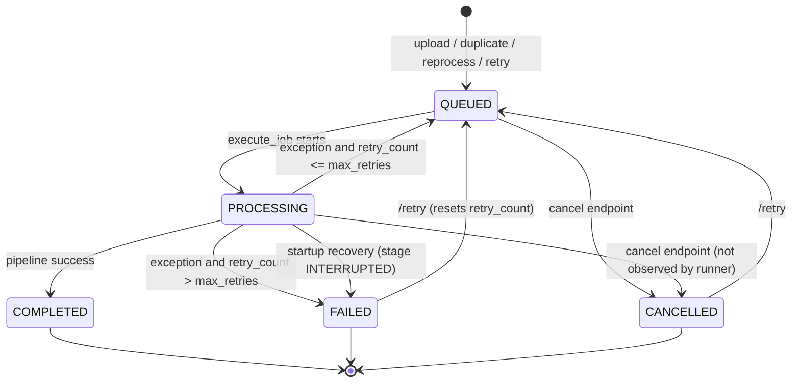
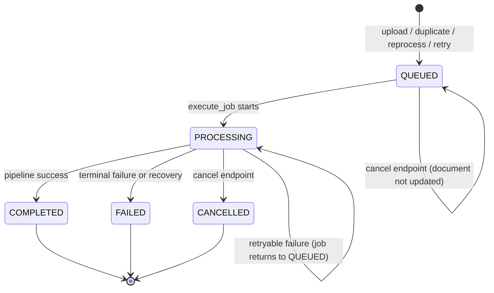

# M11 Stage 5 — Background Ingestion and Worker Reliability

**Milestone:** M11 — Production Hardening / Stage 5

**Date:** 2026-11-12

**Mode:** Read-only source analysis. No code, schema, test, Docker, or git changes were made.

**Target workload:** Private staging with a few invited users and real document uploads.

**Overall verdict:** `CONDITIONAL` — acceptable only for one API OS process with API-only in-process dispatch, pgvector, and the operational runbook in §6. If the compose `worker` profile is enabled, or more than one API process/replica handles jobs, the verdict is `NOT_SAFE_FOR_REAL_DOCUMENT_INGESTION`.


---

## 0. Executive Summary

The ingestion pipeline itself is complete and transactionally reasonable for the default pgvector path: bytes are written atomically to storage, a `Document`, `DocumentVersion`, and `IngestionJob` are committed together, and all chunks/embeddings are written in one later database transaction. A process restart does not lose already-committed upload bytes or committed database rows.

The reliability problem is the **job dispatch and state machine**, not the parser/chunker:

1. There is **no atomic job claim and no lease**. The worker does a plain `SELECT ... WHERE status = 'QUEUED' LIMIT 1` and then executes in a separate session. There is no `FOR UPDATE`, no `SKIP LOCKED`, and no atomic `UPDATE ... RETURNING`. Two workers, or the API's own background task plus a worker, can execute the same job and the same document concurrently.
2. API-side execution is **fire-and-forget** via `asyncio.create_task`. No strong task reference, task registry, drain-on-shutdown, or exception retrieval exists. No FastAPI `BackgroundTasks` is used anywhere in the application.
3. Automatic retry is **not re-dispatched in API-only mode**. On a retryable exception the service sets the job back to `QUEUED`, but nothing in the API process polls or re-spawns it. The `/retry` endpoint rejects `QUEUED` jobs, so a transient failure can leave the job `QUEUED` and the document `PROCESSING` indefinitely.
4. Startup recovery is **blunt and restart-only**. It marks every `PROCESSING` ingestion job as `FAILED/INTERRUPTED` without checking age, owner, or lease. It never re-queues or auto-resumes, and the worker process does not run recovery at all.
5. Cancellation is **advisory**. The cancel endpoint writes `CANCELLED` in a separate transaction, but the running pipeline never checks for it and later overwrites the status with `COMPLETED` or `FAILED/QUEUED`.
6. The optional compose worker is **not operationally ready as shipped**: it lacks the backend's model-gateway, encryption, and Qdrant environment, does not run recovery on startup, and exits immediately on SIGTERM without draining the in-flight job.

For a controlled private staging with one API process and a small number of users, these are manageable with the runbook in §6, but they are not invisible. The two non-negotiable staging constraints are: **run exactly one API OS process and do not enable the worker profile** until the claim/lease improvement in §7 is implemented.


---

## 1. Lifecycle Map

### 1.1 Entities and status fields

| Entity | Relevant fields | Default / transitions | Evidence |
|---|---|---|---|
| `IngestionJob` | `status`, `stage`, `progress_pct`, `retry_count`, `max_retries`, `started_at`, `completed_at`, `document_version_id` | Model default `PENDING`; every creation path writes `QUEUED`. No `claimed_by`, `lease_*`, `next_attempt_at`, or heartbeat fields. | `backend/app/models/knowledge.py:214-242`, `backend/alembic/versions/0002_document_ingestion_engine.py:137-166` |
| `Document` | `status`, `current_version_num`, `total_chunks`, `file_hash`, `file_path` | Model default `PENDING`; upload writes `QUEUED`; execution writes `PROCESSING`; terminal `COMPLETED`/`FAILED`/`CANCELLED`. `current_version_num` is initialised to `1` and no code path increments it. | `backend/app/models/knowledge.py:90-105`, `backend/app/services/ingestion/service.py:106-107` |
| `DocumentVersion` | `version_num`, `file_path`, `file_hash`, `extracted_text` | Unique `(document_id, version_num)`. Only version `1` is ever created by the ingestion code; reprocess does not create a new version. | `backend/app/models/knowledge.py:145-167`, `backend/app/services/ingestion/service.py:113-120`, `backend/app/api/v1/documents.py:137-147` |
| `DocumentChunk` | `chunk_hash`, `chunk_index`, `document_version_id` | No unique constraint on `(document_id, chunk_index)` or hash. `save_chunks` deletes **all** chunks for the document, then inserts new UUID-keyed rows. | `backend/app/models/knowledge.py:176-202`, `backend/app/repositories/document_repository.py:134-180` |
| `IngestionEvent` | `stage`, `status`, `message`, `details` | Append-only audit; tenant-scoped queries. | `backend/app/models/knowledge.py:254-273`, `backend/app/repositories/document_repository.py:285-317` |
| `ChunkEmbedding` | `embedding_version`, `content_hash`, `vector` | Unique `(chunk_id, embedding_version)`. Content hash is `sha256(content::model::dimensions)`. | `backend/app/models/knowledge.py:307-338`, `backend/app/embeddings/service.py:21-24` |
| `EmbeddingJob` | `status`, `stage`, `total_chunks`, `processed_chunks`, `failed_chunks` | Created `QUEUED`, immediately set `PROCESSING` by the synchronous reindex request. No retry counter, lease, or worker. | `backend/app/models/knowledge.py:346-368`, `backend/app/repositories/retrieval_repository.py:145-165`, `backend/app/services/ingestion/service.py:481-489` |

There is no document lock. The only mutual-exclusion signal is `Document.status == "PROCESSING"`, and it is advisory: `execute_job` checks only the **job** status (`COMPLETED`/`CANCELLED`) and never checks the document status before starting. There is no optimistic version column, no `SELECT ... FOR UPDATE`, no advisory lock, and no unique partial index preventing two active jobs for the same document. See `backend/app/services/ingestion/service.py:153-181` and `backend/app/repositories/document_repository.py:28-42`.

### 1.2 Creation and dispatch paths

| Trigger | Persisted result | Dispatch mechanism | Evidence |
|---|---|---|---|
| `POST /knowledge/{kb_id}/documents` (new file) | `Document` `QUEUED`, `DocumentVersion` v1, `IngestionJob` `QUEUED` / stage `QUEUED` / 10%, `UPLOAD` event, one commit | `asyncio.create_task(run_ingestion_in_background(...))` in the request loop | `backend/app/api/v1/knowledge.py:269-282`, `backend/app/services/ingestion/service.py:90-143` |
| Duplicate file in same KB (same SHA-256) | Existing `Document` returned; **new** `IngestionJob` `QUEUED` with no `document_version_id`; no new bytes | Same `create_task` from the upload endpoint | `backend/app/services/ingestion/service.py:58-76`, `backend/app/api/v1/knowledge.py:274-282` |
| `POST /documents/{document_id}/reprocess` | New `IngestionJob` `QUEUED`; document status set to `QUEUED`; no active-job guard and no version increment | `asyncio.create_task(...)` | `backend/app/api/v1/documents.py:121-150` |
| `POST /documents/ingest-url` | Fetch URL, then same as new upload | `asyncio.create_task(...)` | `backend/app/api/v1/documents.py:233-280` |
| `POST /ingestion/jobs/{job_id}/retry` | Only `FAILED`/`CANCELLED` allowed; resets `retry_count=0`, clears errors, sets job/document `QUEUED` | `asyncio.create_task(...)` after commit | `backend/app/api/v1/ingestion.py:57-100` |
| `POST /knowledge/{kb_id}/reindex` | New `EmbeddingJob`, immediately `PROCESSING`, executed **synchronously inside the request** | None; request blocks until reindex completes | `backend/app/api/v1/knowledge.py:516-547`, `backend/app/services/ingestion/service.py:481-535` |

Multi-file uploads are **not atomic**: `upload_document` commits per file inside the endpoint loop, and the endpoint spawns one task per file (`backend/app/api/v1/knowledge.py:269-303`, `backend/app/services/ingestion/service.py:143`). A `ValueError` on a later file aborts the request but leaves earlier files committed and their ingestion tasks running.

Reprocess and duplicate-upload jobs carry no `document_version_id` (`backend/app/api/v1/documents.py:137-147`, `backend/app/services/ingestion/service.py:66-76`). `save_chunks` therefore writes replacement chunks with `document_version_id = NULL` while the latest `DocumentVersion` row remains v1 (`service.py:288-293`). `Document.current_version_num` is never incremented, so the version fields are not a lock, lineage, or concurrency guard.

No FastAPI `BackgroundTasks` / `background_tasks.add_task` appears in `backend/app`. The application uses `asyncio.create_task` directly at `backend/app/api/v1/knowledge.py:282`, `backend/app/api/v1/documents.py:150`, `backend/app/api/v1/documents.py:280`, and `backend/app/api/v1/ingestion.py:100`; the task body is `backend/app/services/ingestion/service.py:548-552`. The task result is not stored, so the event loop keeps only a weak reference and unhandled exceptions are not retrieved.

### 1.3 Job state machine



`execute_job` only short-circuits for `COMPLETED` and `CANCELLED` (`backend/app/services/ingestion/service.py:157-158`). It does not short-circuit for `FAILED` or `PROCESSING`, so a second caller can re-run an already-running or failed job if it invokes the service directly (the worker filters `QUEUED`, but the API task and retry/reprocess paths do not atomically claim).

### 1.4 Document state machine



The retryable-failure branch is the important inconsistency: the job becomes `QUEUED` / stage `RETRY_QUEUED`, but the document is left `PROCESSING` (`backend/app/services/ingestion/service.py:429-439`). In API-only mode nothing re-dispatches the job, so the document can stay `PROCESSING` with a `QUEUED` job that `/retry` refuses to touch.

---

## 2. Detailed Findings

### 2.1 Execution pipeline and commit boundaries

`execute_job` performs the following sequence:

1. Load the job through a tenant-scoped repository (`backend/app/services/ingestion/service.py:153`, `backend/app/repositories/document_repository.py:256-267`).
2. Return immediately only for `COMPLETED` or `CANCELLED` (`service.py:157-158`).
3. Load the document through a tenant-scoped repository (`service.py:160`, `document_repository.py:28-42`).
4. Set job `PROCESSING` / stage `PARSING` / 20%, `started_at`, and document `PROCESSING`; **commit** (`service.py:176-181`).
5. Load bytes from storage, parse, OCR if configured, chunk (`service.py:183-271`).
6. Replace the document's chunks and update the latest version record (`service.py:274-305`, `document_repository.py:134-180`).
7. Embed and index (`service.py:307-394`).
8. Set document/job `COMPLETED` and commit (`service.py:396-419`).

The only commits after the initial `PROCESSING` commit are the terminal success commit at `service.py:417` and the failure commit at `service.py:453`. `record_event` flushes but does not commit (`document_repository.py:285-305`), `save_chunks` flushes (`document_repository.py:179`), and `EmbeddingService` flushes (`backend/app/embeddings/service.py:146`). Consequently:

- Stage/progress values written after line 181 are **inside one long transaction** and are not visible to other sessions until the terminal commit. API polling during a healthy long job sees `PROCESSING` / 20%, not 50%, 75%, or 85%.
- A process death rolls back the entire post-`PROCESSING` transaction. For the default pgvector path this is good: no partial `document_chunks` or `chunk_embeddings` rows survive.
- The transaction stays open across parsing, OCR, chunking, embedding-network calls, and Qdrant writes. This holds a database connection for the whole job (and row locks once `save_chunks` starts deleting/inserting), and can be minutes long for a large PDF.

**Direct answers on restart durability**

- A process restart by itself does not lose bytes that completed `storage.save`, nor database rows that committed. The local write is temp-file + atomic replace, the compose volume is persistent, and PostgreSQL commit is durable.
- It can lose the in-flight post-`PROCESSING` database transaction (expected) and leave a `.tmp` or a fully written but unreferenced file. There is no automatic orphan cleanup; reconciliation only reports.
- In the default pgvector path, no partial chunks/embeddings survive the rollback. In Qdrant mode, vectors can survive a database rollback and are not cleaned. The caught embedding-warning path commits chunks with no embeddings.
- If the upload commit succeeded but the client did not receive the response, a retry finds the hash and returns the existing document, but still creates a new job. Two concurrent first-time uploads can both pass the hash check and create two documents because there is no unique document-hash constraint.

If the failure is a database error (for example an integrity error or a failed flush), the SQLAlchemy session is aborted. The `except Exception` handler at `service.py:421-454` then attempts `record_event(...)` and `session.commit()` without a preceding `rollback()`. That commit can raise `PendingRollbackError`, so the job may remain `PROCESSING` even though the handler ran. This is an unhandled failure mode, not covered by tests.

### 2.2 How the worker claims jobs

The worker performs a plain read, then closes the session, then executes in a new session:

```text
select(IngestionJob)
  .where(IngestionJob.status == "QUEUED")
  .order_by(IngestionJob.created_at.asc())
  .limit(1)
```

Evidence: `backend/app/services/ingestion/worker.py:40-50`.

There is **no** `FOR UPDATE`, **no** `FOR UPDATE SKIP LOCKED`, **no** atomic `UPDATE ... RETURNING`, **no** `claimed_by`, **no** lease, and **no** status update between the select and the execute. The worker logs and calls `service.execute_job(job_id)` at `worker.py:55-62`.

Consequences:

| Scenario | Result |
|---|---|
| Two worker processes start together | Both can select the same oldest `QUEUED` job. Both call `execute_job`; both pass the `COMPLETED`/`CANCELLED` check and set `PROCESSING`; both parse, chunk, and embed the same document. |
| API upload task + worker | The API commits the job as `QUEUED` and schedules `create_task`; the worker can select the same row before the API task flips it to `PROCESSING`. Both execute. If the worker selects after the API's initial commit, it filters on `QUEUED` and will not select it; the race window is between upload commit and the API task's `PROCESSING` commit. |
| API task + `/reprocess` (no status guard), or `/retry` after a cancel/recovery has changed the job state | The endpoint reads the job, writes `QUEUED`/`PROCESSING`-adjacent state, and spawns a second task without an atomic condition. A second task can start while the first is still running. |
| Duplicate upload while the original document is `PROCESSING` | `get_by_hash` returns the existing document, then the service creates a new `QUEUED` job and the endpoint spawns a second task for the same document (`service.py:61-76`, `knowledge.py:274-282`). |
| Two API instances, no worker | Each API task is local to the process that handled the request. Instance B never polls; if instance A dies after the upload commit but before its task starts, the job remains `QUEUED` forever (startup recovery only touches `PROCESSING`). |

The duplicate execution is not merely wasted work. `save_chunks` deletes all chunks for the document and inserts new UUID-keyed chunks without a unique constraint on `(document_id, chunk_index)` (`document_repository.py:143-167`, `models/knowledge.py:194-202`). Under PostgreSQL READ COMMITTED, two concurrent executions can both delete the old set, then both insert their own set because each delete does not see the other transaction's uncommitted inserts. The result can be duplicate chunks with duplicate indexes, duplicate embeddings (unique per `chunk_id`, not per document/index), duplicate retrieval hits, and a last-writer-wins `Document.total_chunks`/`Document.status`. This is a data-quality defect, not just a cost issue.

### 2.3 Retry semantics

**Endpoint retry** (`POST /api/v1/ingestion/jobs/{job_id}/retry`, `backend/app/api/v1/ingestion.py:57-110`):

- Allowed only when status is `FAILED` or `CANCELLED`; `QUEUED` and `PROCESSING` are rejected (`ingestion.py:72-76`).
- Sets `status="QUEUED"`, `stage="QUEUED"`, `progress_pct=10`, `retry_count=0`, clears `error_message`/`error_category`, sets the document to `QUEUED` if it still exists, records a `RETRY` event, commits, then spawns a background task (`ingestion.py:78-100`).
- There is no backoff, no `next_attempt_at`, and no limit on manual retries because `retry_count` is reset to zero each time.
- The read-check-write sequence is not atomic. Two concurrent retry requests can both observe `FAILED` and both spawn tasks. A retry of a `CANCELLED` job can spawn a task while the original cancelled task is still running (cancellation does not stop it).

**Automatic retry inside `execute_job`** (`service.py:421-453`):

- On any uncaught exception, `retry_count` is incremented, error category/message and duration are set.
- If `retry_count <= max_retries` (default 3), the job is set to `QUEUED` / `RETRY_QUEUED` and a `RETRY_SCHEDULED` event is recorded. The **document is not changed** and remains `PROCESSING`.
- If `retry_count > max_retries`, the job is set to `FAILED`, the document to `FAILED`, and a terminal event is recorded.
- There is **no re-dispatch** in API-only mode after setting `QUEUED`. The job sits there; `/retry` rejects it because it is `QUEUED`; the worker (if enabled) is the only component that would pick it up. In API-only staging this is a dead end.
- With a worker enabled, the worker polls every 2 seconds (`worker.py:21-34`), so the automatic retries happen immediately, with no backoff; four total attempts (initial + 3 retries) can complete in a few seconds.
- `error_message`/`error_category` are not cleared if a later attempt succeeds, so a `COMPLETED` job can still display the previous failure text.

Embedding failures are split:

- `TimeoutError`, `ConnectionError`, `PermissionError` are caught locally (`service.py:385-394`): the job continues and completes, the document is marked `COMPLETED`, chunks are available for lexical search, but embeddings are missing or incomplete. This is a deliberate warning path, not a failure.
- Other errors (`RuntimeError` for a 4xx embedding response, `ValueError` for an empty/malformed response, Qdrant exceptions) propagate to the outer handler and enter the retry path. A bad model name, dimension mismatch, or Qdrant configuration error can therefore produce the `QUEUED` dead end described above.

**Idempotency and duplicate prevention**

- **Document level:** `sha256(content)` is looked up by `(tenant_id, knowledge_base_id, file_hash)` (`document_repository.py:44-52`). A hit returns the existing document but creates a new job. There is no DB uniqueness on the hash, so two concurrent identical uploads can both pass the check and create two documents.
- **Chunk level:** chunkers compute `chunk_hash`, which is stored on `DocumentChunk`, but it is not unique and is not used to skip existing chunks. `save_chunks` deletes all chunks for the document and re-inserts (`document_repository.py:143-167`). A serial reprocess replaces chunks; concurrent runs can duplicate them.
- **Embedding level:** `content_hash = sha256(content::model::dimensions)`; an existing embedding is reused only when the same `chunk_id`, `embedding_version`, hash, and non-null vector match (`embeddings/service.py:76-109`). The unique constraint is `(chunk_id, embedding_version)`. Reprocess creates new chunk IDs, so previous embeddings are cascade-deleted and not reused.
- **Qdrant:** point IDs are chunk IDs; re-upserting the same chunks is idempotent, but a reprocess creates new chunk IDs and does not delete the old points.
- **No request idempotency key** exists for upload/job creation; a client retry after an unknown outcome can create additional jobs.

### 2.4 Cancellation semantics

`POST /api/v1/ingestion/jobs/{job_id}/cancel` (`backend/app/api/v1/ingestion.py:113-159`):

- Rejects `COMPLETED`, `FAILED`, `CANCELLED`; allows `QUEUED` and `PROCESSING` (`ingestion.py:128-135`).
- Sets the job to `CANCELLED` / stage `CANCELLED`.
- Sets the document to `CANCELLED` **only if the document is currently `PROCESSING`** (`ingestion.py:137-140`). If the job is `QUEUED` and the document is `QUEUED`, the document is left `QUEUED`.
- Records an event and audit log, commits (`ingestion.py:142-157`).

There is no cancellation flag consumed by `execute_job`, no check between stages, and no conditional update. The running task holds its own ORM objects with `expire_on_commit=False` (`backend/app/database/session.py:28-34`) and never refreshes. At completion it assigns `job.status = "COMPLETED"` and `doc.status = "COMPLETED"` unconditionally (`service.py:398-406`), overwriting the cancellation. If it fails instead, it can overwrite `CANCELLED` with `QUEUED` or `FAILED` (`service.py:429-443`).

Two further inconsistencies:

- A cancelled `QUEUED` job's already-scheduled task loads the job, sees `CANCELLED`, and returns early (`service.py:157-158`), leaving the document `QUEUED` forever.
- If a user cancels a running job and immediately retries it, the endpoint permits the retry (the job is now `CANCELLED`) and spawns a second task while the first task continues. This is a user-triggerable path to concurrent chunk replacement.

The existing cancellation test asserts only the job's `CANCELLED` status, not the document state or the race (`backend/tests/test_background_recovery.py:197-246`).

### 2.5 Startup recovery: exact mutations

`recover_orphaned_jobs` is called once during the API lifespan startup, after schema creation and role seeding (`backend/app/main.py:34-40`). Its implementation is `backend/app/services/ingestion/recovery.py:27-91`.

For every `IngestionJob` with `status == "PROCESSING"` (**all tenants; no age check; no owner/lease check; no row lock**):

- `status = "FAILED"` (`recovery.py:39`)
- `stage = "INTERRUPTED"` (`recovery.py:40`)
- `error_category = "PROCESS_RESTART"` (`recovery.py:41`)
- `error_message = "Job was interrupted by an application process restart. Safe to retry."` (`recovery.py:42-44`)
- `completed_at = now` (`recovery.py:45`)
- If the associated `Document` exists **and** its status is `PROCESSING`, set `Document.status = "FAILED"` (`recovery.py:47-51`)
- Insert an `IngestionEvent` with stage `PROCESS_RESTART`, status `FAILED`, and the same message/details (`recovery.py:54-64`)

For every `EmbeddingJob` with `status == "PROCESSING"`:

- `status = "FAILED"` (`recovery.py:73`)
- `stage = "INTERRUPTED"` (`recovery.py:74`)
- `error_message = "Embedding job was interrupted by an application process restart. Safe to retry."` (`recovery.py:75-77`)
- `completed_at = now` (`recovery.py:78`)
- No document status update, no event, no `error_category` field (the model has none).

The function commits only if at least one row was recovered (`recovery.py:81-86`). It does **not** touch `QUEUED`, `PENDING`, or `RETRY_QUEUED` jobs, does not re-queue or auto-resume, and does not clean chunks or vectors. Interrupted ingestion therefore requires a **manual** `/retry` (after recovery marks it `FAILED`) or a document reprocess. Interrupted embedding requires a manual reindex call; there is no embedding retry endpoint.

**Direct answers on interrupted jobs**

- Crash after the `PROCESSING` commit: job/document stay `PROCESSING` until the API process restarts. Startup recovery then sets job `FAILED/INTERRUPTED` and document `FAILED`; ingestion does **not** auto-resume. `/retry` is required (or reprocess). If the process never restarts, or recovery is skipped/swallowed, `PROCESSING` can persist indefinitely.
- Crash after the upload commit but before the task claims `PROCESSING`: job/document stay `QUEUED`. Startup recovery ignores `QUEUED`; `/retry` rejects `QUEUED`; the job remains until an operator reprocesses or a worker is started. API-only dispatch has no startup dispatcher.
- Retryable exception: job `QUEUED`/`RETRY_QUEUED`, document `PROCESSING`; no in-process re-dispatch; `/retry` rejects `QUEUED`; reprocess or worker.
- Runtime task GC/hang without a process restart: job/document stay `PROCESSING`; there is no watchdog. A restart is the only built-in recovery.
- Cancellation is advisory; see §2.4.

Wiring caveats:

- The call is inside the same `try` block as `create_all` and role seeding; if either fails, recovery is skipped (`main.py:25-43`).
- Any recovery exception is swallowed and only printed as a startup warning (`main.py:41-43`); the API still starts.
- The worker's `main()` never calls recovery (`worker.py:65-75`). A worker restart alone will not recover a job left `PROCESSING` by the worker.
- Because the sweep is not scoped by lease or age, an API restart while a worker is actively processing will mark that live job `FAILED` and its document `FAILED`. The worker may later overwrite those with `COMPLETED`, or with `QUEUED`/`FAILED` if it fails. A retry issued in between can run concurrently with the worker.
- A single API instance with multiple uvicorn worker processes starts recovery in every process. The repo's `render.yaml` uses `--workers 2` (`render.yaml:15`), so even a "single instance" on that blueprint has two recovery sweeps. The Dockerfile command is single-process (`infrastructure/docker/backend.Dockerfile:25`).

### 2.6 Worker process and compose profile

The worker is a standalone process, not started by the API. Compose defines it under profiles `workers`, `worker`, and `full` (`docker-compose.yml:82-101`), runs `python -m app.services.ingestion.worker` (`docker-compose.yml:89`), depends only on PostgreSQL, and mounts the same code and `backend_storage` volume as the backend (`docker-compose.yml:99-101`, `docker-compose.yml:52-54`).

- It only processes `IngestionJob`; it never processes `EmbeddingJob` (`worker.py:11`, `worker.py:43-48`).
- It processes one job at a time sequentially. A hung parse or embedding call blocks the entire queue; `MAX_PROCESSING_DURATION_SECONDS` is defined (`backend/app/core/config.py:72`) but never read anywhere.
- Signal handling calls `stop()` and then `sys.exit(0)` immediately (`worker.py:68-70`). It does not cancel/await the in-flight `execute_job` or mark the job. A SIGTERM leaves the job `PROCESSING`; because the worker does not run recovery, the job stays there until the API restarts.
- The worker environment in compose is not at parity with the backend: it omits `SECRET_KEY`, `SECRET_ENCRYPTION_KEY`, `LLM_BASE_URL`, `OMNIROUTE_API_KEY`, `QDRANT_URL`, and the `DEFAULT_*` retrieval settings (`docker-compose.yml:93-98`). With defaults it uses `LLM_BASE_URL=http://localhost:20128/v1` and `QDRANT_URL=http://localhost:6333` inside the worker container (`config.py:85`, `config.py:91`), which do not reach the host OmniRoute gateway or the compose `qdrant` service. BYOK keys encrypted with a backend-specific `SECRET_ENCRYPTION_KEY` cannot be decrypted (fallback is `SECRET_KEY`; `backend/app/core/crypto.py:28`), and Qdrant-backed KBs will fail indexing. The default `pgvector` vector store does not need Qdrant, but embeddings still need the model gateway.
- Because the backend always spawns its own task on upload/retry/reprocess, enabling the worker profile creates two dispatchers for the same `QUEUED` rows. There is no configuration switch to disable the API-side dispatch.

### 2.7 EmbeddingJob lifecycle

`EmbeddingJob` is not part of the background worker:

- `RetrievalRepository.create_embedding_job` creates it as `QUEUED` with `started_at` already set (`backend/app/repositories/retrieval_repository.py:145-165`).
- `IngestionService.reindex_knowledge_base` immediately sets it to `PROCESSING` / `EMBEDDING` and commits (`service.py:481-489`), then performs embedding and (for Qdrant) upsert **inside the HTTP request** (`service.py:499-535`).
- Success sets `COMPLETED` and commits (`service.py:530-534`); a caught exception sets `FAILED` and commits (`service.py:537-544`).
- For Qdrant, the code commits after setting `INDEXING` before the Qdrant upsert (`service.py:507-509`), so the database embeddings are committed before the external vector write. A crash or Qdrant failure at that point leaves committed DB embeddings but an incomplete external index.
- Startup recovery only marks an interrupted embedding job `FAILED`; it does not re-run it. There is no `/embedding-jobs/{id}/retry` or cancel endpoint. The only recovery is to call `POST /knowledge/{kb_id}/reindex` again, which creates a new `EmbeddingJob`.

### 2.8 Tenant isolation

API-facing reads and mutations are tenant-scoped:

- `IngestionJobRepository` inherits `TenantScopedRepository` and filters both `id` and `tenant_id` (`backend/app/repositories/document_repository.py:250-267`, `backend/app/repositories/base.py:22-29`).
- List/get/retry/cancel all construct the repository with `ctx.tenant.id` (`backend/app/api/v1/ingestion.py:31`, `:47`, `:64`, `:120`).
- Document access is tenant-scoped and additionally ACL-checked (`backend/app/api/v1/documents.py:34-47`, `:56-64`).
- Execution repos are all initialised with the job's tenant and filter by it (`service.py:28-32`, `document_repository.py:28-42`, `:201-207`, `:256-267`, `:307-317`).
- Cross-tenant retry/cancel/get is covered by tests and returns 404 (`backend/tests/test_background_recovery.py:249-299`).

Two system-level exceptions are worth recording:

1. The worker's claim query has **no tenant filter** (`worker.py:43-48`). This is intentional for a cross-tenant worker: it reads `tenant_id` from the job and uses it for all subsequent scoped calls. If a job row were corrupted to point at another tenant's document, the scoped document lookup would fail and the job would be marked `FAILED` ("document not found"), not mutate the other tenant's document.
2. Startup recovery is global and uses `session.get(Document, job.document_id)` **without** a tenant predicate (`recovery.py:34`, `:49`, `:68`). If a job's `document_id` ever referenced a document belonging to a different tenant, recovery could change that document's status. Normal write paths keep them aligned, and there is no composite `(tenant_id, document_id)` foreign key to enforce it (`models/knowledge.py:217-231`; migration `0002_document_ingestion_engine.py:157-161`). This is a hardening gap; adding `Document.tenant_id == job.tenant_id` to the recovery lookup is a small safety fix independent of the queue design.

---

## 3. Evidence Table

All paths are relative to `E:\MM Office\Multi-Tanant-CaaS`. Line numbers are from the inspected working tree.

| # | Claim | Evidence |
|---|---|---|
| 1 | `IngestionJob` has status/stage/progress/retry fields but no claim, lease, heartbeat, or next-attempt fields | `backend/app/models/knowledge.py:214-242`, `backend/alembic/versions/0002_document_ingestion_engine.py:137-166` |
| 2 | `Document` uses a `status` string and `current_version_num`, with no optimistic version/lock column | `backend/app/models/knowledge.py:90-115` |
| 3 | `DocumentVersion` is unique on `(document_id, version_num)` but only v1 is created | `backend/app/models/knowledge.py:145-167`, `backend/app/services/ingestion/service.py:113-120` |
| 4 | Upload writes bytes first, then commits `Document` + `DocumentVersion` + `IngestionJob` | `backend/app/services/ingestion/service.py:90-143` |
| 5 | Duplicate upload returns the existing document but creates a new `QUEUED` job (no version) | `backend/app/services/ingestion/service.py:58-76` |
| 6 | All API dispatch is `asyncio.create_task`, not FastAPI `BackgroundTasks` | `backend/app/api/v1/knowledge.py:282`, `backend/app/api/v1/documents.py:150`, `backend/app/api/v1/documents.py:280`, `backend/app/api/v1/ingestion.py:100`, `backend/app/services/ingestion/service.py:548-552` |
| 7 | The task has no retained reference, registry, drain, or exception retrieval | same as #6; no task field is stored or awaited |
| 8 | Worker claims with plain `SELECT ... status='QUEUED' ... LIMIT 1` | `backend/app/services/ingestion/worker.py:40-50` |
| 9 | Worker executes in a new session with no atomic claim/update | `backend/app/services/ingestion/worker.py:55-62` |
| 10 | `execute_job` short-circuits only for `COMPLETED`/`CANCELLED`, not `PROCESSING`/`FAILED` | `backend/app/services/ingestion/service.py:153-158` |
| 11 | `execute_job` commits `PROCESSING` before doing pipeline work | `backend/app/services/ingestion/service.py:176-181` |
| 12 | Post-`PROCESSING` stages are flushed but not committed until success/failure | `backend/app/repositories/document_repository.py:285-305`, `backend/app/repositories/document_repository.py:179`, `backend/app/embeddings/service.py:146`, `backend/app/services/ingestion/service.py:417`, `:453` |
| 13 | Success/failure writes job/document status unconditionally (can clobber cancellation) | `backend/app/services/ingestion/service.py:396-406`, `:429-443`; `expire_on_commit=False` at `backend/app/database/session.py:28-34` |
| 14 | Retry endpoint only accepts `FAILED`/`CANCELLED`, resets `retry_count`, spawns a task | `backend/app/api/v1/ingestion.py:57-100` |
| 15 | Automatic retry sets `QUEUED`/`RETRY_QUEUED` but does not re-dispatch; document stays `PROCESSING` | `backend/app/services/ingestion/service.py:421-439` |
| 16 | Cancel is a separate read-check-write with no cooperative signal; only updates document when it is `PROCESSING` | `backend/app/api/v1/ingestion.py:113-159` |
| 17 | Startup recovery marks all `PROCESSING` ingestion jobs `FAILED/INTERRUPTED` | `backend/app/services/ingestion/recovery.py:33-65` |
| 18 | Recovery updates the document without a tenant predicate | `backend/app/services/ingestion/recovery.py:47-51` |
| 19 | Recovery is startup-only and its failure is swallowed | `backend/app/main.py:34-43` |
| 20 | Worker never runs recovery | `backend/app/services/ingestion/worker.py:65-75` |
| 21 | Worker exits immediately on SIGINT/SIGTERM without draining | `backend/app/services/ingestion/worker.py:68-70` |
| 22 | Worker compose profile is optional and shares DB/storage but not backend env | `docker-compose.yml:82-101`, `docker-compose.yml:52-54` |
| 23 | Embedding content hash is `sha256(content::model::dimensions)`; reuse requires same chunk id/version/hash | `backend/app/embeddings/service.py:21-24`, `:76-109` |
| 24 | `save_chunks` deletes all document chunks and inserts new UUID-keyed rows with no index uniqueness | `backend/app/repositories/document_repository.py:134-180`, `backend/app/models/knowledge.py:194-202` |
| 25 | Qdrant vectors are upserted before the database commit; no cleanup on failure | `backend/app/services/ingestion/service.py:351-375`, `:417` |
| 26 | Local storage write is temp-file + atomic replace | `backend/app/storage/local.py:37-49` |
| 27 | Storage reconciliation detects orphan files but does not delete them | `backend/app/storage/recovery.py:229-314`, especially `:299-304` |
| 28 | API job/document lookups are tenant-scoped | `backend/app/repositories/base.py:22-29`, `backend/app/repositories/document_repository.py:28-42`, `:256-267`, `backend/app/api/v1/ingestion.py:31-54` |
| 29 | Worker claim and recovery queries are global (system-level) | `backend/app/services/ingestion/worker.py:43-48`, `backend/app/services/ingestion/recovery.py:34`, `:68` |
| 30 | Recovery tests exercise seeded state transitions, not live crashes | `backend/tests/test_background_recovery.py:42-138`, `backend/tests/test_m10_stage3_knowledge_and_retrieval.py:405-425` |
| 31 | Retry/cancel tests assert endpoint state, not background completion or document cancellation | `backend/tests/test_background_recovery.py:141-246`, `backend/tests/test_m10_stage3_knowledge_and_retrieval.py:350-397` |
| 32 | Tests use in-memory SQLite, so PostgreSQL row-lock/`SKIP LOCKED` behavior is not exercised | `backend/tests/conftest.py:16` |
| 33 | Staging blueprint starts two uvicorn workers | `render.yaml:15` |
| 34 | Dockerfile starts one uvicorn process (default) | `infrastructure/docker/backend.Dockerfile:25` |
| 35 | `MAX_PROCESSING_DURATION_SECONDS` is defined but not enforced | `backend/app/core/config.py:72` (no reader found in `backend/app`) |


---

## 4. Failure-Mode Matrix

| # | Crash / trigger point | State left in PostgreSQL / storage | Behavior after a normal restart | Required recovery | Residual state |
|---|---|---|---|---|---|
| F1 | Process dies during `storage.save` before the DB commit | No `Document`/job row; possibly a `.tmp` file or partial temp | Nothing to recover; the client retries the upload | Client retry | Orphan `.tmp`; no DB reference |
| F2 | Process dies after `storage.save` completes, before the upload commit | Raw file exists; no `Document`/job row | Nothing to recover | Client retry | Orphan raw file; `reconcile_database_and_storage` reports it as orphan but does not delete it |
| F3 | Process dies after the upload commit, before the `create_task` starts/commits `PROCESSING` | `Document` `QUEUED`, `IngestionJob` `QUEUED`, bytes committed | Startup recovery ignores `QUEUED`; no dispatcher re-spawns it. With no worker the job is stranded | Manual reprocess (creates a new job) or run a worker | Original job remains `QUEUED`; `/retry` returns 400 |
| F4 | Process dies mid-pipeline after the `PROCESSING` commit | Job `PROCESSING`, document `PROCESSING`; post-`PROCESSING` transaction rolls back (pgvector: no partial chunks/embeddings) | API startup recovery sets job `FAILED/INTERRUPTED`, document `FAILED`; no auto-resume | Restart API, then `POST /ingestion/jobs/{id}/retry` (or reprocess) | Job/event history records `PROCESS_RESTART`; operator must retry |
| F5 | Process dies during the final commit (`service.py:417`/`:453`) | Commit is atomic: either the whole completed/failed state committed, or the transaction rolled back leaving `PROCESSING` | Same as F4 if rolled back; if committed, state is terminal and consistent | None if committed; F4 procedure if rolled back | If the client retries the original upload after an unknown outcome, duplicate detection returns the existing document but creates a new job |
| F6 | Qdrant upsert succeeds, then the DB commit fails or process dies | DB chunks/embeddings roll back; Qdrant contains vectors for chunk IDs that do not exist in the DB | Startup recovery marks the job/document `FAILED`; Qdrant is not reconciled | Manual retry/reprocess; external vector cleanup is manual | Orphan Qdrant points; a later reprocess creates new chunk IDs and does not delete the old points |
| F7 | Worker process killed (SIGKILL or SIGTERM) mid-job | Job `PROCESSING`, document `PROCESSING`; open transaction rolls back | Worker restart does **not** run recovery; job stays `PROCESSING` indefinitely unless the API restarts | Restart the API to trigger recovery, then retry | Worker has no graceful drain; SIGTERM exits immediately |
| F8 | API restarts while a worker is processing | API startup recovery marks the worker's job `FAILED/INTERRUPTED`, document `FAILED` | Worker continues and may later write `COMPLETED`; if it fails it may write `QUEUED`/`FAILED` | Avoid restarting API during worker jobs; if it happens, verify final state before retry | State churn; retry during the overlap can run concurrently |
| F9 | Retryable exception in `execute_job` (e.g. Qdrant error, embedding 4xx, DB error) | Job `QUEUED` / `RETRY_QUEUED`; document stays `PROCESSING`; retry transaction commits | API-only: no re-dispatch; `/retry` rejects `QUEUED`; stranded. Worker: re-polls immediately (no backoff) | Cancel the stuck `QUEUED` job, then reprocess; or run a worker; or wait for the lease/claim improvement | Old job and document status diverge; automatic retry counter may have advanced |
| F10 | Database error while handling the failure (session already aborted) | Failure commit can fail; job remains `PROCESSING` | API restart recovery marks it `FAILED`; without restart it stays `PROCESSING` | Restart API, then retry | Error is only in logs; no failure event may be persisted |
| F11 | `asyncio` task is garbage-collected, cancelled by loop shutdown, or hangs in a synchronous parser | Job `PROCESSING`, document `PROCESSING` | No watchdog; stays until API restart recovery (if the process restarts) | Restart API; verify no duplicate task is still running | No timeout enforcement (`MAX_PROCESSING_DURATION_SECONDS` unused); a hung parse can block the event loop |
| F12 | Cancel a `QUEUED` job | Job `CANCELLED`; document remains `QUEUED` (cancel only updates `PROCESSING` documents) | Scheduled task sees `CANCELLED` and returns early; document stays `QUEUED` | `/retry` the `CANCELLED` job (sets document `QUEUED`) or reprocess | Document status is inconsistent until retried/reprocessed |
| F13 | Cancel a `PROCESSING` job | Job/document `CANCELLED`; running task continues | Task later writes `COMPLETED` or `QUEUED`/`FAILED`, overwriting `CANCELLED` | Treat cancellation as best-effort; verify terminal state | No cooperative cancellation; cancel cannot be guaranteed |
| F14 | Duplicate upload while original document is `PROCESSING`, or reprocess/retry during processing | Two or more active tasks for the same document | Both can replace chunks; concurrent `DELETE` + `INSERT` can leave duplicate chunks; last commit wins | Avoid user actions during processing; if it happens, inspect chunk count/indexes and reprocess once | Duplicate chunks/embeddings, duplicate retrieval hits, inconsistent totals |
| F15 | Reindex request crashes or is cancelled | `EmbeddingJob` `PROCESSING`; pgvector embeddings may be uncommitted (rollback) or Qdrant partially indexed | API startup recovery marks `EmbeddingJob` `FAILED/INTERRUPTED`; no auto-resume | Call reindex again (new `EmbeddingJob`); reconcile Qdrant if used | No retry endpoint; Qdrant may retain partial vectors |
| F16 | Storage volume is removed/replaced (`docker compose down -v`, host loss) | DB rows remain, files are gone | API still starts; document reads/ingestion fail with `FileNotFoundError` | Restore storage backup; `reconcile_database_and_storage` reports missing files | DB records point at missing bytes; no automatic repair |


---

## 5. Staging Evaluation

### 5.1 Option A — one API process, in-process `asyncio.create_task`, no worker profile

This is the only shape that can be conditionally accepted.

| Area | Assessment | Evidence / reason |
|---|---|---|
| Upload durability | Acceptable | Bytes are written before the DB commit using a temp-file + atomic replace (`local.py:37-49`); compose mounts a named `backend_storage` volume (`docker-compose.yml:52-54`); PostgreSQL commits are durable. A process restart does not lose committed bytes/rows. |
| Ingestion correctness | Acceptable only for serial, non-overlapping runs | The pipeline is exercised end-to-end synchronously by tests (`test_ingestion_pipeline.py:27-93`, `test_ingestion_to_embedding.py:14-59`). |
| Crash during active pipeline | Conditional | The post-`PROCESSING` transaction rolls back; API restart recovery converts the job/document to `FAILED`; a manual `/retry` is required. No automatic resume. |
| Crash before pipeline starts | Weak | A `QUEUED` job is not recovered or dispatched; `/retry` rejects `QUEUED`. The operator must reprocess the document or run a worker. |
| Transient failure retry | Weak | Automatic retry writes `QUEUED` but nothing re-dispatches; the document stays `PROCESSING`. |
| Cancellation | Weak | Best-effort only; a queued document can remain `QUEUED`; an in-flight job can overwrite `CANCELLED`. |
| Concurrent user actions | Weak | Duplicate upload/reprocess/retry during processing is not guarded and can run two pipelines for one document. |
| Worker/multi-process safety | Not acceptable | No atomic claim; duplicate execution is possible. Do not enable the worker profile; keep exactly one uvicorn process. |
| Progress visibility | Limited | Stages after `PROCESSING` are uncommitted until terminal; the API shows 20% for the whole job. |
| API responsiveness | Risk | Parsers are `async def` but perform synchronous CPU work (for example PyMuPDF extraction in `backend/app/parsers/pdf.py:38-90`); in-process ingestion runs on the API event loop and can stall all requests during a large parse. Uploads are also fully buffered in memory before the size check (`knowledge.py:271`, `service.py:51-55`). |
| Tenant isolation | Acceptable for API paths | Scoped repositories and cross-tenant 404 tests. Recovery's unscoped document `get` is a hardening gap, not a normal write path. |

### 5.2 Option B — API plus compose `worker` profile

`NOT_SAFE_FOR_REAL_DOCUMENT_INGESTION` as currently implemented:

1. The API always spawns its own task; the worker also polls. Both can claim the same `QUEUED` job. There is no atomic claim, so duplicate execution is a race, not a theoretical possibility.
2. The worker's environment does not match the backend (model gateway, Qdrant, encryption keys), so its jobs can fail where the API's would succeed. See `docker-compose.yml:93-98` versus `docker-compose.yml:35-51`.
3. The worker does not run recovery and exits immediately on SIGTERM. A worker crash leaves `PROCESSING` until an API restart.
4. An API restart can mark the worker's live job `FAILED` because recovery is not lease-aware.

Therefore the worker profile must stay disabled for private staging until §7 is implemented. This is a constraint, not a preference.

### 5.3 Verdict

**`CONDITIONAL`** — the single-process, API-only, pgvector configuration is acceptable for a private staging workload with a few invited users **only if all of the following are enforced**:

- Exactly one backend OS process (one uvicorn worker; one container/replica). Do not use `--workers 2` as in `render.yaml:15`.
- The compose `worker` profile is not enabled.
- `DEFAULT_VECTOR_STORE=pgvector` (or `fts`), not Qdrant.
- The staging runbook in §6 is followed, including monitoring `PROCESSING`/`QUEUED` age and the manual retry/reprocess procedures.
- The live crash drills in §9 pass before users are invited.

If any of those conditions is not met, the verdict is `NOT_SAFE_FOR_REAL_DOCUMENT_INGESTION`.

---

## 6. Operational Mitigations for Private Staging

These are mandatory for the `CONDITIONAL` verdict. They do not fix the code; they keep a small, controlled staging workload inside the safe envelope.

### 6.1 Process topology

1. Run **one** uvicorn process and **one** backend container/replica. Verify there is no `--workers 2` (the repo's `render.yaml:15` has it; the Dockerfile does not, `infrastructure/docker/backend.Dockerfile:25`).
2. Do **not** start the compose `worker` profile (`docker compose --profile workers ...`). The API already dispatches in-process, and the worker has no atomic claim.
3. Do not run the API behind a load balancer that starts a second replica during staging. A rolling deploy is a restart and will trigger recovery while old tasks may still run.

### 6.2 Monitoring queries

Run these against the staging database at least every minute (or expose them through an existing observability endpoint):

```sql
-- Jobs that are running too long or waiting with no worker.
SELECT id, tenant_id, document_id, status, stage, retry_count,
       started_at, created_at, updated_at,
       now() - COALESCE(started_at, created_at) AS age
FROM ingestion_jobs
WHERE status IN ('PROCESSING', 'QUEUED')
ORDER BY created_at;

-- Documents stuck in PROCESSING/QUEUED.
SELECT id, tenant_id, knowledge_base_id, status, total_chunks,
       updated_at, now() - updated_at AS status_age
FROM documents
WHERE status IN ('PROCESSING', 'QUEUED')
ORDER BY updated_at;

-- Recovery/failure history.
SELECT job_id, stage, status, message, created_at
FROM ingestion_events
WHERE status IN ('FAILED', 'RETRY_SCHEDULED')
ORDER BY created_at DESC
LIMIT 50;
```

Suggested staging thresholds:

- `PROCESSING` job older than **15 minutes** → page/notify the operator. The intended cap is `MAX_PROCESSING_DURATION_SECONDS=600` (`backend/app/core/config.py:72`), but it is not enforced.
- `QUEUED` job older than **5 minutes** → investigate. In API-only mode this usually means an auto-retry dead end or a crash before task start.
- `Document.status = PROCESSING` older than **15 minutes** → investigate even if the job looks terminal, because the retryable-failure path leaves the document behind.
- Any document with `total_chunks = 0` after `COMPLETED` → inspect parser/logs; any document with `index-status.pending_chunks > 0` after `COMPLETED` → embeddings were skipped (warning path) or partially indexed.

Also monitor API latency and `/health` during uploads. Parsers run synchronously on the event loop, so a large PDF can make the API unresponsive even though the job is "background".

### 6.3 Manual procedures

**A. Process crashed or was restarted during a `PROCESSING` job**

1. Restart the API once if it is not already running; this runs `recover_orphaned_jobs` and converts `PROCESSING` jobs/documents to `FAILED`.
2. Verify the job is `FAILED` / stage `INTERRUPTED` and the document is `FAILED`.
3. Confirm no old task is still running (the process is new; check logs for the job id).
4. `POST /api/v1/ingestion/jobs/{job_id}/retry` and watch the job to `COMPLETED`.
5. If retry returns 400 because the job is still `PROCESSING`, the restart did not run recovery (check the startup warning in `main.py:41-43`); restart again and investigate the startup error before retrying.

**B. Job stuck `QUEUED`, document `QUEUED` (crash before dispatch)**

`/retry` will return 400. Do not run the worker. Use:

1. `GET /api/v1/ingestion/jobs/{job_id}` to confirm `QUEUED` and no recent `started_at`.
2. `POST /api/v1/ingestion/jobs/{job_id}/cancel` (allowed for `QUEUED`) to retire the old job. This leaves the document `QUEUED`.
3. `POST /api/v1/documents/{document_id}/reprocess` to create a new job and set the document `QUEUED` again.
4. Watch the new job to `COMPLETED`.

Alternatively, leave the old job `QUEUED` and reprocess; with no worker it will remain inert, but it will pollute the job list and could be picked up later if a worker is accidentally enabled.

**C. Job `QUEUED` / document `PROCESSING` after a transient failure**

This is the automatic-retry dead end (F9). Procedure:

1. Confirm the job has `retry_count > 0`, `stage = RETRY_QUEUED`, and the document is `PROCESSING`.
2. Cancel the old `QUEUED` job, then reprocess the document as in B. Do not simply retry: `/retry` rejects `QUEUED`.
3. If the failure is a known embedding-provider misconfiguration (bad model name, dimension, Qdrant), fix the retrieval config first; otherwise the new job will fail the same way.
4. If the job somehow remains `PROCESSING` with a stale `started_at`, restart the API first, then retry the resulting `FAILED` job.

**D. Cancel a running job**

Treat cancel as a request, not a guarantee:

1. After `POST /cancel`, poll the job and document. If the job later becomes `COMPLETED`, the pipeline won the race.
2. Do not immediately retry after a cancel. Wait until the job is terminal **and** no task is running for that document. Otherwise the retry can run concurrently with the original task.
3. If a queued document is left `QUEUED` after cancel, retry the cancelled job (allowed) or reprocess the document.

**E. Reprocess / duplicate upload**

1. Check the document status first. Do not reprocess while it is `PROCESSING` or `QUEUED`; wait for terminal state.
2. Do not re-upload the same file as a status check. A duplicate upload returns `is_duplicate=true` but still creates and dispatches a new ingestion job (`service.py:61-76`).
3. If a user double-clicks upload, check for multiple `Document` rows with the same `file_hash` in the KB (there is no unique constraint) and cancel/retire the redundant jobs.
4. Inspect chunks if concurrency is suspected: duplicate `chunk_index` values for one document indicate two pipelines raced.

**F. Storage and data**

1. Keep the `backend_storage` volume; do not use `docker compose down -v` in staging. Take a volume backup before risky restarts.
2. `backend/app/storage/recovery.py:229-314` can report missing/hash-mismatched/orphan files. It is a read-only reconciliation report; it does not delete or repair. Run it from a maintenance shell when storage or DB was restored.
3. If a document's file is missing, ingestion will fail on `storage.get`; restore the file from backup or delete the document and re-upload.
4. Use `pgvector` or `fts` for staging. If Qdrant is unavoidable, delete the document's Qdrant points before reprocess and reconcile after; there is no automatic cleanup.

**G. Embedding/index health**

1. After an upload, call `GET /api/v1/knowledge/{kb_id}/index-status`; `pending_chunks > 0` means chunks exist without embeddings.
2. A `COMPLETED` document with `pending_chunks > 0` is the caught embedding-warning path (`service.py:385-394`), not a failed job. Fix the provider/config, then call `POST /api/v1/knowledge/{kb_id}/reindex`.
3. Reindex is synchronous and can time out the HTTP request on a large KB; run it during a quiet window, and remember an interrupted reindex leaves an `EmbeddingJob` `PROCESSING` until the API restarts.

**H. User-facing controls for the staging window**

- Limit uploads to one file per request and one active ingestion per document.
- Tell invited users not to press Cancel/Retry/Reprocess while a document shows `PROCESSING`; there is no server-side guard.
- Lower `MAX_FILE_SIZE_BYTES` for staging (for example 10–20 MB) to reduce event-loop stalls and memory pressure; uploads are fully buffered before the size check (`knowledge.py:271`, `service.py:51-55`).
- Prefer text/Markdown/DOCX over large scanned PDFs, which trigger CPU-heavy parsing/OCR.


---

## 7. Recommended Smallest Safe Improvement

The smallest improvement that addresses the core defects is a **PostgreSQL-backed claim + lease** for `IngestionJob`, used by both the worker and the API-side dispatch. No Redis is needed: row locks, `SKIP LOCKED`, partial indexes, and the database clock are sufficient at this scale. Do not implement this in Stage 5; this is the design for the next implementation stage.

### 7.1 Schema additions (one Alembic migration)

Add nullable columns to `ingestion_jobs`:

| Column | Type | Purpose |
|---|---|---|
| `claimed_by` | `VARCHAR(200)` | Worker/process identity for diagnostics |
| `claimed_at` | `TIMESTAMPTZ` | When the current owner claimed |
| `lease_id` | `UUID` | Fencing token; new value on every claim |
| `lease_expires_at` | `TIMESTAMPTZ` | Expiry for recovery |
| `heartbeat_at` | `TIMESTAMPTZ` | Last heartbeat |
| `next_attempt_at` | `TIMESTAMPTZ` | Backoff gate for claim |
| `cancel_requested_at` | `TIMESTAMPTZ` | Cooperative cancellation flag |

Indexes:

```sql
CREATE INDEX ix_ingestion_jobs_claim
  ON ingestion_jobs (status, next_attempt_at, created_at)
  WHERE status = 'QUEUED';

CREATE INDEX ix_ingestion_jobs_lease
  ON ingestion_jobs (lease_expires_at)
  WHERE status = 'PROCESSING';
```

Optional complementary guard (recommended, but slightly more API semantics):

```sql
CREATE UNIQUE INDEX uq_ingestion_jobs_active_document
  ON ingestion_jobs (document_id)
  WHERE status IN ('QUEUED', 'PROCESSING');
```

This prevents a second active job for the same document (duplicate upload, reprocess during processing, retry race). On conflict, the API should return the existing active job (or HTTP 409) instead of creating another. Add a unique `(tenant_id, knowledge_base_id, file_hash)` constraint on `documents` if duplicate document rows from concurrent uploads are also unacceptable.

### 7.2 Atomic claim

Replace the worker's plain `SELECT` with one transaction:

```sql
WITH candidate AS (
    SELECT id
    FROM ingestion_jobs
    WHERE status = 'QUEUED'
      AND (next_attempt_at IS NULL OR next_attempt_at <= now())
    ORDER BY created_at
    FOR UPDATE SKIP LOCKED
    LIMIT 1
)
UPDATE ingestion_jobs AS j
SET status = 'PROCESSING',
    stage = 'PARSING',
    claimed_by = :owner,
    claimed_at = now(),
    lease_id = :lease_id,               -- UUID generated by the worker
    lease_expires_at = now() + interval '10 minutes',
    heartbeat_at = now(),
    started_at = now(),
    updated_at = now()
FROM candidate AS c
WHERE j.id = c.id
RETURNING j.id, j.tenant_id, j.lease_id;
```

Only the process that receives a returned row executes it. Two workers, two API processes, or an API task plus a worker cannot claim the same row. `FOR UPDATE SKIP LOCKED` keeps competing claimers moving instead of blocking.

For API in-process dispatch, do not call `execute_job(job_id)` unconditionally. After the upload/reprocess/retry commit, have `run_ingestion_in_background` perform the same conditional claim by id:

```sql
UPDATE ingestion_jobs
SET status = 'PROCESSING', stage = 'PARSING',
    claimed_by = :owner, claimed_at = now(),
    lease_id = :lease_id, lease_expires_at = now() + interval '10 minutes',
    started_at = now(), updated_at = now()
WHERE id = :job_id AND status = 'QUEUED'
RETURNING id, tenant_id, lease_id;
```

If no row is returned, another dispatcher won; the task exits without doing work. This preserves the current upload UX while making dispatch single-owner.

### 7.3 Heartbeat and fencing

- While executing, a heartbeat task (or a check between stages) runs:

```sql
UPDATE ingestion_jobs
SET lease_expires_at = now() + interval '10 minutes',
    heartbeat_at = now()
WHERE id = :job_id
  AND lease_id = :lease_id
  AND status = 'PROCESSING';
```

- A zero row count means the lease was lost (cancelled, reclaimed, or expired). The runner must stop and **roll back** its open transaction rather than commit stale chunks.
- Every terminal/status write must be fenced:

```sql
UPDATE ingestion_jobs
SET status = :new_status, stage = :new_stage, ...
WHERE id = :job_id
  AND lease_id = :lease_id
  AND status = 'PROCESSING';
```

If this returns zero rows, a newer owner exists; discard the old transaction. This is what prevents an old process that was paused (GC, CPU-blocked parse) from clobbering a newer claim. The heartbeat must not be blocked by a synchronous parser. Either:

- run the heartbeat from a separate thread/connection, or
- offload parser/chunker CPU work with `asyncio.to_thread`, or
- set the lease comfortably longer than the worst-case parse and enforce a hard timeout.

The first two also reduce API event-loop stalls in Option A. The current parsers are synchronous inside `async def` (for example `backend/app/parsers/pdf.py:38-90`), so this is a real interaction, not a theoretical one.

### 7.4 Lease-expiry recovery (replaces the blunt startup sweep)

Run a sweep on API startup and periodically (for example every 60 seconds) from the API or the worker:

```sql
WITH expired AS (
    SELECT id
    FROM ingestion_jobs
    WHERE status = 'PROCESSING'
      AND lease_expires_at < now()
    FOR UPDATE SKIP LOCKED
)
UPDATE ingestion_jobs AS j
SET status = CASE
        WHEN j.retry_count < j.max_retries THEN 'QUEUED'
        ELSE 'FAILED'
    END,
    stage = CASE
        WHEN j.retry_count < j.max_retries THEN 'RETRY_QUEUED'
        ELSE 'INTERRUPTED'
    END,
    retry_count = j.retry_count + 1,
    next_attempt_at = now()
        + (power(2, LEAST(j.retry_count, 6)) * interval '30 seconds'),
    claimed_by = NULL,
    claimed_at = NULL,
    lease_id = NULL,
    lease_expires_at = NULL,
    heartbeat_at = NULL,
    completed_at = CASE
        WHEN j.retry_count >= j.max_retries THEN now()
        ELSE NULL
    END,
    error_category = 'LEASE_EXPIRED',
    error_message = 'Worker lease expired; job was recovered.'
FROM expired AS e
WHERE j.id = e.id
  AND j.status = 'PROCESSING'
RETURNING j.id, j.tenant_id, j.status;
```

Then update the associated document in the same transaction: `QUEUED` when the job was requeued, `FAILED` when the job exhausted retries. Record an `IngestionEvent` (`LEASE_EXPIRED`, `RETRY_SCHEDULED` or `FAILED`). The row lock plus `status = 'PROCESSING'` condition prevents two sweepers from double-recovering the same row.

Migration note: existing `PROCESSING` rows have `lease_expires_at IS NULL`, so the lease sweep will not select them. Backfill `lease_expires_at = now()` for rows already `PROCESSING` during the migration, or run the old one-time recovery once after deploying.

This changes the current behavior from "mark every `PROCESSING` job failed at API startup" to "recover only expired leases." It is multi-process safe, worker-restart safe, and allows interrupted jobs to resume automatically. If the product prefers manual recovery, set the expired job to `FAILED/INTERRUPTED` instead of `QUEUED`; the important part is lease-aware selection, not the terminal state.

### 7.5 Completion, failure, and cancellation

- Completion and terminal failure should be a **single conditional database update** for the job and document (or an ORM transaction that performs the equivalent `UPDATE ... WHERE lease_id = :lease AND status = 'PROCESSING'` check before commit). If the condition fails, roll back the chunk/embedding transaction. This prevents:
  - a cancelled job being marked `COMPLETED`,
  - an old worker overwriting a newer retry,
  - a recovery update being overwritten by a stale runner.
- Retryable failure should set `next_attempt_at` with exponential backoff (for example 30 seconds, 2 minutes, 10 minutes, capped) and clear the claim. The claim query already gates on `next_attempt_at`. This replaces the current 2-second hot poll loop and works for both API-only and worker dispatch.
- Manual `/retry` should reset `retry_count=0`, set `next_attempt_at=now()`, and use a conditional `UPDATE ... WHERE status IN ('FAILED','CANCELLED')` so two concurrent retries cannot both spawn.
- Cancellation should be a conditional update: for `QUEUED`, atomically set `CANCELLED` and update the document; for `PROCESSING`, set `cancel_requested_at` and let the runner observe it at stage boundaries. The runner's final fenced update will fail if the row is already `CANCELLED`, so it rolls back instead of marking `COMPLETED`. This turns cancellation from advisory into a guarantee at transactional boundaries.
- Recovery's document update should join on `documents.tenant_id = ingestion_jobs.tenant_id` (or use the scoped repository) to close the tenant-isolation gap in §2.8.

### 7.6 What this buys, and what it does not

| Defect | After claim/lease |
|---|---|
| Two workers/API+worker double execution | Fixed: one atomic claim per job |
| Crash before dispatch leaves `QUEUED` forever | Fixed: a dispatcher/worker picks it up; no manual reprocess required |
| Crash mid-pipeline leaves `PROCESSING` forever | Fixed: lease expiry requeues or fails; API-only with a periodic sweep no longer needs a restart |
| Automatic retry dead end | Fixed: `next_attempt_at` + claim loop re-dispatches; API-only needs a claimer/sweeper loop, not a new task per retry |
| Cancel overwritten by runner | Fixed by fenced conditional updates + cancel flag |
| API restart marks live worker jobs failed | Fixed: only expired leases are recovered |
| Duplicate chunks from concurrent runs | Fixed by one active job per document (with the optional unique index) and single-owner claims |
| Progress visibility | Still limited unless stage updates are committed separately; not part of the minimal fix |
| Qdrant orphan vectors | Not fully fixed; add a Qdrant delete/reconcile step for the document before reprocess |
| CPU-bound parsing stalls the API | Not fixed by claim/lease; offload parsing or run a separate worker process |

Do **not** add Redis for this. PostgreSQL already has the required primitives, and a second store would create a new consistency boundary and a new failure mode. A partial unique index plus `UPDATE ... RETURNING` is enough for a private staging queue; revisit only if throughput requires a dedicated broker.

---

## 8. Test Coverage and Drill Status

### 8.1 What exists and what it proves

No test was executed for this report; the instruction was read-only analysis. The following is a source-level inventory of the existing tests.

| Test | What it actually proves | What it does not prove |
|---|---|---|
| `backend/tests/test_background_recovery.py:42-106` — `test_orphaned_ingestion_job_recovery` | A seeded `PROCESSING` job is changed to `FAILED` / `INTERRUPTED` / `PROCESS_RESTART`; a seeded `PROCESSING` document becomes `FAILED`; an `IngestionEvent` is written. | It calls `recover_orphaned_jobs` directly; it does not start the app, kill a process, or verify startup wiring. |
| `backend/tests/test_background_recovery.py:109-138` — `test_orphaned_embedding_job_recovery` | A seeded `PROCESSING` `EmbeddingJob` becomes `FAILED` / `INTERRUPTED`. | No document update, no reindex/retry, no process crash. |
| `backend/tests/test_background_recovery.py:141-194` — `test_retry_recovered_ingestion_job` | `POST /retry` on a `FAILED` job returns 200 with job/document `QUEUED`; error fields cleared. | It does not await the spawned task or verify that the retry completes. |
| `backend/tests/test_background_recovery.py:197-246` — `test_cancel_running_ingestion_job` | `POST /cancel` on a seeded `QUEUED` job returns `CANCELLED`; job row is `CANCELLED`. | It does not assert the document status, does not run an in-flight task, and the test name ("running") does not match the seeded `QUEUED` state. |
| `backend/tests/test_background_recovery.py:249-299` — cross-tenant test | Tenant B gets 404 for get/retry/cancel of Tenant A's job. | No concurrent access or worker path. |
| `backend/tests/test_m10_stage3_knowledge_and_retrieval.py:350-397` | Retry of `FAILED` → `QUEUED`; cancel of `QUEUED` → `CANCELLED`, endpoint-level only. | No task execution, no document-status assertion, no race. |
| `backend/tests/test_m10_stage3_knowledge_and_retrieval.py:405-425` | A seeded `PROCESSING` job with a non-existent `document_id` becomes `FAILED/INTERRUPTED`. | It does not test the document update (the document does not exist) or real recovery. |
| `backend/tests/test_ingestion_pipeline.py:27-93` | Upload → synchronous `execute_job` → parse/chunk/persist → content/chunks/history endpoints. | No background dispatch, no crash, no concurrency. |
| `backend/tests/test_ingestion_to_embedding.py:14-59`, `:62-94` | Synchronous ingestion with mock embeddings and with FTS-only mode. | No background dispatch, crash, or provider failure. |
| `backend/tests/test_m10_stage3_knowledge_and_retrieval.py:840+` | Reprocessing/stale-vector cleanup behavior exists in the suite. | Not a crash/claim test; does not exercise two concurrent processors. |

Important coverage gaps:

- Tests use in-memory SQLite (`backend/tests/conftest.py:16`). They cannot validate PostgreSQL `FOR UPDATE SKIP LOCKED`, row-lock contention, or the actual worker.
- No test references `IngestionWorker`, `_process_next_job`, `SKIP LOCKED`, a lease, `asyncio.create_task`, or `run_ingestion_in_background` (source search).
- No test kills a process, restarts the app, or exercises the lifespan recovery in `backend/app/main.py:34-40`.
- No test runs two dispatch paths (worker + API, two API processes, retry + in-flight task, duplicate upload during processing).
- No test covers a failure in the failure handler, a storage write failure, a DB outage mid-transaction, or a Qdrant failure after DB commit.
- No test covers `EmbeddingJob` reindex interruption/recovery through the API.

### 8.2 What was NOT run in this stage

- No `pytest` run (the task is read-only analysis).
- No live crash drill: no `kill -9`, container restart, DB connection kill, or storage-volume test. These live drills are the Stage 4 drill deliverable and are pending; none were run for this Stage 5 analysis.
- No Docker/compose run, no worker process run, no PostgreSQL concurrency test.
- No Qdrant crash/consistency test.
- No load/concurrency test for duplicate upload, reprocess, cancel+retry, or two workers.
- No multi-process API test (`--workers 2` vs `--workers 1`).

**Live crash drills are required before staging.** The existing recovery tests are state-transition unit/integration tests; they do not prove that a real process death leaves the database/state in the expected condition or that the operator procedure recovers it.


---

## 9. Pre-Staging Crash Drills (Required)

Run these on disposable staging data before inviting users. Record the job/document/chunk/embedding counts before and after each drill.

| Drill | Procedure | Pass criteria |
|---|---|---|
| D1: Kill during parse | Upload a large PDF; while the job is `PROCESSING`, `kill -9` the API or `docker restart` the backend. Restart. | Job becomes `FAILED/INTERRUPTED`, document `FAILED`, recovery event exists; `/retry` completes; no duplicate chunks. |
| D2: Kill during chunk/embedding | Use a document with enough chunks to keep the job in the embedding stage; kill the process before completion. | Post-`PROCESSING` transaction rolled back (no partial chunks/embeddings in pgvector); recovery marks `FAILED`; retry completes without duplicate chunks. |
| D3: Kill after upload commit, before task claim | Immediately after the 201 response, kill the API (or simulate by inserting a `QUEUED` job and not spawning a task). Restart. | Confirms the current gap: job remains `QUEUED`; `/retry` returns 400; the runbook's cancel+reprocess path creates a new job and completes. This drill is expected to expose the defect, not pass silently. |
| D4: Cancel during an in-flight job | Start a long ingestion, `POST /cancel` while `PROCESSING`. | Observe whether the job ends `CANCELLED` or is overwritten by `COMPLETED`/`FAILED`; confirm the documented behavior and that no duplicate chunks result. |
| D5: Retry/reprocess during processing | Start a job, then call reprocess (or upload the same file again) while the document is `PROCESSING`. | Detect whether two pipelines run; inspect `chunk_index` duplication. This is a corruption drill: stop and fix before staging if duplicates appear. |
| D6: Storage restart | `docker restart` the backend with a completed upload; verify bytes remain. In a disposable environment only, test volume removal (`down -v`). | Normal restart preserves bytes; volume removal is detected by reconciliation as missing files; no silent data loss is claimed. |
| D7: Worker overlap (only if worker is being considered) | Start API + worker, upload one document, and observe both dispatch paths. | Expected current result: possible duplicate execution. This drill is a blocker; do not use the worker profile in staging until the claim/lease design is implemented. |
| D8: Recovery restart during worker job (only if worker is being considered) | Start a worker job, restart the API, then let the worker finish. | Expected current result: state churn (`FAILED` then `COMPLETED` or `QUEUED`); retry during the overlap is unsafe. Blocker for worker mode. |

Acceptance rule: no drill may leave a document permanently `PROCESSING`/`QUEUED` without an operator-visible event and a tested runbook path. If D3 or D5 cannot be made operationally acceptable, implement the claim/lease design in §7 before staging.


---

## 10. Conclusion and Report-Back Summary

**Verdict:** `CONDITIONAL` for a private staging workload **only** in the single-API-process, API-only, pgvector configuration with the §6 runbook and the §9 drills. `NOT_SAFE_FOR_REAL_DOCUMENT_INGESTION` for the compose worker profile, multiple API processes/replicas, or Qdrant without additional cleanup.

**Top three risks**

1. **No atomic claim or lease.** The worker's plain `SELECT` and the API's fire-and-forget task can execute the same job/document concurrently. Duplicate chunk replacement can produce duplicate chunks and embeddings, duplicate retrieval hits, and last-writer-wins document status.
2. **In-process retry and queue orphans dead-end.** A retryable failure sets the job to `QUEUED` but nothing re-dispatches it; `/retry` rejects `QUEUED`; startup recovery ignores `QUEUED`. A crash between upload commit and task start, or a transient embedding/Qdrant error, can leave the document `QUEUED`/`PROCESSING` until an operator cancels and reprocesses.
3. **Recovery and cancellation are not state-safe.** Recovery runs only at API startup, marks every `PROCESSING` job `FAILED` without owner/lease/age checks, and is not run by the worker. Cancellation is never observed by the running pipeline and can be overwritten. A process restart during ingestion either requires manual retry (API-only) or leaves `PROCESSING` until an API restart (worker mode).

**Live crash drills required before staging:** **Yes.** The existing recovery tests are direct function calls against seeded SQLite state; they do not exercise real process death, PostgreSQL locking, multi-dispatch, or the operator runbook. Complete §9 D1–D6 (and D7–D8 only if worker mode is considered) before inviting users. If worker mode is required, implement the PostgreSQL claim/lease design in §7 first; it is one migration plus service/worker changes and does not require Redis.
