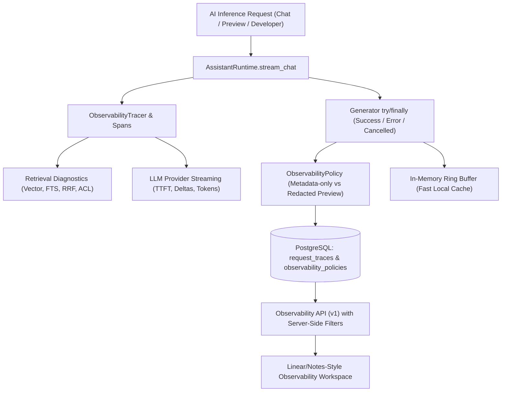

# M15 Architecture Decision Record (ADR) — Observability 2.0 & AI Request Intelligence

| Field | Value |
|---|---|
| Milestone | M15 — Observability 2.0, AI Request Intelligence & Platform Reliability |
| Status | **APPROVED FOR LOCAL IMPLEMENTATION** |
| Decision Date | 2026-11-14 |
| Architecture Model | Modular Monolith · PostgreSQL-backed Telemetry · Privacy-First Policy |

---

## 1. Context and Problem Statement

The platform requires production-grade observability into AI requests (timings, tokens, costs, retrieval stages, citations, and error categorization) while operating within strict constraints:
- **Hosting constraints:** Render Free (ephemeral disk, 512 MB RAM, one CPU worker).
- **Database constraints:** Neon Free PostgreSQL (bounded storage, connection pooling, pgvector).
- **Security directive:** Strict multi-tenant isolation, no prompt injection or credential exposure, defense-in-depth data protection.
- **Resource bounds:** No additional microservices, no mandatory Redis or external APM (Phoenix/Datadog/LangSmith).

---

## 2. Decision Summary

### ADR-01: Durable Trace Storage in Primary PostgreSQL
- **Decision:** Introduce a dedicated `request_traces` table in the primary PostgreSQL database, managed via Alembic migration `0011`.
- **Rationale:** Process memory and local JSON files are destroyed on Render restarts. PostgreSQL provides transactional integrity, foreign key integrity to tenants/assistants, and indexed filtering without new infrastructure dependencies.
- **Neon Free Optimization:** Bounded trace retention (default 30 days) and indexed query columns (`tenant_id`, `created_at`, `status`, `assistant_id`, `traffic_type`).

### ADR-02: Non-Blocking Telemetry Write Strategy
- **Decision:** Telemetry persistence must not block client streaming or fail user inference requests. Trace finalization updates the trace in memory first, then writes to PostgreSQL asynchronously. Telemetry database errors are logged safely and do not disrupt the client SSE stream.
- **Rationale:** A telemetry failure should never degrade user-facing AI chat.

### ADR-03: Generator Lifecycle & Abort Handling
- **Decision:** Wrap the streaming generator in a standard Python `try...except...finally` block that handles `GeneratorExit`. If the client aborts or disconnects, the trace status is marked `CANCELLED` and its duration recorded.
- **Rationale:** Prevents orphan traces from remaining permanently `RUNNING`.

### ADR-04: Privacy-First Safe Input/Output Observability
- **Decision:** Implement a tenant-level `ObservabilityPolicy`:
  - **Default:** `METADATA_ONLY` (no user message or completion text stored).
  - **Opt-in:** `REDACTED_PREVIEW` (sanitized and truncated preview, max 250 characters).
  - **Sanitization:** Strict multi-pass redaction covering API keys, bearer tokens, passwords, private keys, and script tags.
  - **Role Gating:** Only tenant owners and organization admins can view previews in the API/UI.

### ADR-05: Real Retrieval Diagnostics Capture
- **Decision:** Pass the full `diagnostics` object returned by `RetrievalService.search()` into the `retrieval` span and trace metadata, including:
  - Vector search latency, FTS search latency, RRF fusion latency, security filter latency.
  - Candidate counts (candidate vs. authorized), connected knowledge base IDs, fallback flags.
- **Rationale:** Enables precise diagnostic answers to "why did the assistant retrieve this document?" without re-querying the database.

### ADR-06: Verifiable Cost & Pricing Calculation
- **Decision:** Provide cost estimation only when a verified pricing model is defined:
  - Mock provider: `$0.00` (`zero_cost`).
  - Known commercial models: Standard input/output rates per million tokens.
  - Unknown/custom models: `null` with status `unknown`.
- **Rationale:** Never fabricate monetary figures. Clearly distinguish estimated BYOK costs from platform billing.

---

## 3. Consequences

### Positive
- Traces survive container restarts and redeployments.
- Aborted and failed requests are accurately categorized and never stuck in `RUNNING`.
- Sensitive prompts remain protected by default.
- Operational latency breakdowns (retrieval vs. generation vs. TTFT) are immediately actionable.

### Negative / Trade-offs
- Slight database storage consumption on Neon Free; mitigated by strict retention policies and lightweight JSON span payloads.
- Previews are truncated to 250 characters; full conversation audits require inspecting authenticated conversation history directly.
