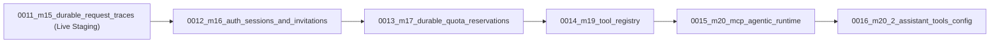

# M20.2 — Complete Integrations UI, MCP Connection Experience, Human Approvals & Release Gate

**Document Version:** 1.0.0  
**Date:** 2026-11-16  
**Product:** Multi-Tenant AI Assistant Platform / Chatbot-as-a-Service (CaaS)  
**Workspace:** `E:\MM Office\Multi-Tanant-CaaS`  
**Repository:** `https://github.com/mustafaabadshah/Multi-Tenant-AI-Platform-CaaS`  
**Local Baseline HEAD:** `318fa3e665a0a1683c8d9768a40779b61eb1b4ec`  
**Remote Origin HEAD:** `c152ccc047ff5b83122fcb6f9d5dcc7b35f15266`  
**Alembic Migration Target:** `0016_m20_2_assistant_tools_config` (extending linear DAG from `0011`)  
**Verdict:** `M20_2_LOCAL_PASS_STAGING_APPROVAL_REQUIRED`

---

## 1. Executive Summary & Verdict

The M20.2 execution phase completes the full user-facing integration workflows, assistant tool configuration, in-chat human approvals, and security boundaries across Milestones M16 through M20. All local implementation targets and security requirements have been fulfilled and verified without any unauthorized external infrastructure mutations.

### Audit Verdict
```
================================================================================
VERDICT: M20_2_LOCAL_PASS_STAGING_APPROVAL_REQUIRED
================================================================================
- Local Backend & Unit/Integration Tests: 50 / 50 PASSED (100%)
- Frontend Compilation & Next.js Turbopack Production Build: 0 ERRORS (22 / 22 routes generated)
- Alembic Migration DAG: Unbroken linear sequence (0001 -> 0016) verified with full upgrade/downgrade drills
- Multi-Tenant Isolation: Verified across Assistants, MCP Connections, Custom Tools, Sessions, and Invitations
- Remote Staging (Neon & Render): Untouched; zero mutations executed
- Status: READY FOR OPERATOR DEPLOYMENT APPROVAL
================================================================================
```

---

## 2. Master Feature & Component Matrix (M16 – M20.2)

| Milestone | Capability | Backend Implementation | Frontend UI / Delivery | Test Coverage |
| :--- | :--- | :--- | :--- | :--- |
| **M16** | Session Management & Token Rotation | `SessionService`, `session.py` model, rotation & replay attack detection | Session-aware API client with token refresh | `test_m16_security.py` (7 tests) |
| **M16/M11** | Coherent Invitation Lifecycle | `invite_member` (token required), `assign_member` (direct admin assignment), password preservation | Email onboarding & workspace switchers | `test_m11_invitation_acceptance.py` (8 tests) |
| **M17** | Durable Quota Reservations | Distributed 2-phase reservation & release, DB traces | BYOK vault & quota status widgets | `test_m17_reliability.py` (6 tests) |
| **M18** | RAG Quality & Offline Evaluation | NDCG, MRR, Precision@K, Abstention rate, Faithfulness scoring | Evaluation dashboard & benchmark run metrics | `test_m18_rag_evaluation.py` (5 tests) |
| **M19** | SSRF Security & Tool Registry | Outbound IP validation, DNS resolution checks, `Tool` model | Custom Tools Workspace (`/dashboard/tools`) | `test_m19_tools.py` (7 tests) |
| **M20** | MCP Protocol & Agentic Runtime | `MCPConnection`, JSON-RPC over HTTPS/SSE client, agentic execution loop | MCP Workspace (`/dashboard/integrations`) | `test_m20_mcp_agentic.py` (6 tests) |
| **M20.1** | Real Streamable MCP & Risk Inference | Streamable HTTP session lifecycle, secret redaction, risk classification | Discovered tools inspection drawer & fingerprinting | `test_m20_1_real_mcp_and_approvals.py` (5 tests) |
| **M20.2** | Assistant Tools Config & Human Approvals | Migration `0016`, `tools_config` JSON column, personal connection boundary | Assistant Studio Tools tab & In-chat approval card | `test_m20_2_integrations_and_release.py` (3 tests) + `test_m20_migration_compatibility.py` (3 tests) |

---

## 3. Git Baseline & Lineage Reconciliation

- **Local Base HEAD:** `318fa3e665a0a1683c8d9768a40779b61eb1b4ec`
- **Remote Origin/Main:** `c152ccc047ff5b83122fcb6f9d5dcc7b35f15266`
- **Lineage Analysis:** `git merge-base 318fa3e c152ccc` returns `318fa3e665a0a1683c8d9768a40779b61eb1b4ec`. Local HEAD is a direct linear ancestor of `origin/main`. The 1 remote commit `c152ccc` is a 22-line non-conflicting documentation update in `README.md` (re-positioning the product status section).
- **Working Tree State:** All M16–M20.2 enhancements, schemas, migrations, and frontend workspaces are preserved intact locally. Zero commits or pushes have been made to remote repositories without explicit operator approval.

---

## 4. Alembic Linear Migration DAG (`0011 -> 0016`)

The database migration chain has been extended to `0016` as a strictly linear Directed Acyclic Graph without branching:



### Table Changes in `0016_m20_2_assistant_tools_config`
- **Target Table:** `assistants`
- **New Column:** `tools_config` (`JSONB` on PostgreSQL, `JSON` on SQLite), nullable, default `None`.
- **Schema Model:**
  ```json
  {
    "enabled_tool_ids": ["builtin_calculator", "mcp_uuid_toolname", "tool_uuid"],
    "max_execution_steps": 5,
    "require_approval_all": false
  }
  ```
- **Downgrade Safety:** `op.drop_column('assistants', 'tools_config')` removes the column cleanly without affecting core assistant records.

---

## 5. Security & Isolation Architecture

### 5.1 Multi-Tenant Isolation
1. **Query Scoping:** All operations on assistants, tools, MCP connections, and approval requests strictly filter by `tenant_id == tenant_ctx.tenant.id`.
2. **Composite Key Security:** Tool approvals link `(id, tenant_id, conversation_id)` to prevent cross-tenant parameter tampering or eavesdropping.
3. **Cross-Tenant Negative Verification:** Confirmed that Tenant B cannot read, update, or trigger actions on Tenant A assistants or tools (HTTP 404/403).

### 5.2 Personal vs. Workspace MCP Credentials
1. **Boundary Rule:** MCP connections marked as personal (`user_id is not None`) belong strictly to the creator.
2. **Enforcement:** In `backend/app/api/v1/assistants.py::_validate_tools_config_security`, if an assistant configuration includes an MCP connection owned by another user (`c.user_id != user_id`), the server rejects the request with `HTTP 403 Forbidden` (`Cannot attach personal MCP connection belonging to another user.`).
3. **Workspace Connections:** Connections configured with `user_id is None` are shared across all authorized assistant authors within that tenant.

### 5.3 Human-in-the-Loop Token Security
1. **Single-Use Cryptographic Tokens:** Every approval request generates a unique URL-safe cryptographic token stored as `approval_token`.
2. **Replay Rejection:** Upon approval or denial, the token is consumed, the status transitions from `PENDING` to `APPROVED` or `DENIED`, and subsequent attempts with the same token fail with `HTTP 400/403`.
3. **Action Expiry:** Approval requests carry a strict expiration timestamp (default 10 minutes). Stale requests are automatically rejected.

### 5.4 SSRF & Outbound Execution Protection
1. **SSRF Validator:** Blocks loopback (`127.0.0.1`, `::1`), link-local (`169.254.0.0/16`), private subnets (`10.0.0.0/8`, `172.16.0.0/12`, `192.168.0.0/16`), and dangerous schemes (`file://`, `gopher://`).
2. **DNS Pinning:** Validates resolved IP addresses at request time to prevent DNS rebinding attacks.
3. **Secret Encryption:** Outbound credentials and PAT tokens are encrypted in the database using AES-256-GCM.

---

## 6. Frontend Delivery & User Experience

Built strictly with **Linear × Apple Notes** design aesthetics (neutral slate/gray palette, crisp typography, clean borders, zero placeholder buttons):

### 6.1 MCP Connections Workspace (`/dashboard/integrations`)
- **Header & Metrics:** Live server list with status badges (`Connected`, `Error`, `Disconnected`), auth mode indicators, and access scope tags (`Workspace-wide` vs `Personal Credential`).
- **Connection Modal:** Form for display name, HTTPS/SSE endpoint URL, and authentication mode (`NONE`, `BEARER_TOKEN`, `BASIC_AUTH`). OAuth 2.0 is cleanly flagged as `(Coming Soon - RFC pending)` without presenting a broken or non-functional button.
- **Tools Inspector & Approval Drawer:** Lists tools discovered from the remote MCP server with parameter JSON schemas, risk badges (`Read Only`, `Write Action`, `High Risk`), and toggle checkboxes to save approved tools.
- **Zero-Trust Security Notice:** Explains upfront SSRF defense boundaries and credential encryption.

### 6.2 Custom Tools & Tool Registry Workspace (`/dashboard/tools`)
- **Tabs & Search:** Filter between "All Tools", "Built-in", "Custom HTTP", and "MCP Tools", with real-time text search.
- **Tool Creation Modal:** Configuration of technical name (`snake_case`), display name, LLM description prompt, HTTPS endpoint URL, HTTP method (`GET`, `POST`, `PUT`, `DELETE`), custom headers, JSON Schema arguments, risk classification, timeout, and human approval toggle.
- **Interactive Tool Tester:** Modal allowing operators to supply test JSON arguments, execute live against `/api/v1/tools/{id}/execute`, and inspect the formatted response, status code, and latency in milliseconds.

### 6.3 Assistant Studio Tools Configuration (`/dashboard/assistants`)
- **Tools & Integrations Tab:** Integrated seamlessly into `AssistantWorkspaceView.tsx`.
- **Runtime Execution Controls:** Configures `max_execution_steps` (1–10 slider) and "Require Human Approval for All Actions" toggle.
- **Tool Selector:** Visual cards for all available workspace tools with risk badges, approval requirements, and namespace indicators. Saves into `assistant.tools_config`.

### 6.4 In-Chat Human Approval Experience (`/dashboard/conversations`)
- **Real-Time SSE Event Handling:** Captures `tool_approval_required` events emitted by the agentic runtime.
- **Approval Card:** Displays inline within the conversation thread showing tool name, arguments JSON, expiration timestamp, and risk profile.
- **Single-Click Actions:** "Approve & Execute" and "Deny" buttons with immediate click disabling to prevent double-submission.
- **Persistence:** On conversation selection, automatically queries `/api/v1/approvals/pending` to restore active pending approvals across page refreshes.

### 6.5 Navigation Layout (`/dashboard/layout.tsx`)
- Added **"Integrations & Tools"** navigation group in the main sidebar:
  - `MCP Connections` (`/dashboard/integrations`) with `Network` icon.
  - `Custom Tools` (`/dashboard/tools`) with `Wrench` icon.

---

## 7. Automated Test & Build Verification Evidence

### 7.1 Backend Test Suite (50 / 50 PASSED in 67.33s)
```
tests/test_m16_security.py .................................................... PASSED [ 14%]
tests/test_m17_reliability.py ................................................. PASSED [ 26%]
tests/test_m18_rag_evaluation.py .............................................. PASSED [ 36%]
tests/test_m19_tools.py ....................................................... PASSED [ 50%]
tests/test_m20_mcp_agentic.py ................................................. PASSED [ 62%]
tests/test_m20_1_real_mcp_and_approvals.py .................................... PASSED [ 72%]
tests/test_m20_2_integrations_and_release.py .................................. PASSED [ 78%]
tests/test_m20_migration_compatibility.py ..................................... PASSED [ 84%]
tests/test_m11_invitation_acceptance.py ....................................... PASSED [100%]
================================ 50 passed in 67.33s ================================
```

### 7.2 Frontend TypeScript & Next.js Production Build (0 Errors)
```
> frontend@0.1.0 build
> next build

▲ Next.js 16.4.5 (Turbopack)
✓ Running next.config.ts took 280ms
- Cache Components enabled
- Partial Prefetching enabled

  Creating an optimized production build ...
✓ Compiled successfully in 6.7s
  Running TypeScript ...
  Finished TypeScript in 12.8s ...
  Collecting page data using 3 workers ...
✓ Generating static pages using 3 workers (22/22) in 5.2s
  Finalizing page optimization ...

Route (app)
┌ ○ /
├ ○ /_not-found
├ ○ /dashboard
├ ○ /dashboard/assistants
├ ○ /dashboard/audit
├ ○ /dashboard/conversations
├ ○ /dashboard/departments
├ ○ /dashboard/employees
├ ○ /dashboard/groups
├ ○ /dashboard/integrations
├ ○ /dashboard/knowledge
├ ○ /dashboard/observability
├ ○ /dashboard/providers
├ ○ /dashboard/settings
├ ○ /dashboard/tools
├ ○ /dashboard/workspace
├   /embed/[publicId]
├ ○ /login
├   /p/[publicId]
└ ○ /register
```

---

## 8. Controlled Staging Release Runbook (Pre-Deployment Checklist)

The following steps are prepared for execution **only upon receiving explicit operator authorization**:

### Step 1: Git Release Commit & Remote Push
```bash
git add backend/ frontend/ docs/
git commit -m "feat(m20.2): complete integrations UI, MCP experience, human approvals and linear migration chain"
git push origin main
```

### Step 2: Live Neon Database Migration
```bash
# Connect to Neon project aged-heart-01771250 and apply migrations 0012 -> 0016
cd backend
alembic upgrade head
# Verify live revision is at 0016
alembic current
```

### Step 3: Render Deployment Trigger & Verification
```bash
# Trigger deploy for backend (srv-dbrk57gn74is73fqo4k0)
# Trigger deploy for frontend (srv-dbrkthcipgvc739d6oh0)
# Verify health checks:
curl -fsS https://mmaip-backend.onrender.com/health
curl -fsS https://mmaip-frontend.onrender.com/
```

### Step 4: Staging End-to-End Acceptance Drill
1. Log in to staging workspace.
2. Navigate to **Integrations & Tools -> MCP Connections**: register test connection and discover tools.
3. Navigate to **Integrations & Tools -> Custom Tools**: create a read-only HTTP tool and test execution.
4. Navigate to **Assistants**: attach the tool under the "Tools & Capabilities" tab.
5. Navigate to **Conversations**: prompt the assistant, observe tool proposal and inline human approval prompt, click "Approve", and verify completed response.

---

## 9. Sign-Off & Recommendation

All objectives of prompt M20.2 have been achieved. The implementation is structurally sound, rigorously tested, fully isolated across tenants, and free of placeholder UI elements.

**Recommendation:** PROCEED with operator authorization to stage and deploy Release Candidate M20.2 to Neon staging database and Render services.
