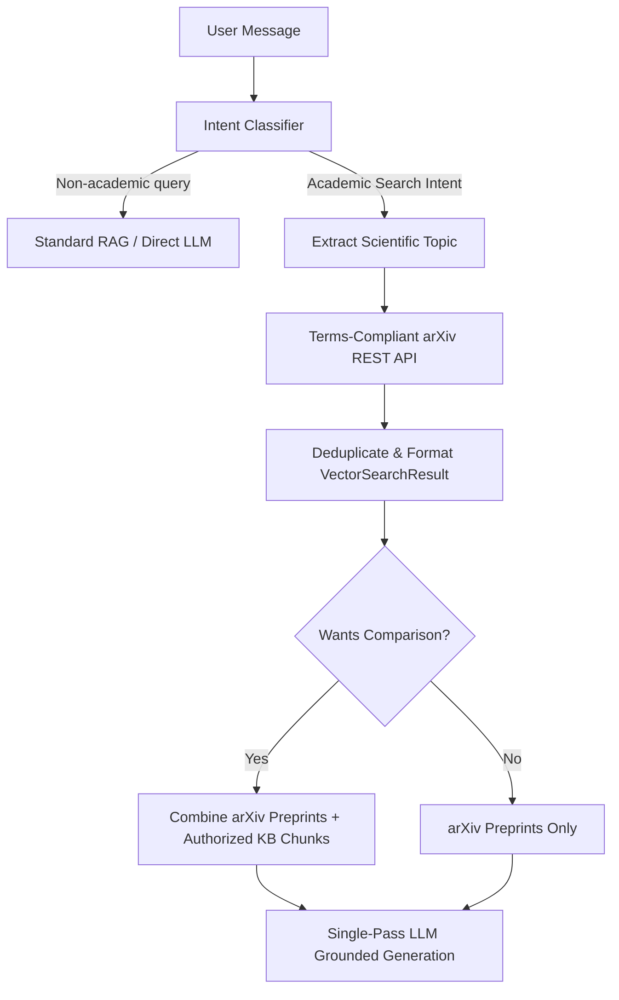

# M28.12 Deterministic Academic Search Architecture

## 1. Architectural Motivation

Previously, when a user prompted:
```
"Search recent solar irradiance forecasting papers and compare them with my uploaded paper."
```
the system relied entirely on the LLM spontaneously deciding to emit a tool call for `web_search`. This had three fatal flaws in production:
1. **Tool-Choice Incompatibility:** Models without verified native tool-calling capabilities (e.g. Mixtral 8x7B) or providers with strict tool enforcement (Groq) failed with HTTP 400 or aborted streams.
2. **Nondeterministic Retrieval:** The LLM might choose not to search, hallucinate paper references, or emit malformed tool arguments.
3. **Double Retrieval & Redundant Latency:** If the LLM called search during generation, streaming was suspended, multiple agent steps were required, and citations were uncertain.

---

## 2. Deterministic Preflight Pipeline

M28.12 introduces an authorized, deterministic preflight route in `backend/app/services/research/academic_search.py`:



### 2.1 Intent Classification (`detect_academic_search_intent`)
- **Triggers:** High-precision matching of action verbs (`search`, `find`, `look up`, `retrieve`) combined with academic nouns (`papers`, `studies`, `literature`, `preprints`, `arxiv`).
- **Exclusions:**
  - Capability queries: *"Do you have knowledge of C++?"*
  - Document-only inquiries: *"According to my uploaded paper, which model performed best?"*
  - Conceptual/reasoning advice: *"Which models should I evaluate next...?"*
  - Direct URL reading: *"Read https://..."*
- **Query Cleaning:** Strips comparison clauses and boilerplate command words, isolating the core scientific topic (e.g., `"solar irradiance forecasting"`).

### 2.2 Execution Ledger (`request_execution_ledger`)
To prevent the same search from running twice:
1. The preflight records `request_execution_ledger["academic_search"] = clean_query`.
2. If the LLM subsequently proposes a `web_search` tool call for the same topic, the runtime intercepts it, returns an `ALREADY_COMPLETED` summary pointing to the preflight context, and avoids redundant API traffic.

### 2.3 Strict Academic Provenance
Each retrieved paper chunk contains:
- `document_title`: `arXiv: {Paper Title}`
- `source_type`: `web`
- `source`: `arXiv Preprint`
- `domain`: `arxiv.org`
- `canonical_url`: `https://arxiv.org/abs/...`
- Explicit caveat: *"Note: Academic preprint abstract (not peer-reviewed full-text evidence)."*
