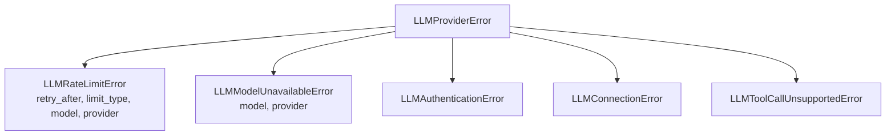

# M28.16 — Multi-Provider Registry, Error Hierarchy & User-Facing Recovery

**Milestone:** M28.16  
**Component:** LLM Providers (`backend/app/llm/providers/`, `capabilities.py`, `observability/policy.py`)  
**Status:** IMPLEMENTED & LOCAL TEST VERIFIED (`20/20 PASS`)  
**Target Invariant:** Typed Provider Exceptions, Accurate Span Error Categorization, Actionable UI Feedback  

---

## 1. Provider Exception Hierarchy

All provider adapters inherit from a unified exception hierarchy in `backend/app/llm/base.py`:

### 1.1 Field Contracts
- `LLMRateLimitError`:
  - `retry_after: float | None` (Seconds until quota replenishment).
  - `limit_type: str | None` (`"TPM"`, `"RPM"`, or `"general"`).
  - `model: str | None` (Target model identifier).
  - `provider: str | None` (`"groq"`, `"gemini"`, `"openai"`, etc.).
- `LLMModelUnavailableError`:
  - `model: str | None` (Target model identifier that returned 404/not supported).
  - `provider: str | None` (`"gemini"`, `"groq"`, etc.).

---

## 2. Observability & Span Error Categorization

In `backend/app/observability/policy.py`:
`categorize_error(err: Exception | str) -> ErrorCategory`
- First checks typed exceptions:
  - `isinstance(err, LLMRateLimitError)` $\rightarrow$ `ErrorCategory.RATE_LIMITED`
  - `isinstance(err, LLMModelUnavailableError)` $\rightarrow$ `ErrorCategory.MODEL_UNAVAILABLE`
  - `isinstance(err, LLMToolCallUnsupportedError)` $\rightarrow$ `ErrorCategory.TOOL_ERROR`
  - `isinstance(err, LLMAuthenticationError)` $\rightarrow$ `ErrorCategory.AUTHENTICATION`
  - `isinstance(err, LLMConnectionError)` $\rightarrow$ `ErrorCategory.NETWORK_ERROR`
- Falls back to disciplined text inspection for string-only error logs:
  - Tool errors checked before general model errors to avoid false categorization.
  - "rate limit" / "429" / "quota" $\rightarrow$ `RATE_LIMITED`.
  - "not found" / "404" / "model unavailable" $\rightarrow$ `MODEL_UNAVAILABLE`.

---

## 3. Supported Model Matrix (Updated Production Standards)

| Provider | Production Default | Secondary / Alternative Models | Discovery API | Free-Tier Constraints |
|---|---|---|---|---|
| **Groq LPU** | `llama-3.3-70b-versatile` | `llama-3.1-8b-instant`, `openai/gpt-oss-120b` | `GET /v1/models` | 8,000–30,000 TPM |
| **Google Gemini** | `gemini-2.0-flash` | `gemini-1.5-pro`, `gemini-1.5-flash`, `gemini-1.5-flash-8b` | `GET /v1beta/models` | 15 RPM, 1,000,000 TPM |
| **OpenAI** | `gpt-4o-mini` | `gpt-4o`, `gpt-3.5-turbo` | `GET /v1/models` | Account-tier dependent |
| **Anthropic** | `claude-3-5-sonnet-20241022` | `claude-3-5-haiku-20241022` | N/A | Account-tier dependent |
| **OmniRoute** | `auto` | Operator configured gateway routes | `GET /v1/models` | Local / zero-cost routing |

---

## 4. User-Facing Error Messages

Instead of displaying raw unformatted JSON or cryptic Python tracebacks, `runtime.py` formats friendly user messages:
- **Rate Limit Exceeded:**
  > *"The AI provider is currently rate-limited (Tokens per minute exceeded). Please wait 20s before retrying, or switch to a lighter model in Assistant Settings."*
- **Model Unavailable / Retired:**
  > *"The configured model 'models/gemini-1.5-flash' is not available from this provider. Please update the assistant model setting to 'gemini-2.0-flash' or use auto."*
